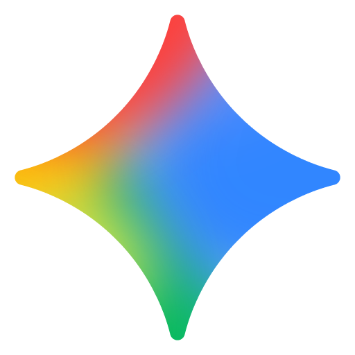
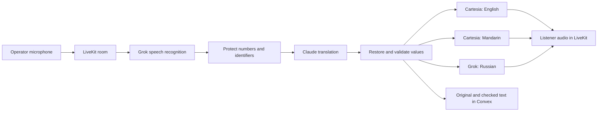
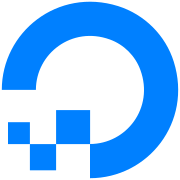
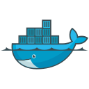
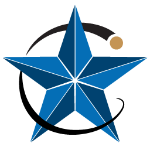

# OrbitCall

**A shared workspace for satellite operators to review close approaches, compare maneuvers, and agree on a plan across languages.**

OrbitCall combines a 3D orbital view, calculation services, AI agents, and translated voice calls. Each dispatcher works with an assigned fleet. Operators share the evidence and proposed maneuver while keeping their company policies private. People make the final decision.

[Try the demo](https://orbitcall.vercel.app/) · [Read our Devpost story](https://devpost.com/software/orbitcall) · [Architecture](#architecture) · [Run locally](#run-locally) · [Technical roadmap](docs/master-roadmap.md)

Built at **Cal Hacks 13.0**, October 23-25, 2026. This is a hackathon prototype. The globe, orbital services, agent calls, voice worker, and supporting backend components are implemented. We are connecting them into the complete shared operator workflow. [Current scope](#current-scope) separates that work from the planned Factory integration.

## Why we built it

When two satellites approach each other, an alert is only the start. Operators still need to understand the evidence, decide who should move, and check that the maneuver will not create another close approach.

ESA's [2025 Space Environment Report](https://www.esa.int/Space_Safety/Space_Debris/ESA_Space_Environment_Report_2025) describes growing collision-avoidance activity as traffic and debris increase. ISRO's [report for 2025, published in 2026](https://www.isro.gov.in/Indian_Space_Situational_Awareness_Report_2025.html), records **82 LEO maneuver plans revised to avoid post-maneuver close approaches**.

Our focus is the coordination between those steps: a place where operators can understand the same incident, discuss options in their own language, and see exactly what they are agreeing to.

## The operator workflow

| Step | What the operator does | What OrbitCall contributes |
|---|---|---|
| **1. Detect** | Opens the assigned fleet and starts a scan | A globe with satellite positions, a pinned catalog, and a 72-hour screening window |
| **2. Compare** | Reviews the encounter and available options | Calculated maneuver candidates, checked explanations, and private policy evaluation |
| **3. Coordinate** | Talks or writes to the other operators | One shared room, English/Russian/Mandarin translation, clarifications, and summaries |
| **4. Approve** | Selects a plan and explicitly approves its current revision | Separate selection and approval records, a catalog re-screen, and an authorized schedule artifact |
| **5. Review** | Returns to the incident record and later observations | Source history, the agreed plan, and evidence that is consistent, conflicting, or insufficient |

The planned demonstration uses three dispatcher laptops and a read-only globe on a large display. Each dispatcher has four assigned spacecraft. A room groups linked pair incidents and all operators they involve. There is no fixed participant cap. Each incident keeps its own proposals and approvals.

The main screens are **Orbit**, **Decision Center**, **Policy**, and **Inbox**. Starting a workflow creates the shared case, joins the responsible operators, and sends their notifications. The two sides take decision turns. A maneuver affecting several incidents uses one trajectory plan, with current approvals required for every affected pair.

Selecting a card does not approve it. Speech does not approve it. A changed proposal requires fresh approval. An active-spacecraft pair needs its required operators, while confirmed debris has a separate one-operator process. The [user flow](docs/user-flow.md) and [API specification](docs/specification.md) define these rules.

## Architecture

[](docs/assets/readme/architecture.svg)

[Open the full-size diagram](docs/assets/readme/architecture.png) · [Editable SVG](docs/assets/readme/architecture.svg)

**Convex owns the application state.** Browsers read authorized queries and send commands through mutations. Actions call the orbital service and AI providers, then publish checked results. The shared state updates the operator screens and observer display.

**DigitalOcean hosts the long-running services.** The Python orbital API runs calculation jobs. A separate Python worker joins LiveKit rooms, transcribes speech, translates checked text, and publishes audio. Docker Compose and Caddy define the deployment. The deployed orbital API and voice worker have passed recorded infrastructure checks. The website rehearsal remains separate. The Factory worker is a planned addition. [Deployment evidence](deploy/demo-status.md)

**The browser draws the orbits.** Three.js renders the globe, and satellite.js propagates the pinned orbital elements in a Web Worker. The numerical service handles authoritative screening and maneuver calculations. Browser animation never creates an approval or a screening result.

### Three agent providers, distinct roles

| Provider | Role | Input and output |
|---|---|---|
|  **Claude** | Incident Analyst and Operator Advocates | Explains checked incident facts and evaluates candidates against each company's private policy. Shared results contain feasibility outcomes and categories rather than private limits |
|  **Gemini** | Coordination Host | Uses shared room context to ask clarifying questions and produce summaries tied to current events, messages, and candidate revisions |
|  **Grok** | Independent rationale check | Reviews shared explanations and reports agreement or disagreement. It supplements deterministic checks and has no approval authority |

Claude also translates text. Grok also supplies speech recognition and Russian speech. Provider calls record their model, input version, result, and available usage information. Stale or invalid output is rejected before publication.

### Live translation



The translation worker handles this pipeline on DigitalOcean. It listens only to human microphone tracks, so translated audio cannot feed back into recognition. It protects numbers, signs, units, times, and satellite identifiers before translation and checks them afterward. If translation fails validation, the original remains visible. Persistent text is available alongside the call.

[Voice worker, setup, measurements, and known limits](services/voice/README.md)

## Technology and sponsor contributions

### Application and infrastructure

| Technology | Where we use it |
|---|---|
|  **Next.js** ·  **React** ·  **TypeScript** | App Router frontend, operator interface, typed backend contracts |
|  **Three.js** · **satellite.js** | Custom globe, satellite rendering, orbit paths, and browser propagation |
|  **Tailwind CSS** · **Motion** · **Zustand** · **Lucide** | Styling, animation, local interface state, and controls |
|  [**Convex**](https://www.convex.dev/) | Reactive database, server functions, job scheduling, shared messages, agent-run records, and authorization checks |
|  [**Auth0**](https://auth0.com/) | Operator identity and the sign-in bridge to Convex. Fleet assignments determine which objects a user can act for |
|  **Python** ·  **FastAPI** ·  **NumPy** · **SGP4** | Fleet screening, candidate geometry, re-screening, simulation, and verification calculations |
|  [**Vercel**](https://vercel.com/) | Next.js frontend and versioned orbital files served to the browser |
|  [**DigitalOcean**](https://www.digitalocean.com/) ·  **Docker** ·  **Caddy** | Deployment configuration for the orbital API, voice worker, persistent data, and HTTPS routing |

### AI, voice, memory, and history

| Technology | Contribution | Implementation boundary |
|---|---|---|
|  [**Anthropic Claude**](https://www.anthropic.com/) | Incident analysis, private-policy evaluation, and checked translation | Agent and translation implementations are present. Models do not compute orbital evidence or approve plans |
|  [**Google Gemini**](https://ai.google.dev/) | Coordination clarifications and per-event summaries | Uses the official Google GenAI SDK in a Convex Node action with validated structured output |
|  [**xAI Grok**](https://x.ai/) | Rationale checking, streaming speech recognition, and Russian TTS | Text and audio integrations have separate roles and configuration |
|  [**LiveKit**](https://livekit.io/) | Shared audio rooms and translated tracks | A Python worker joins the room. LiveKit transports audio, while final text is stored in Convex |
|  [**Cartesia**](https://cartesia.ai/) | English and Mandarin translated speech | Configured voices are selected by language and speaker voice profile. Missing voices leave text available |
|  [**Backboard**](https://backboard.io/) | Company-scoped memory across incidents | Memory components are implemented. Recalled preferences are context, never standing approval |
|  [**Tiger Data**](https://www.tigerdata.com/) ·  **PostgreSQL** | Historical observations and time-series queries | The adapter preserves source, evidence version, observation time, and simulation labels. Convex remains the application authority |
|  [**Factory Droid SDK**](https://factory.com/) | Planned schedule preview and authorized file artifact | The dedicated scheduling worker remains to build. It must write the exact approved revision after re-screening |

### Development tools

 **Cursor** was part of our development workflow for writing, refactoring, and debugging the frontend, Convex backend, and Python services. We also used **Grok Bot** to plan the project and coordinate work between teammates. Git and  **GitHub** keep the independently developed components together.

## Real data and reproducible calculations

The main catalog contains **19,468 unique space objects** in the pinned CelesTrak snapshot `gp-20261024T2134Z`. Each source file has a recorded URL, fetch time, record count, and SHA-256 checksum.

| Source | What it supplies | How we use it |
|---|---|---|
|  [**CelesTrak GP**](https://celestrak.org/NORAD/documentation/gp-data-formats.php) | OMM orbital elements for active spacecraft and selected debris groups | The shared real-mode catalog and SGP4 calculations |
| **CelesTrak SATCAT** | Object metadata, including ownership, launch information, and object type | Satellite details and classification. Demo assignments remain separate from real ownership |
| [**CelesTrak SOCRATES**](https://celestrak.org/SOCRATES/) | Reference conjunction records and supplied maximum probability | An independent comparison for our screening, with source and epoch differences visible |
|  [**NASA ISS ephemeris**](https://spotthestation.nasa.gov/trajectory_data.cfm) | Public ISS trajectory data | Input to the separately labeled, simulated maneuver-verification replay |
|  **NASA GIBS** ·  **Esri** · **NOAA** · **GDACS** · **EUMETSAT** | Earth imagery and weather/context layers | Visual context on the globe, separate from collision evidence |

Real mode uses OMM directly. Development mode keeps the TLE catalog and synthetic scenarios for interface work. OMM is a data format, not an automatic accuracy improvement. Source quality, epoch, and the propagation method still matter.

The orbital service calculates geometry. It does not invent covariance, calculate a replacement collision probability from miss distance, or attach the original probability to a proposed maneuver as a predicted result. SOCRATES values retain their `max_prob` label.

[Data layout and preparation](data/README.md) · [Orbital-service contract](services/orbit/docs/contract.md) · [Numerical decisions](services/orbit/docs/decisions.md)

### Recorded component validation

The orbital-service documentation records a comparison against **200 SOCRATES rows with matching orbital inputs**: 200 matched, a 0.001-second 95th-percentile closest-approach-time error, and a 7-metre 95th-percentile miss-distance error. The other 38,190 rows have different orbital inputs and are reported separately as data differences.

That comparison uses the pinned TLE validation snapshot, not the later OMM catalog shown in real mode. It measures a comparable reference subset. It is not a flight-safety certification or a claim that every catalog encounter has that accuracy. [Method and limitations](services/orbit/README.md#limits-say-them-in-the-pitch)

## Current scope

| Area | What is present | What still needs to happen |
|---|---|---|
| Globe and catalog | Interactive Three.js view, pinned OMM loading, direct propagation, satellite details, and a TLE development mode | Rehearse the deployed operator workflow with the same catalog and assignments |
| Orbital API | Screening, candidate generation, re-screening, verification, simulation, persisted jobs, and service tests | Complete the application wiring and deployment checks for the full sequence |
| Shared backend | Assigned-fleet scans, workflow rooms, inbox, proposal selection, approval invalidation, maneuver records, and observer projections | Connect and rehearse the frontend with the current shared contracts |
| Agents and identity | Claude, Gemini, and Grok call implementations, private policies, Auth0 integration, assignments, and checked results | Verify the connected discussion, revision, and approval flow across the operator screens |
| Voice | LiveKit room integration and a tested three-language translation worker | Rehearse speech recognition, values, track routing, and recovery on the demo network |
| Memory and history | Backboard components and Tiger Data observation/query adapters | Complete their incident-workflow integration and visible demonstration |
| Scheduling | Defined approval, re-screening, preview, and artifact contracts | Implement and connect the dedicated Factory worker |

The demo uses simulated encounters, policies, assignments, and proposed maneuvers alongside real catalog data. Verification uses a separately labeled simulated replay. A scheduled artifact records an agreement, not evidence that a spacecraft executed a maneuver. OrbitCall does not command spacecraft.

## Run locally

### Interface and development scenarios

Use Node.js 22.13 or newer in the Node 22 line and npm. The frontend and backend are separate packages.

```sh
git clone https://github.com/ksavkin/OrbitCall.git
cd OrbitCall/web
npm ci
npm run dev
```

Open [localhost:3000](http://localhost:3000). The frontend can run without backend credentials for development scenarios. Use the **Dev** switch to explore the local simulation. To use the committed TLE snapshot without a live CelesTrak request, start it with `ORBITCALL_OFFLINE=1 npm run dev`.

### Connect an application backend

Install the root package in a separate terminal and create your own Convex development deployment. The team's shared demo deployment has its own release process.

```sh
cd OrbitCall
npm ci
npm run check
npx convex dev
```

Set the public connection values in `web/.env.local`, then restart Next.js:

```dotenv
NEXT_PUBLIC_CONVEX_URL=https://<your-deployment>.convex.cloud
NEXT_PUBLIC_AUTH0_DOMAIN=<your-tenant>.auth0.com
NEXT_PUBLIC_AUTH0_CLIENT_ID=<your-public-client-id>
```

Keep provider keys in the server that uses them. The backend requires the configured model IDs as well as API keys. Voice also needs LiveKit, Cartesia/Grok voice IDs, and a scoped Convex callback credential. These are documented in the component guides rather than copied into the frontend environment.

| Setup | Guide |
|---|---|
| Backend, models, and data contracts | [Master roadmap](docs/master-roadmap.md), [API specification](docs/specification.md), [Analyst guide](docs/phase1-andrew.md) |
| Python orbital service and pinned data | [Orbital-service README](services/orbit/README.md) |
| Voice worker, provider configuration, and smoke checks | [Voice-worker README](services/voice/README.md) |
| DigitalOcean, Docker Compose, and Caddy | [Deployment runbook](deploy/README.md) |
| Frontend and design conventions | [Web README](web/README.md), [UI design system](docs/adil/design-system.md) |

### Checks

```sh
# Repository root: backend TypeScript and tests
npm run check

# web/: frontend TypeScript, lint, and production build
npx tsc --noEmit
npm run lint
npm run build
```

The root test suite uses fixtures and mocked provider responses. Python service test commands and data prerequisites are in their READMEs. Live API success and a complete deployed rehearsal are separate checks.

## What we learned

Small details can change an orbital verdict. A distance just below a threshold must not become a pass because of display rounding. A propagation failure must remain missing coverage rather than disappear from a successful scan.

AI output needs the same care. Numerical values come from tools, references must identify real records, and a result can become stale while a model is answering. Clear ownership of data and explicit human decisions made the individual components easier to reason about and test.

Our next milestone is the complete three-operator demonstration: one shared case, discussion in three languages, a checked revision, current human approvals, and a traceable schedule artifact.

## Project documents

The [master roadmap](docs/master-roadmap.md) is the source of truth for the agreed scope and stack. The README is the public overview. Detailed implementation notes may describe an earlier milestone, so use the current source and contract when checking a component.

- [Assigned-fleet user flow](docs/user-flow.md)
- [Frontend/backend specification](docs/specification.md)
- [Functionality and stable requirement IDs](docs/functionality.md)
- [Sponsor roles and submission evidence](docs/sponsors.md)
- [Operator Advocate implementation](docs/operator-advocate-v1.md)
- [Agent integration plan](docs/andrew/rounds-plan.md)

## Team

**Adilbek Bazarkulov** · **Konstantin Savkin** · **Andrew Yu** · **Freja R**

[Live demo](https://orbitcall.vercel.app/) · [Devpost](https://devpost.com/software/orbitcall) · [Source](https://github.com/ksavkin/OrbitCall)
