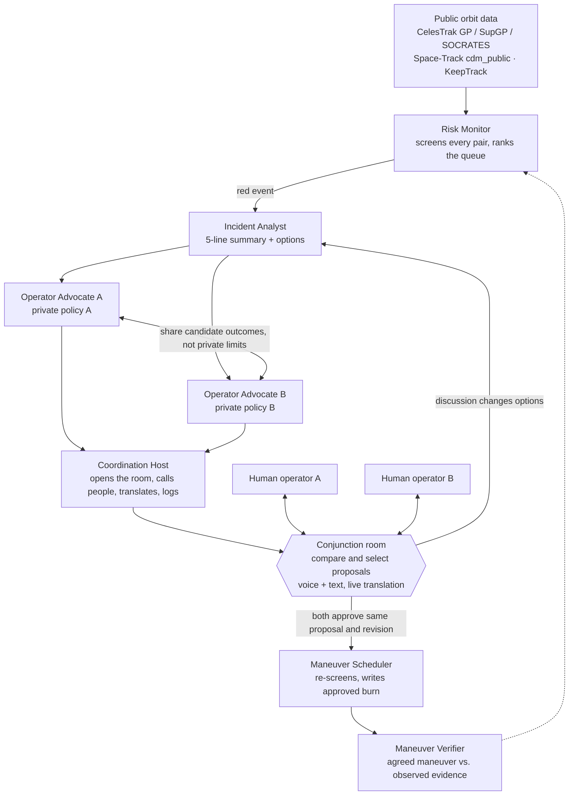

# OrbitCall

**A dispatcher for orbit.** OrbitCall watches the public satellite catalog, finds dangerous conjunctions, and brings both operators into one room. Each company's agent evaluates multiple computed proposals within its private policy. Humans compare the proposals, discuss them by voice or text in their own languages, and approve the same proposal revision. Agents use the discussion to revise the options. After the maneuver time, OrbitCall compares what was agreed with later observations and records the evidence.

Nothing moves without a human. It is a handshake, not a law.

> Built at **Cal Hacks 13.0** (Oct 23–25, 2026).
> **Status: planning.** This repo holds documentation, not an implemented application. Product decisions updated Oct 24, 2026; see [Feature decisions](docs/analysis.md).

---

## The problem

When two active satellites from different companies are on a collision course, the decision "who dodges" is still made by email. Tracking, screening and the maneuver itself are automated. The step in the middle is not:

- there is no protocol between companies for who yields;
- there is no shared check that the promised maneuver was done;
- there is no record to settle a dispute later;
- operators sit in different time zones and speak different languages, with 13 minutes to 3 days of warning.

Starlink solved this for itself with onboard autonomy. A small operator with 5–50 satellites and no 24/7 shift still has an inbox.

OrbitCall solves the communication and decision step between operators who are **willing** to coordinate. It does not solve unwillingness to share data; that is policy, not software.

## How it works

1. **Risk Monitor** propagates the catalog with SGP4, finds close pairs, and ranks them using current supplied probability and time to closest approach. Red (Pc > 1e-4 and TCA < 72 h) wakes the agents. Missing probability is explicit; there is no risk forecast.
2. **Incident Analyst** prepares a five-line summary and multiple computed proposals, initially 2–3 when feasible, showing who moves, timing, delta-v, estimated consequences and assumptions. Waiting can be an option with a review condition.
3. **Operator Advocates A and B** evaluate candidates using their own private company policies. They exchange feasibility outcomes and constraint categories; raw policy values are inaccessible to the other side.
4. **Coordination Host** opens the room, contacts the relevant operators, translates and logs. Each person also has a persistent inbox with incident details, operator contacts and history, including when the other operator is absent.
5. **Two humans** compare and select a candidate, discuss it, and approve or veto that exact revision. Counters are ordinary voice or text, with automatic agent revisions. Switching the selected candidate or revising it visibly resets both approvals. Every new incident asks both people again.
6. **Maneuver Scheduler** re-screens the moved satellite against the whole catalog and records only the currently approved maneuver. A new conflict returns to discussion; a wait agreement schedules no burn.
7. **Maneuver Verifier** compares later observations with the agreed plan, showing evidence consistent with the plan, a mismatch, or insufficient data. The shared record supports an operator-scoped six-month report draft and supporting event export.

Principles:

- Physics is deterministic code (SGP4), not a model. Models reason, explain and translate.
- Every agent explanation is checked against the numbers before it reaches the screen.
- Translation protects numbers, units, times and identifiers with placeholders and restores them from the original message or exact proposal revision.
- Both approvals refer to one incident, proposal ID and revision. Past agreements never authorize a future event.
- Policy privacy is enforced in data access, agent context, live updates, logs and exports, as well as the UI.
- One source of truth: one reactive database, both laptops subscribe to it.
- Agents run only for the top of the queue, not for every pair.

## Planned stack

| Layer | Choice |
|---|---|
| Frontend | Next.js, globe.gl / CesiumJS |
| Backend, live state, scheduler | Convex |
| Orbital mechanics | SGP4 (`sgp4` npm or `python-sgp4`) |
| Reasoning agents, translation | Claude (Sonnet; Haiku for Risk Monitor) |
| Agent runtime | Fetch.ai uAgents, Agentverse, Agent Chat Protocol, ASI:One |
| Voice | STT → protect values → Claude translation → restore/check → Cartesia TTS; Grok Voice via LiveKit for the Coordination Host under the same value checks; text fallback |
| Optional | Factory Droid SDK (Maneuver Scheduler diff), Backboard (agent memory), Tiger Data (Pc time series), Auth0 (two operator roles) |
| Deploy | Vercel + Convex |

## Data sources

Public sources, with accounts or keys where required. The demo uses a real pair from the demo week's SOCRATES or public CDM snapshot, pinned with source timestamps for reproducibility. Demo operator policies and proposed actions are labeled simulated. Verification uses a separately labeled historical maneuver replay.

| Source | Role |
|---|---|
| CelesTrak GP | Base catalog for screening |
| CelesTrak SupGP | Operator-supplied orbits; GP vs. SupGP shows source disagreement, not a statistical uncertainty interval |
| CelesTrak SOCRATES | Reference #1: validate our screening, source of live pairs |
| Space-Track `cdm_public` | Reference #2: public CDMs and supplied probability matched to the event, epoch and data version |
| KeepTrack API v4 | Owner, purpose and country metadata for the Coordination Host |

Validation reports recall over the full eligible SOCRATES list for a defined snapshot and catalog scope, plus separate timing/distance errors. Counts, exclusions and input differences are visible; the pitch uses measured results only. Every queue row links to the relevant CelesTrak source or object data.

## Fetch.ai agents

| Agent | Address |
|---|---|
| Risk Monitor | TBD |
| Incident Analyst | TBD |
| Operator Advocate A | TBD |
| Operator Advocate B | TBD |
| Coordination Host | TBD |
| Maneuver Scheduler | TBD |
| Maneuver Verifier | TBD |

Addresses are filled in once the agents are registered on Agentverse.

## What we do not promise

- We use supplied Pc with provenance; we do not invent covariance or a post-maneuver probability. Approximate candidate geometry is labeled indicative.
- We compare a bounded set of computed maneuver candidates; this is not a production delta-v optimizer.
- We do not forecast future risk estimates. Historical observations remain available.
- Agents never touch a satellite. Scheduling requires two current approvals of the same candidate revision; a saved agreement cannot bypass the next incident's decision.
- The report export is a reviewable draft with source coverage and missing fields. Its FCC field mapping and applicability must be verified before a filing-ready template is released; it does not file automatically.

## Docs

- [Plan v1](docs/plan-v1.md) — the full pre-hackathon kit: problem, evidence, architecture, demo script, data sources, sponsors, judge Q&A, 36-hour plan.
- [Functionality](docs/functionality.md) — what OrbitCall does: actors, domain objects, lifecycle, functions by area, open questions for the specification.
- [Feature decisions](docs/analysis.md) — accepted and skipped recommendations, their rationale, and the remaining proposals that have not been adopted.

## Team

- **Kostya, Andrew** — backend
- **Adil** — frontend
- **Freya** — product and demo
