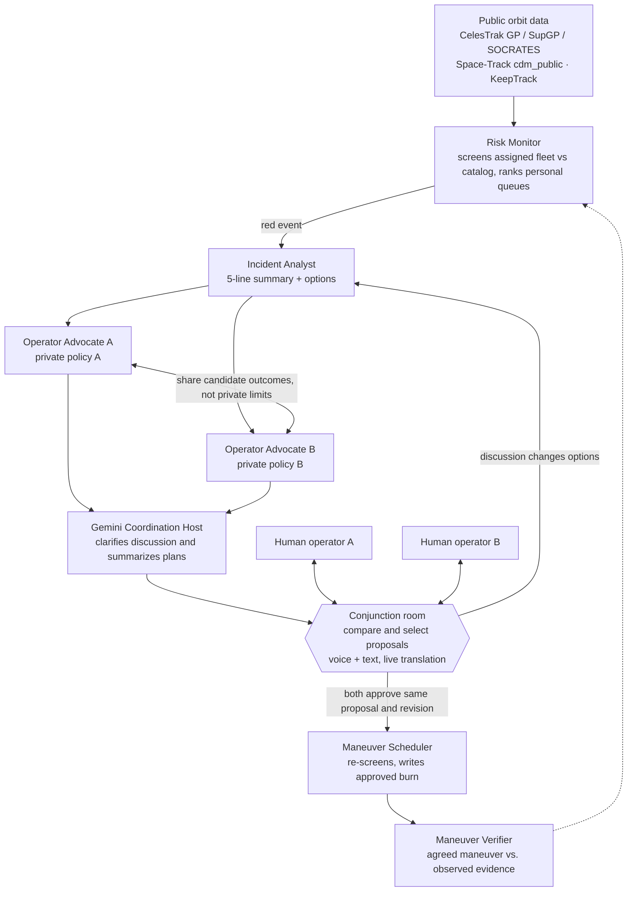

# OrbitCall

**A dispatcher for orbit.** Each dispatcher opens My Fleet: their assigned satellites, current positions, incident queue and globe. Run Scan checks those spacecraft against all other usable objects in a pinned catalog over the next 72 hours. An incident involving two participating operators opens one shared coordination room. Each company's agent evaluates multiple computed proposals within its private policy. Humans compare the proposals, discuss them by voice or text in their own languages, and approve the same proposal revision. Agents use the discussion to revise the options. After the maneuver time, OrbitCall compares what was agreed with later observations and records the evidence.

Nothing moves without a human. It is a handshake, not a law.

> Built at **Cal Hacks 13.0** (Oct 23–25, 2026).
> **Status: Phase 1 implementation.** The frontend lives in `web/`; the Convex backend at the repository root implements the first Incident Analyst and its checks. The broader workflow below remains the product plan. Product decisions updated Oct 24, 2026; see [Feature decisions](docs/analysis.md). Current assignments and feature-branch workflow are in [roadmap issue #1](https://github.com/ksavkin/OrbitCall/issues/1).

## Master plan

Start with [the locked master roadmap](docs/master-roadmap.md), the team's source of truth: short phase goals, recent problem evidence, the complete technical architecture, sponsor roles, and deployment instructions. The target is a hackathon demo with three dispatcher laptops and one read-only large display. Rooms support 2-4 operators across linked pair incidents. The locked languages are English, Russian, and Mandarin. The v1.1 agent-provider split is Claude for analysis/advocacy, Gemini for the Coordination Host, and Grok for independent checking. These are target roles, with implementation status recorded in the roadmap.

## Current integration and modes

See [the integration handoff](docs/integration-status.md) for what is implemented and what is still planned. **Dev on** uses the current TLE catalog and synthetic scenarios. **Dev off** loads the pinned OMM catalog named by Convex and propagates OMM directly. Missing or invalid inputs keep a waiting/error state with no TLE fallback. CelesTrak remains the source. Switching formats does not itself guarantee more accurate orbits. [Data preparation](data/README.md) explains the committed inputs and static web delivery.

## Development

For the backend, run `npm ci` then `npm run check` from the repository root. Tests use simulated fixtures and a mocked model provider, so no accounts or keys are required. Run `npm run dev` to start Convex locally or connect to the team's existing OrbitCall development project.

See [Andrew's Phase 1 implementation and integration guide](docs/phase1-andrew.md) for the live model settings, fixture walkthrough, event ingestion hook, summary query and remaining integration work. The frontend has its own package and setup in [web/README.md](web/README.md).

---

## The problem

Dispatchers need to review close approaches, coordinate a response and check whether a proposed maneuver creates another encounter. ESA reports growing collision-avoidance activity. ISRO reports that 82 LEO maneuver plans were revised in 2025 to avoid close approaches after the maneuver. [ESA 2025 report](https://www.esa.int/Space_Safety/Space_Debris/ESA_Space_Environment_Report_2025), [ISRO 2026 release](https://www.isro.gov.in/Indian_Space_Situational_Awareness_Report_2025.html).

OrbitCall demonstrates that decision workflow: assigned fleets, checked options, multilingual discussion, explicit human approval and a shared record. Small operators and this interface are our product focus. The reports support the orbital-coordination problem, rather than proving a universal manual process or a lack of existing tools. The [master roadmap](docs/master-roadmap.md) contains the dated evidence and demo scope.

## How it works

The accepted [assigned-fleet user flow](docs/user-flow.md) defines the dashboard, scan scope, priority order and approval paths. Demo: three users based in Russia, the US and China, each seeded with four assigned spacecraft, plus a read-only observer display. A room supports 2-4 operators with linked pair events. Country and language do not grant access. My Incidents is ordered by severity, then earliest closest approach. Missing/stale evidence stays visible in a separate review section.

TCA means **Time of Closest Approach**, when two objects are predicted to be nearest. The interface uses "Time until closest approach" alongside miss distance. Detection does not itself determine collision probability.

1. **Risk Monitor** propagates assigned spacecraft against the available catalog with SGP4, finds close pairs, and ranks each personal queue by severity then earliest closest approach. Red (Pc > 1e-4 and TCA < 72 h) wakes the agents. Missing probability is explicit; there is no risk forecast.
2. **Incident Analyst** prepares a five-line summary and multiple computed proposals, up to four when feasible, showing who moves, timing, delta-v, estimated consequences and assumptions. Waiting can be an option with a review condition.
3. **Operator Advocates A and B** evaluate candidates using their own private company policies. They exchange feasibility outcomes and constraint categories; raw policy values are inaccessible to the other side.
4. **Gemini Coordination Host** follows the shared room discussion, asks clarifying questions and posts a checked summary for each linked incident. Claude translates the host text and the existing TTS path reads it aloud. Each person also has a persistent inbox with incident details, operator contacts and history, including when the other operator is absent.
5. **The incident's assigned operators** compare and select a candidate, discuss it in the room's always-on chat or optional live call, and approve that exact revision by ticking a checkmark, or veto it. Speech never approves. Counters are ordinary voice or text, with automatic agent revisions. Switching the selected candidate or revising it visibly resets required approvals. Bilateral active-spacecraft coordination requires both sides; confirmed debris requires only the assigned active-object operator, without a fictional debris approval. Every new incident asks the required operators again.
6. **Maneuver Scheduler** re-screens the moved satellite against the whole catalog and records only the currently approved maneuver. A new conflict returns to discussion; a wait agreement schedules no burn.
7. **Maneuver Verifier** compares later observations with the agreed plan, showing evidence consistent with the plan, a mismatch, or insufficient data. The shared record supports an operator-scoped six-month report draft and supporting event export.

Principles:

- Physics is deterministic code (SGP4), not a model. Models reason, explain and translate.
- Every agent explanation is checked against the numbers before it reaches the screen.
- Translation protects numbers, units, times and identifiers with placeholders and restores them from the original message or exact proposal revision.
- Bilateral approvals refer to one incident, shared selection generation, proposal ID and revision. Confirmed debris uses one real active-object approver, never a fictitious second approval. Past agreements never authorize a future event.
- Policy privacy is enforced in data access, agent context, live updates, logs and exports, as well as the UI.
- One source of truth: one reactive database, all three laptops and the observer display subscribe to authorized views.
- Agents run only for the top of the queue, not for every pair.

## Planned stack

| Layer | Choice |
|---|---|
| Frontend | TypeScript, Next.js 16.4.3, React 19.3, existing Three.js GlobeScene, Tailwind CSS 4, Motion and Zustand |
| Backend, live state, scheduler | Convex: the single source of truth for events, rooms, messages, proposals, approvals, policies, inbox and log; cron and scheduled functions; agent calls |
| Orbital mechanics | A separate Python service (`python-sgp4`, Python 3.12): catalog screening, re-screen, verification, validation and the simulated satellite's orbit. It keeps the catalog snapshot; Convex calls it and stores the results. `satellite.js` only draws orbits in the browser |
| Reasoning agents, translation | Claude Sonnet for analysis, private advocates and translation. Gemini Flash runs the Coordination Host. Grok independently checks shared rationale. Risk Monitor uses deterministic backend jobs and Python screening |
| Agent runtime | Convex actions call the provider assigned to each role with explicit instructions and scoped data. Gemini uses `@google/genai` in a Node action. Convex stores checked outputs and job state. No general agent framework. Fetch.ai remains dropped |
| Orbit data format | Real mode: pinned OMM JSON, Convex catalog URL, static Vercel assets and direct OMM propagation are implemented. Assigned-fleet numerical screening remains planned. Dev uses TLE and synthetic scenarios. No real-mode fallback to TLE |
| Voice | LiveKit Cloud call plus persistent text. Python worker: Grok STT (`grok-voice-transcribe-2.0`) → protect values → Claude translation → restore/check → Cartesia EN/ZH or Grok RU TTS. Three languages, one shared room, pair-specific approvals |
| Model and voice configuration | Use the pinned identifiers in the master roadmap, including `gemini-3.8-flash` for the host. Test EN/RU/ZH speech and number integrity before rehearsal. Gemini host text uses the same checked translation and listener-language TTS routing |
| Sign-in | Pre-created test users only, one per operator; no registration. Login through Auth0 with sign-ups disabled; Convex verifies the identity on every read, write and subscription |
| Additional locked sponsors | Factory Droid SDK for authorized schedule artifacts, Backboard for isolated operator memory, Tiger Data for historical observations. Convex owns app decisions |
| Development | Cursor (required by the SpaceXAI track) |
| Deploy | Vercel frontend, shared Convex backend, DigitalOcean Docker containers for Python orbital API, LiveKit worker, and Node/Factory worker |

## Data sources

Public sources, with accounts or keys where required. The demo runs on the demo week's real catalog snapshot, pinned with source timestamps for reproducibility. Two labeled simulated US spacecraft can create the US/Russia and US/China encounters, each against a real catalog counterpart with a simulated demo assignment. Each dispatcher still has four assigned spacecraft. Engineered encounters, operator policies and proposed actions are labeled simulated. Verification uses a separately labeled historical maneuver replay. See the master roadmap for the complete four-screen story.

| Source | Role |
|---|---|
| CelesTrak GP | Base catalog for screening |
| CelesTrak SupGP | Operator-supplied orbits; GP vs. SupGP shows source disagreement, not a statistical uncertainty interval |
| CelesTrak SOCRATES | Reference #1: validate our screening, source of live pairs |
| Space-Track `cdm_public` | Reference #2: public CDMs and supplied probability matched to the event, epoch and data version |
| Space-Track `gp_history` | Historical element sets: the epochs SOCRATES used (validation) and before/after orbits for the verification replay |
| KeepTrack API v4 | Owner, purpose and country metadata for the Coordination Host |

Validation reports recall over the full eligible SOCRATES list for a defined snapshot and catalog scope, plus separate timing/distance errors. Counts, exclusions and input differences are visible; the pitch uses measured results only. Every queue row links to the relevant CelesTrak source or object data.

## What we do not promise

- We use supplied Pc with provenance; we do not invent covariance or a post-maneuver probability. Approximate candidate geometry is labeled indicative.
- We compare a bounded set of computed maneuver candidates; this is not a production delta-v optimizer.
- We do not forecast future risk estimates. Historical observations remain available.
- Agents never touch a satellite. Scheduling requires both assigned sides for bilateral active-spacecraft coordination, or the assigned active-object operator for confirmed debris, approving the same current candidate revision; a saved agreement cannot bypass the next incident's decision.
- The report export is a reviewable draft with source coverage and missing fields. Its FCC field mapping and applicability must be verified before a filing-ready template is released; it does not file automatically.

## Docs

- [Locked master roadmap](docs/master-roadmap.md) — phase goals, full stack, agents, sponsor boundaries, and deployment runbook.
- [Assigned-fleet user flow](docs/user-flow.md) — accepted dashboard, fleet screening, priority, bilateral/debris workflows, primary-source research and acceptance scenarios.
- [Plan v1](docs/plan-v1.md) — the full pre-hackathon kit: problem, evidence, architecture, demo script, data sources, sponsors, judge Q&A, 36-hour plan.
- [Functionality](docs/functionality.md) — what OrbitCall does: actors, domain objects, lifecycle, functions by area, open questions for the specification.
- [Feature decisions](docs/analysis.md) — accepted and skipped recommendations, their rationale, and the remaining proposals that have not been adopted.
## Team

- **Kostya, Andrew** — backend
- **Adil** — frontend
- **Freya** — product and demo
