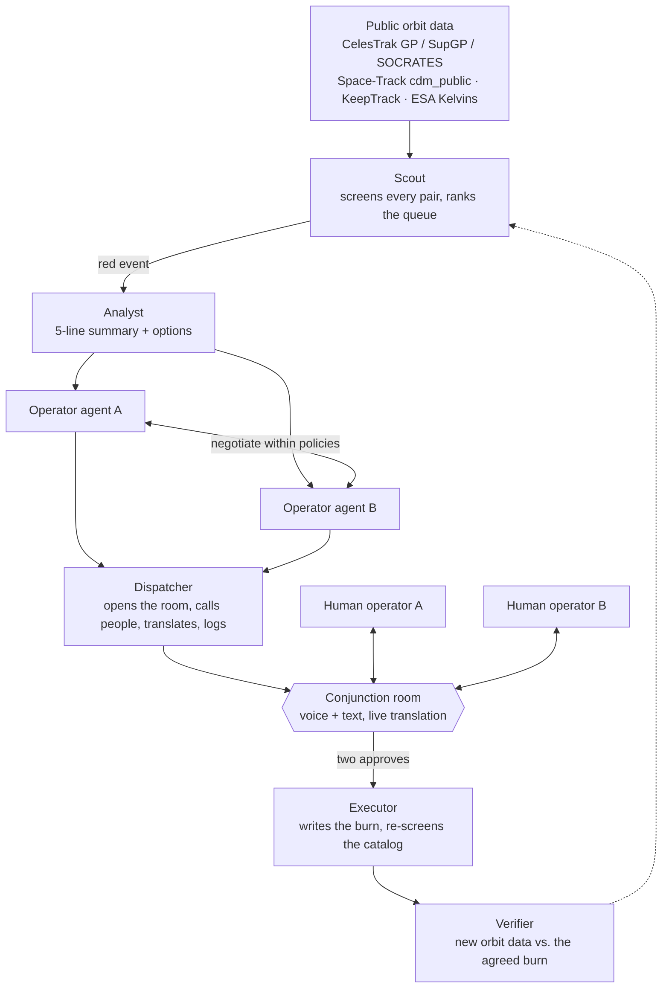

# OrbitCall

**A dispatcher for orbit.** OrbitCall watches the public satellite catalog, finds dangerous conjunctions, calls both operators into one room, lets each company's agent negotiate within its own written policy, and asks the humans only "yes or no." People speak their own language; the room translates. After the maneuver, OrbitCall checks that it actually happened.

Nothing moves without a human. It is a handshake, not a law.

> Built at **Cal Hacks 13.0** (Oct 23–25, 2026).
> **Status: planning.** Hacking starts Friday ~21:00. This repo holds the plan only; code lands during the event.

---

## The problem

When two active satellites from different companies are on a collision course, the decision "who dodges" is still made by email. Tracking, screening and the maneuver itself are automated. The step in the middle is not:

- there is no protocol between companies for who yields;
- there is no shared check that the promised maneuver was done;
- there is no record to settle a dispute later;
- operators sit in different time zones and speak different languages, with 13 minutes to 3 days of warning.

Starlink solved this for itself with onboard autonomy. A small operator with 5–50 satellites and no 24/7 shift still has an inbox.

OrbitCall solves the communication and decision step between operators who are **willing** to coordinate. It does not solve unwillingness to share data; that is policy, not software.

## How it works

1. **Scout** propagates the catalog with SGP4, finds close pairs, and ranks them by probability and time to closest approach. Red (Pc > 1e-4 and TCA < 72 h) wakes the agents.
2. **Analyst** packs the pair into a five-line summary with two or three options.
3. **Operator agents A and B** each know their company's policy (fuel reserve, no-move mission windows, acceptable risk) and converge on who moves, when and by how much.
4. **Dispatcher** opens the room, calls both owners plus anyone the fix affects, translates and logs.
5. **Two humans** approve, veto or counter. One "no" sends the agents back with a new constraint.
6. **Executor** records the maneuver and re-screens the moved satellite against the whole catalog.
7. **Verifier** later compares new orbit data with the promised maneuver and flags any mismatch to both sides.

Principles:

- Physics is deterministic code (SGP4), not a model. Models reason, explain and translate.
- Every agent explanation is checked against the numbers before it reaches the screen.
- One source of truth: one reactive database, both laptops subscribe to it.
- Agents run only for the top of the queue, not for every pair.

## Planned stack

| Layer | Choice |
|---|---|
| Frontend | Next.js, globe.gl / CesiumJS |
| Backend, live state, scheduler | Convex |
| Orbital mechanics | SGP4 (`sgp4` npm or `python-sgp4`) |
| Reasoning agents, translation | Claude (Sonnet; Haiku for Scout) |
| Agent runtime | Fetch.ai uAgents, Agentverse, Agent Chat Protocol, ASI:One |
| Voice | Grok Voice via LiveKit; fallback STT → Claude → Cartesia TTS; text chat as the last fallback |
| Optional | Factory Droid SDK (Executor diff), Backboard (agent memory), Tiger Data (Pc time series), Auth0 (two operator roles) |
| Deploy | Vercel + Convex |

## Data sources

All open. A snapshot is cached so the demo runs offline.

| Source | Role |
|---|---|
| CelesTrak GP | Base catalog for screening |
| CelesTrak SupGP | Operator-supplied orbits; GP vs. SupGP gives an honest uncertainty estimate |
| CelesTrak SOCRATES | Reference #1: validate our screening, source of live pairs |
| Space-Track `cdm_public` | Reference #2: official public CDMs |
| KeepTrack API v4 | Owner, purpose and country metadata for the Dispatcher |
| ESA Kelvins CDM dataset | History for the "risk will rise or fall" model |

## Fetch.ai agents

| Agent | Address |
|---|---|
| Scout | TBD |
| Analyst | TBD |
| Operator A | TBD |
| Operator B | TBD |
| Dispatcher | TBD |
| Executor | TBD |
| Verifier | TBD |

Addresses are filled in once the agents are registered on Agentverse.

## What we do not promise

- We don't compute true Pc with covariances; we take it from SOCRATES / CDMs.
- We don't optimize delta-V; there are three fixed options: raise, lower, wait.
- We don't replace the operator. Agents never touch a satellite; only two human approvals put a maneuver into the schedule.

## Docs

- [Plan v1](docs/plan-v1.md) — the full pre-hackathon kit: problem, evidence, architecture, demo script, data sources, sponsors, judge Q&A, 36-hour plan.
- [Functionality](docs/functionality.md) — what OrbitCall does: actors, domain objects, lifecycle, functions by area, open questions for the specification.

## Team

- **Kostya, Andrew** — backend
- **Adil** — frontend
- **Freya** — product and demo
