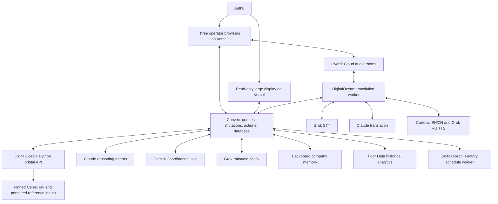

# OrbitCall master roadmap

Status: locked hackathon plan, version 1.1. Updated October 24, 2026, America/Los_Angeles. Code baseline: `ec5ea34`, including the OMM snapshot merge. Version 1.1 assigns the Coordination Host to Gemini.

This document is the team's source of truth. It defines the finished hackathon demo, phase goals, stack, agent roles, data ownership, service contracts, and deployment plan. It separates implemented code from work still required. Other documents explain or implement this plan and must follow its current decisions.

The team may improve a locked choice. Record the change, reason, affected contracts, and owner here before implementing the replacement. Update the specification and sponsor claims in the same change. Until then, use this plan. Account access, selected voice IDs, and deployment addresses are configuration values to record during setup, not invitations to swap providers silently.

Reading order: [phase goals](#3-phases-goals-only), [locked stack](#4-locked-technical-stack), [architecture](#5-architecture-and-service-ownership), [agents](#6-agents-what-runs-where), [data and APIs](#7-data-ownership-and-communication), [sponsor roles](#10-sponsor-integrations-and-evidence), [deployment](#13-deployment-runbook), and [current implementation status](#15-baseline-status-and-team-handoff).

## 1. Problem and solution

### The problem

- A dispatcher is responsible for a fleet of satellites.
- Each satellite can approach other satellites or debris.
- An alert identifies an encounter. Operators still need to understand it and decide what to do.
- A proposed maneuver can affect other encounters.
- Operators need a shared plan, clear approval, and a record of the outcome.

### Evidence published after 2023

| Date | Source and finding | What it supports in OrbitCall |
|---|---|---|
| November 19, 2024 | NASA reported an ISS debris-avoidance burn coordinated with Roscosmos and station partners. [NASA incident report](https://www.nasa.gov/blogs/spacestation/2024/11/19/space-station-raises-orbit-avoiding-orbital-debris/) | Avoidance and coordination are operational tasks. Debris needs a different decision path from an active counterpart |
| April 1, 2025 | ESA reported increasing collision-avoidance activity and a need to coordinate around active satellites and non-maneuverable debris. [ESA Space Environment Report 2025](https://www.esa.int/Space_Safety/Space_Debris/ESA_Space_Environment_Report_2025) | Show a fleet queue, source evidence, and a coordination workflow |
| April 16, 2026 | ISRO reported that 82 maneuver plans for LEO satellites were revised in 2025 to avoid close approaches after the maneuver. [ISRO ISSAR-2025 release](https://www.isro.gov.in/Indian_Space_Situational_Awareness_Report_2025.html) | Re-screen the moved spacecraft against the catalog before recording its schedule |

These reports support the operational problem. Our specific focus on small operators, multilingual discussion, and this interface is a product hypothesis. Do not describe a news article as a customer interview or claim that every operator uses the same manual process. A real operator conversation would strengthen the pitch and Anthropic submission.

### Our solution

- Give each dispatcher an assigned fleet and a personal incident queue.
- Screen that fleet against the available catalog.
- Group related incidents in one coordination room.
- Let agents explain evidence and prepare calculated options.
- Let operators discuss those options in English, Russian, and Mandarin.
- Require explicit approval of the same current proposal revision.
- Re-screen and write the approved schedule artifact.
- Show history, memory, and later verification evidence.

OrbitCall records a coordination decision and a demo schedule file. It does not command a spacecraft.

### Scope boundary

The deliverable is a complete hackathon demonstration. No registration product, billing, onboarding funnel, commercial operations, formal certification, or long-term service program is required. Pre-created accounts are enough. The report is a reviewable demo summary and supporting export, not an automatic regulatory filing.

## 2. The finished demo

### Four screens

| Screen | Person or role | What it shows |
|---|---|---|
| Large monitor | Demo observer, read-only | Globe, satellites, debris, scan progress, linked encounters, shared agent progress, and approval/schedule state |
| Laptop 1 | US dispatcher, played by the judge | Four assigned spacecraft, Run Scan, incident details, candidate selection, chat/call, and Approve |
| Laptop 2 | Russian dispatcher | Their assigned fleet, incident notification, Russian discussion, and their own approvals |
| Laptop 3 | Chinese dispatcher | Their assigned fleet, incident notification, Mandarin discussion, and their own approvals |

Use headsets for the three laptops. Keep the large monitor muted. Country is a demo profile attribute, not a claim about ownership or account authorization.

### Main story

1. The large monitor rotates the globe while the judge sits at the US laptop.
2. The judge sees their four assigned spacecraft and presses Run Scan.
3. The backend identifies two linked demo incidents, US/Russia and US/China.
4. The judge presses Start workflow. The other operators are joined to the same coordination room automatically, see a notice in their inbox, and open it when they want to talk.
5. Agents present evidence and up to four calculated options per incident. The selected maneuver has a checked schedule preview before approval.
6. The operators speak in three languages and see original and translated text.
7. A meaningful counter changes one proposal. Its required approvals visibly reset.
8. Each pair selects and approves its current plan independently.
9. Re-screening passes. Factory commits the authorized schedule artifact and exposes the resulting diff.
10. The large monitor follows the same shared state. Tiger Data shows recorded history.
11. A second incident or follow-up demonstrates Backboard recall without reusing approval.
12. A labeled historical replay demonstrates verification. The current demo burn remains scheduled, not claimed executed.

This is a rehearsal sequence, not measured timing. Keep the main presentation under the event's five-minute limit and create a separate two-minute demo-first cut for Cartesia. [Cal Hacks FAQ](https://hive.hackberkeley.org/faq), [sponsor briefs](https://hive.hackberkeley.org/prizes).

### Flexible participation

- A conjunction event always represents two objects and one encounter time.
- A situation with more satellites is several linked pair events. A coordination room groups all of them and every operator company they involve. There is no fixed company cap.
- The rehearsed room has three operators. Another operator joins when a linked event concerns their fleet. A fourth is supported, not required on stage.
- A debris incident has one active operator. It can use its own incident workspace or appear in a relevant group room.
- Room size is limited by usability and the host's context size, not by orbital mechanics. Section 6 sets the host limit.
- Keep approvals per event. Attendance in the group never approves every event.
- Shared spacecraft or a shared maneuver version can link decisions. A material trajectory change invalidates approvals only where their inputs are affected.
- A maneuver of one spacecraft has one trajectory plan. The plan lists every pair event the moved trajectory affects.
- The moved trajectory is re-screened once against the full catalog. Its schedule needs every affected pair's required approvals on the same plan version.
- A new plan version invalidates approvals in every affected pair event. Linked events that do not use the moved trajectory keep their approvals.

NASA defines conjunctions between two trajectories and requires mitigation trajectories to be screened for new risk. Our room grouping is the product design around those pair events. [NASA process definitions](https://www.nasa.gov/cara/training-materials-and-documentation/), [NASA mitigation guidance](https://nodis3.gsfc.nasa.gov/displayDir.cfm?Internal_ID=N_PR_8079_0001_&page_name=Chapter4).

### Demo data and modes

| Mode | Catalog and behavior |
|---|---|
| Dev on | Existing TLE catalog and local synthetic agent/incident scenarios. Used for frontend development and fallback demonstration |
| Dev off | Backend-driven OMM catalog and shared backend state. Missing OMM stays visibly pending. No silent TLE or local-simulator fallback |
| Backend demo run | Explicitly seeded, labeled simulated encounters and policies processed by the real backend, orbital service, and provider APIs. Uses OMM in Dev off |
| Historical replay | Separate sourced observations of a past maneuver. Never presented as proof that a current demo action happened |

The base catalog is real public data. Engineered encounters, demo ownership assignments, policies, and schedule actions are labeled simulated. For a reliable three-operator story, the scenario may use two flagged US simulated spacecraft, each against a real catalog counterpart assigned to the RU or CN demo company. Keep four assigned spacecraft per dispatcher. This replaces the earlier one-simulated-object-per-run restriction. Do not force one artificial orbit to meet two arbitrary real trajectories.

The same numerical pipeline must produce the engineered trajectories, screening results, candidate geometry, and rendered orbits. Store the scenario inputs and measured closest approach. A fixture is not a real detected emergency. A supplied demo probability is marked simulated and is not computed from SGP4 geometry.

The current OMM delivery is implemented: pinned files under `data/snapshots/` are copied byte-for-byte into `web/public/snapshots/`, and Convex returns the catalog index URL. The browser loads that index and propagates the OMM records directly. Current queued encounters still come from SOCRATES and are filtered to objects in that catalog. This object-membership filter does not recompute encounter geometry or implement the assigned-fleet screening service. [Data layout and preparation](../data/README.md).

## 3. Phases: goals only

Phases describe completion order, not fixed hours. Establish deployment early and update it throughout the build. Do not restart completed work just to match a phase number.

### Phase 0: One shared plan

- Everyone understands the same demo and scope.
- One code baseline and one shared environment are identified.
- Provider access and sponsor requirements are known.

### Phase 1: Connected foundation

- The frontend, backend, and workers can communicate.
- Shared changes appear on all four screens.
- Failures are visible and recoverable.

### Phase 2: Identity and responsibility

- Each dispatcher sees the correct assigned fleet.
- Each dispatcher can act only for their assigned spacecraft.
- The large monitor can observe without approving.

### Phase 3: Consistent orbital data

- Real mode loads the same orbital snapshot everywhere.
- Objects, positions, and source timestamps agree.
- Development and simulated data are clearly identified.

### Phase 4: Fleet screening

- A dispatcher can screen their fleet against the catalog.
- Results show scope, progress, and missing coverage.
- Repeated scans update existing events without duplication.

### Phase 5: A useful incident queue

- The next incident to review is clear.
- Missing evidence remains visible.
- Notifications reach the responsible operators.

### Phase 6: Calculated options

- Agents explain each incident using checked evidence.
- Options respect each operator's private policy.
- Operators can compare feasible alternatives.

### Phase 7: Shared coordination

- Related incidents open in one shared room.
- Operators can speak and read in three languages.
- Discussion changes the relevant options when needed.

### Phase 8: Clear human agreement

- Selection is separate from approval.
- Required operators approve the same current revision.
- Changed inputs visibly invalidate affected approvals.

### Phase 9: Authorized schedule artifacts

- The selected maneuver is checked against other traffic.
- Only the authorized plan enters the schedule file.
- The diff and result are visible to the operators.

### Phase 10: Memory, history, and evidence

- Relevant preferences carry into a new incident.
- Recorded observations explain how an event changed.
- Scheduling, execution evidence, and missing data stay distinct.
- The shared record can be reviewed and exported.

### Phase 11: The complete four-screen story

- The judge can drive the main flow without guidance on every click.
- All three operators contribute to the outcome.
- The public display follows the same events and decisions.

### Phase 12: Deployed and rehearsed

- The deployed build passes the complete demo path.
- Reset and failure recovery work between judges.
- Setup instructions, sponsor evidence, video, and submission are ready.

## 4. Locked technical stack

These are target choices. The baseline status table in section 15 identifies what already exists.

| Layer | Locked technology | Location |
|---|---|---|
| Frontend | TypeScript, Next.js 16.4.3 App Router, React 19.3.0 | `web/`, hosted on Vercel |
| Visual interface | Three.js 0.186.x, existing custom GlobeScene, Tailwind CSS 4, Motion, Zustand, Lucide | Browser. Keep the current renderer rather than replacing it with Cesium/globe.gl |
| Browser propagation | satellite.js 7.1.x in a Web Worker, `json2satrec` for real-mode OMM | Browser. Display computation only |
| Application backend | Convex TypeScript functions, reactive database, scheduler, storage, search | Root `convex/`, hosted by Convex |
| Identity | Auth0 React SDK, `ConvexProviderWithAuth0`, server identity checks | Auth0 tenant, browser token bridge, Convex authorization |
| Numerical service | Python 3.12, FastAPI, Uvicorn, `sgp4`, NumPy, HTTPX, Pydantic | `services/orbit/`, DigitalOcean container |
| Analysis and advocate agents | Anthropic SDK for TypeScript, explicit role-specific prompts and data access | Convex actions |
| Coordination Host agent | Google Gemini API through the official `@google/genai` TypeScript SDK, structured outputs | Convex Node action |
| Independent rationale check | Grok text API, structured check result | Convex action, no scheduling authority |
| Live media | LiveKit Cloud, `livekit-client`, Python LiveKit RTC/Agents SDK | Browser audio transport and DigitalOcean translation worker |
| STT | Grok streaming speech-to-text | Translation worker calls xAI |
| Translation | Claude with protected values and validation | Translation worker calls Anthropic |
| TTS | Cartesia for English and Mandarin, Grok TTS for Russian | Translation worker calls providers and publishes LiveKit tracks |
| Schedule artifacts | Node.js 22, `@factory/droid-sdk`, installed Droid CLI, Git | `services/scheduler/`, DigitalOcean container and persistent volume |
| Agent memory | Backboard memory API, one isolated assistant per company per demo run | Called by Convex actions |
| Historical analytics | Tiger Cloud PostgreSQL/TimescaleDB, `pg` driver in Node actions | External analytics database, accessed through the backend |
| Worker hosting | DigitalOcean Droplet, Docker Compose, Caddy HTTPS proxy | One shared demo host, persistent Docker volumes |
| Delivery | GitHub, GitHub Actions, npm lockfiles, Python lockfile, container images | CI and deploy configuration |
| Development tools | Actual use of Cursor for the SpaceXAI track, existing team tools as needed | Developer machines. Record real usage accurately |

No NestJS service, Prisma, or separate ORM is required. Convex defines its schema and access functions in TypeScript. Tiger Data uses a small parameterized SQL adapter. FastAPI is the numerical-service HTTP boundary, not a replacement application backend.

Use Node.js 22.13 or newer within Node 22 for the build and Node worker. The root and `web/` packages remain separate. Existing npm lockfiles are authoritative for installed JS packages. New dependencies must be added with committed locks. Add a Python lockfile when the numerical/voice services are implemented. Do not invent exact package patches for services not yet installed.

### Model and voice registry

| Role | Locked identifier or API | Configuration |
|---|---|---|
| Incident Analyst and Operator Advocates | `claude-sonnet-5-5` | `ANTHROPIC_MODEL` |
| Text Coordination Host | `gemini-3.8-flash` | `GEMINI_HOST_MODEL` |
| Phrase translation | `claude-sonnet-5-5` | `TRANSLATION_MODEL` |
| Independent rationale check | `grok-4.20-0309-reasoning` | `XAI_CHECKER_MODEL` |
| Speech recognition | `grok-voice-transcribe-2.0`, `wss://api.x.ai/v1/stt` | `XAI_STT_MODEL` |
| English/Mandarin speech | `sonic-3.6-2026-08-27` | `CARTESIA_MODEL_ID`, separate validated voice IDs |
| Russian speech | `POST https://api.x.ai/v1/tts`, language `ru` | `XAI_TTS_VOICE_ID`, recorded from the tested voice selection |
| Factory execution | Droid SDK session with the model ID selected from that account's `listModels()` | `FACTORY_MODEL_ID`, saved in the demo manifest before rehearsal |

These are configured target IDs, not proof of access in the team's accounts. An access failure leaves the step failed with a visible reason. Record any provider/model change as a new lock revision. Do not switch to `latest` aliases during judging.

The target names above are supported by the provider documentation checked for this plan: [Claude models](https://platform.claude.com/docs/en/models/overview), [Gemini model](https://ai.google.dev/gemini-api/docs/models/gemini-3.8-flash), [Grok checker](https://docs.x.ai/developers/models/grok-4.20), [Grok STT](https://docs.x.ai/developers/model-capabilities/audio/speech-to-text), [Cartesia snapshot](https://docs.cartesia.ai/build-with-cartesia/tts-models/latest), [Grok TTS](https://docs.x.ai/developers/model-capabilities/audio/text-to-speech), [Factory SDK](https://docs.factory.com/sdk/typescript).

The three agent providers have separate jobs: Claude analyzes incidents and advocates for each company, Gemini hosts the shared coordination discussion, and Grok independently checks rationale. Claude also translates phrases. Grok also provides STT and Russian TTS. Gemini Host text uses the existing checked translation and speech path. It adds no separate media server or speech pipeline.

Grok TTS uses the endpoint's documented request fields. Do not invent a TTS `model` parameter. Cartesia currently lists Russian support too. Routing Russian to Grok is our chosen demo allocation, not a claim that Cartesia cannot speak Russian.

## 5. Architecture and service ownership



### Frontend responsibility

- Render the globe, fleet list, queue, room, candidates, messages, and evidence.
- Format backend values and compute visible countdowns.
- Propagate the pinned orbit elements for smooth display.
- Send user intent through Convex functions.
- Connect to LiveKit using a server-issued, room-scoped token.
- Never infer approval from speech, local selection, or an animation.
- Never call sponsor services with secret keys or compute authoritative risk in the browser.

Zustand holds local UI state such as focused object, open panel, filters, and Dev mode. Convex owns shared domain state. Existing simulator stores are not the production contract and require an explicit adapter.

### Convex responsibility

- Authenticate and authorize every private read, write, and subscription.
- Own incidents, room membership, selected revisions, approvals, messages, and audit records.
- Reserve jobs, schedule actions, and store verified results.
- Keep all screens synchronized through reactive queries.
- Mediate access to memory and historical analytics.

Queries read authorized state. Mutations change it transactionally. Actions call external services and then invoke mutations to publish results. External actions have different failure semantics from mutations, so job IDs and idempotency belong in our code. [Convex function types](https://docs.convex.dev/functions), [actions](https://docs.convex.dev/functions/actions), [scheduling](https://docs.convex.dev/scheduling/scheduled-functions).

### DigitalOcean responsibility

- Run long-lived audio connections and the Factory subprocess.
- Run CPU-bound screening outside Convex transactions.
- Keep the numerical snapshot and schedule workspace on persistent storage.
- Expose authenticated HTTPS service endpoints through Caddy.

One CPU Droplet is the locked initial host. Use measured memory and screening runtime to size it before rehearsal. No GPU claim is made. [Droplet quickstart](https://docs.digitalocean.com/products/droplets/getting-started/quickstart/), [Docker image](https://docs.digitalocean.com/products/marketplace/catalog/docker/).

### Dependency rules

- Browser application commands go to Convex. Live audio goes to LiveKit.
- OMM assets load from the versioned index named by Convex. The current demo serves the committed files from `web/public/snapshots/` through Vercel. This is asset delivery, not browser access to the numerical API.
- Convex calls the orbital and schedule services using service authentication.
- Workers publish results through narrow authenticated backend functions or HTTP actions. They do not expose a general client write token.
- Tiger Data cannot alter approvals. Backboard cannot authorize a maneuver. Factory cannot select one.
- There is no all-purpose third-party agent framework. We implement explicit role calls and job state ourselves. LiveKit Agents is used for media handling only.

## 6. Agents: what runs where

The agent graph represents these actual roles and tool calls. Do not animate an external call that did not happen. Stream short public explanations of work, not private model reasoning.

| Role | Implementation and host | Input | Output and authority |
|---|---|---|---|
| Risk Monitor | Deterministic Convex jobs plus Python screening | Snapshot, assigned object IDs, window, supplied source values | Encounter results, severity, queue updates. No LLM is needed to assign a threshold color |
| Incident Analyst | Claude Sonnet action in Convex | Shared event evidence and computed candidate results | Five-line explanation and checked candidate descriptions. Cannot read private company policy |
| Operator Advocate | One Claude Sonnet role per company in Convex | That company's policy, relevant memory, shared candidates | Feasible/infeasible outcomes, recommendations, and shareable constraint categories. Cannot approve |
| Coordination Host | Gemini Flash Node action in Convex | Group-room public context, messages, pair-scoped decisions | Room summary, clarification requests, revisions to consider, end-of-call summary. Cannot approve |
| Independent checker | Grok text action in Convex | Published candidate facts and proposed explanation | Agreement/disagreement flag and reason. Does not replace deterministic number checks |
| Maneuver Scheduler | Convex authorization mutations, Python re-screen, Factory worker on DigitalOcean | Exact selected revision, required approvals, snapshot and trajectory versions | Prepared diff and committed schedule artifact. Cannot alter maneuver numbers or command a spacecraft |
| Maneuver Verifier | Python numerical method, Convex result publication | Approved plan and later observations | Consistent, mismatch, or awaiting data, with method and limitations |
| Translation worker | Python LiveKit process on DigitalOcean | Each source audio track and final phrases | Original text, checked translations, and listener-language audio. Cannot approve or change a proposal directly |

Three companies produce three advocate instances. The number of advocates follows room membership and relevant incident sides, not a hard-coded A/B pair. Deterministic screening runs for all assigned assets. LLM work runs only for the selected/top relevant incidents, with one deduplicated agent run per evidence version.

### Gemini Host contract

- Trigger the host when a relevant final human message arrives, checked candidate results change, a summary is requested, or a call ends. Deduplicate by room, input version, and trigger. Its own messages do not trigger another host run.
- Send only shared messages with source IDs, linked event facts, current candidate revisions, shareable feasibility outcomes, and server-reported approval state. Private policies and Backboard memory stay with the authorized advocate.
- Send every linked event in the room, so the host sees all pairs and shared movers. The host context accepts up to 24 linked events. A larger room fails the host run with a visible reason. It never drops an event silently.
- Call `models.generateContent` through `@google/genai` in a Convex Node action. Use a JSON Schema for an allowlisted result: referenced event/message IDs, clarification questions, requested revisions, and per-event summary text.
- Check referenced IDs, numerical values, room membership, and input freshness before publishing through a mutation. A requested revision returns to the existing calculation and validation flow.
- Generate canonical host text, then use Claude translation and the selected Cartesia/Grok TTS routes for each listener. Host speech cannot create an approval.
- Show the Gemini provider/model and actual result in the agent trace. A host failure leaves the text room and existing evidence available, with bounded retry and no silent provider substitution.

Google documents the official SDK and JSON Schema output support. A valid schema still needs our factual and authorization checks. [Google GenAI SDK](https://ai.google.dev/gemini-api/docs/libraries), [structured outputs](https://ai.google.dev/gemini-api/docs/structured-output).

### Prompt and context contract

- Every run identifies role, room/event, input version, company scope where applicable, model, and attempt.
- Each role gets an allowlisted context object. Do not pass a full database document or another agent's private context by default.
- Private advocates exchange outcomes and categories. They do not exchange raw fuel reserves or protected mission windows.
- Numerical values come from stored source facts or deterministic tools. Validate model output before publishing it.
- Unchecked, incomplete, or stale outputs stay unpublished or visibly failed.
- Model timeout or disagreement can block a new recommendation. It never generates an automatic human approval.

## 7. Data ownership and communication

### Authoritative and derived data

| Store | Records | Boundary |
|---|---|---|
| Convex | Users, companies, assignments, demo runs, snapshot manifests, events, room membership, messages, policies, proposals/revisions, approvals, job state, audit log, artifact references | Authoritative application state |
| Versioned orbital files | OMM records, source snapshots, numerical result files | Authoritative inputs for the identified numerical run, linked by snapshot/hash |
| Tiger Data | Observation history keyed by event, source, time, and evidence version | Analytics copy. Its lag or failure does not change current approval state |
| Backboard | Company-scoped memory entries with source references | Advisory context. Current policy and current approvals remain in Convex |
| Factory workspace | Prepared file, diff, committed schedule, local Git history | Derived artifact of a reserved authorization intent |
| LiveKit | Live audio tracks and room connectivity | Media transport. Final text and approval state remain in Convex |

Do not store the full orbital catalog as a live stream of one Convex write per moving satellite. Store its manifest and only the metadata needed by fleet/event queries. Browser positions update locally between snapshot changes.

### Target domain records

| Record | Required identity/version information |
|---|---|
| User | Auth0 subject, company, role, display language, profile country |
| Assignment | User, company, object ID, validity, assignment version |
| Snapshot | Snapshot ID, source URLs, epochs, fetch times, object count, content hash |
| Scan run | Caller, assigned primary IDs/version, snapshot, start/end window, phase, counters, coverage, errors |
| Event | Canonical pair, closest-approach time, geometry, supplied probability/provenance, current evidence version, workflow |
| Coordination room | Room ID, linked event IDs, membership with no fixed company cap, shared messages, call state, demo run |
| Proposal revision | Event, stable proposal ID, immutable revision, calculated maneuver or wait, assumptions, feasibility |
| Selection | Event, proposal ID, revision, monotonic selection generation |
| Approval | Event, selection generation, revision, real approver, side, time, current authorization context |
| Trajectory plan | Object ID, current scheduled trajectory version, affected events, the proposal revision used in each affected event, schedule-artifact reference |
| Job or provider run | Job ID, input version, attempt, running/finished state, public progress, sanitized result/error |
| Demo manifest | Run ID, scenario, object assignments, model/voice versions, provider readiness, observation provenance |

Use string object IDs, including long catalog numbers and reserved `SIM-` IDs. Domain timestamps are UTC ISO strings at API boundaries. Database time fields can use epoch milliseconds if conversion is explicit. Use units in names: `missKm`, `deltaVMs`, `altitudeKm`, `latDeg`, `lonDeg`. Missing data is null, not zero.

### User-command pattern

1. A browser calls a mutation such as `scans.startMine`.
2. The mutation resolves identity and assignments, validates the request, and reserves a job.
3. The mutation schedules an internal action after commit.
4. The action calls the external service with the pinned input version.
5. A mutation checks the returned version and stores a valid result.
6. Reactive queries update the three laptops and observer display.

Never wait for an entire catalog scan inside a database mutation. A numerical service starts a job and returns its ID. Convex polls bounded job-status requests until completion. Use measured counters for progress, or display an indeterminate state. Do not generate a fake percentage.

### Target API families

Names below are the implementation target, not a claim that all functions exist at the baseline.

| Area | Functions | Purpose |
|---|---|---|
| Session | `users.me`, `config.flags` | Identity, assigned object IDs, enabled capabilities |
| Fleet | `fleet.listMine` | All assigned spacecraft, position samples, freshness, incident counts |
| Catalog | `catalog.snapshot`, `events.orbits` | Versioned OMM manifest and authorized event orbits |
| Scan | `scans.startMine`, `scans.getMine` | Full assigned-fleet scan, deduplication, progress, coverage |
| Queue | `events.myQueue`, `inbox.list`, `inbox.markRead` | Personal work and unread updates |
| Group room | `rooms.startWorkflow`, `rooms.get`, `rooms.byId`, `rooms.listMine`, `rooms.join`, `rooms.leave` | Event-scoped entry plus room context for every linked event and operator |
| Discussion | `messages.list`, `messages.send`, `summary.request` | Persistent original/translated conversation with event references |
| Proposals | `proposals.list`, `proposals.revisions`, `rooms.select` | Up to four cards and a shared event-specific selection |
| Approval | `approvals.approve`, `approvals.veto` | Explicit current event-specific authorization |
| Live media | `call.join`, `rooms.setInCall` | Authorized room token and presence |
| Scheduling | `maneuvers.get`, internal schedule jobs | Re-screen, preview, reserved commit, retry status |
| Evidence | `history.series`, `verifications.get`, `verifications.replay` | Tiger-backed history and numerical verification |
| Memory | Internal company-memory read/write actions | Backboard context with source IDs |
| Observer | `demo.publicView` | Allowlisted shared state for the large display |
| Reset | `demo.reset` | Close the demo run and start the next judge cleanly |

### Internal service endpoints

| Service | Endpoint | Behavior |
|---|---|---|
| Orbit API | `GET /health` | Process readiness and loaded snapshot version |
| Orbit API | `GET /snapshot` | Manifest and backend-owned OMM asset reference |
| Orbit API | `POST /screen` | Accept pinned primary IDs/window, reserve numerical job, return job ID |
| Orbit API | `GET /jobs/{jobId}` | Authorized job status, counters, coverage, and completed result reference |
| Orbit API | `POST /candidates` | Bounded candidate calculation for the identified event/version |
| Orbit API | `POST /rescreen` | Full-catalog re-screen job for the exact proposed trajectory |
| Orbit API | `POST /simulate` | Deterministic, flagged demo-orbit construction |
| Orbit API | `POST /verify` | Numerical comparison using supplied historical/live observations |
| Orbit API | `GET /validation` | Measured reference coverage and error summary |
| Schedule worker | `GET /health` | Droid CLI/account readiness without revealing credentials |
| Schedule worker | `POST /prepare` | Build/check the selected revision's file and diff in an isolated workspace |
| Schedule worker | `POST /commit` | Execute an existing reserved intent with an idempotency key |
| Schedule worker | `GET /jobs/{jobId}` | Publicly safe status and artifact references |

All service requests carry a scoped service credential and job/run ID. Results echo snapshot, evidence, and proposal versions where applicable. No browser can choose a different primary fleet by calling these endpoints. Long jobs run outside the API request thread and survive a client request timeout. Persist job status before reporting acceptance.

## 8. Fleet screening and decision logic

### Fleet scope

- My Fleet contains all assigned objects, including those with no current incidents.
- Clicking one spacecraft filters the view. Run Scan still checks the entire assigned fleet and labels that scope.
- Screening compares those spacecraft to every other usable object in the pinned catalog, including debris and fleet peers.
- Exclude self-pairs. Deduplicate repeated pair encounters by canonical object IDs and a fixed closest-approach matching window of 60 seconds.
- Do not merge separate encounters by repeatedly chaining nearby time matches. Keep a canonical encounter anchor.
- A shared event has one ID, even if both operators scan it.
- A zero-result scan means no encounters found within its disclosed scope and window. Partial/failed coverage never produces an all-clear result.

### Numerical contract

- Horizon: the next 72 hours from the pinned scan start.
- Initial encounter screening distance: 5 km, with the actual coverage and method shown.
- Python SGP4 is authoritative for screening. Browser satellite.js propagates the same OMM inputs for display.
- Preserve OMM epochs and normalize explicitly documented provider defaults. Do not round-trip OMM into TLE.
- SGP4's selected gravity constants must agree across verification runs. Distinguish those constants from WGS84 geodetic display conversion.
- Cartesian state vectors explicitly identify TEME, km, km/s, and epoch. Geographic display uses degrees and km.
- A coarse pass finds possible close approaches, then refines local minima. Report propagation errors and exclusions.
- Validate with the full eligible reference scope and separate geometry/time error from recall. The fixture subset is not the validation denominator.

The selected libraries provide OMM ingestion: Python `sgp4.omm.initialize` and satellite.js `json2satrec`. [Python sgp4](https://pypi.org/project/sgp4/), [satellite.js initialization](https://shashwatak.github.io/satellite-js/docs/initialization). OMM is the exchange format, while source quality, epoch, and propagation method determine evidence quality. [CelesTrak formats](https://celestrak.org/NORAD/documentation/gp-data-formats.php).

### Probability and queue

- Use supplied, matched CDM probability where available. Keep SOCRATES maximum probability labeled `max_prob`.
- Never calculate a replacement Pc from a miss distance or fabricate covariance.
- Real-event probability and simulated scenario probability are separate provenance types.
- Red: usable current supplied probability above `1e-4` and a future closest approach less than 72 hours away.
- Yellow: `1e-5` through `1e-4`, or above `1e-4` at 72 hours or later.
- Sort active known-evidence events by severity, then earliest closest approach, then emergency flag, descending supplied value, and stable ID.
- Missing/stale evidence has a separate always-visible Data needs review section.
- Scheduled, monitoring, and awaiting-verification events remain in follow-up. Completed records stay in history/inbox.
- Show GP/SupGP differences as source disagreement with epochs, not a calibrated uncertainty band.
- My Incidents holds only our own fleet-scan events. Each is checked against SOCRATES and labeled Matched, Data differs or Not in SOCRATES, with both sets of numbers (decision of October 25, 2026; spec `ReferenceCheck`). SOCRATES pairs never form the queue.
- Display probability as "1 in N" first, with the exact value next to it: a decimal with two significant digits from 0.0001 up, scientific notation below.

These thresholds and ordering are OrbitCall demo rules, not a general operational standard. TCA means Time of Closest Approach. Use plain interface labels such as Time until closest approach.

### Candidates and approval

- Calculate a bounded grid of allowed moving object, available burn times, along-track direction, and delta-v. Filter burn times already in the past.
- Show up to four distinct computed candidates, including wait when justified. Do not manufacture four feasible alternatives.
- Label approximate candidate geometry indicative. Do not attach the original event's Pc to a proposed burn as its post-maneuver probability.
- Each advocate privately evaluates its own hard constraints and preferences. Shared cards show feasibility outcomes and shareable reasons.
- A card selection writes the shared selection. It is not approval and does not automatically send a counter.
- Approval identifies event, proposal ID, immutable revision, selection generation, real user, and current assignment.
- Two active companies require both event sides. Confirmed debris requires the active side only, with no fictional approval.
- An absent active operator never becomes a debris-style unilateral case.
- Same-company active pairs remain visible for internal review with scheduling disabled for this demo until an internal approval rule is explicitly added.
- Relevant new evidence, policy, trajectory, selection, or authorization invalidates affected approvals. Unrelated conversation does not.

The initial candidate grid keeps the existing demo bounds: lead times of 12, 6, or 3 hours when still available, and delta-v magnitudes of 0.02, 0.05, 0.1, or 0.2 m/s. Re-screen checks the original pair and all other catalog objects over the pinned horizon. The current demo pass rule requires at least 1 km separation for the original pair and no new encounter under 1 km. These are explicit demo gates, not a claim of operational safety or a validated Pc reduction.

## 9. Group rooms, privacy, and voice

### Membership and event boundaries

- A room links events that require the same coordination discussion. Do not merge the entire global encounter graph automatically.
- At least one linked event must concern each participating operator. The main demo contains US/RU and US/CN.
- Membership has no fixed company count. A room grows when a new linked event concerns another operator.
- A member can read that room's intentionally shared event cards and conversation. This does not grant full fleet, private policy, private memory, or unrelated incident access.
- My Incidents remains assignment-scoped. A linked room card can have `canAct: false` for a member who is not an approval side of that event.
- The large display gets a dedicated observer projection. It cannot read raw policies, private traces, memory contents, or approval controls.
- Call and chat are room-scoped. Proposal selection, approval, scheduling, and verification remain event-scoped.
- A message can identify an event. Ambiguous constraints are clarified before agents change a proposal.

### Live audio path

1. `call.join({ roomId })` resolves identity and membership and issues a short-lived LiveKit token.
2. The browser publishes microphone audio to LiveKit Cloud.
3. The Python worker subscribes to original human audio tracks only. It ignores translated/host tracks to prevent feedback loops.
4. Grok STT produces final phrases tagged with speaker, language, sequence, and timestamps. Interim text is not a confirmed constraint.
5. Protect identifiers, numbers, units, signs, and timestamps before Claude translation. Restore and validate them afterward.
6. Translate into the other active listener languages. Cache by phrase ID and target language, not separately per identical-language listener.
7. Cartesia speaks English/Mandarin. Grok TTS speaks Russian.
8. Publish translated audio with stable source-speaker/language track metadata. Listeners play their chosen translation or a same-language original, not both.
9. Persist the original and checked translated text in Convex. Captions and the audit record come from those final message records.
10. The Coordination Host can speak a checked text summary through the same TTS routing. It does not need an additional uncontrolled speech-to-speech planning path.

LiveKit documents a multi-user translation pattern with participant languages and per-track translation. Its token grants support room-scoped publish/subscribe permissions. [Translation example](https://github.com/livekit/agents/blob/main/examples/other/translation/multi-user-translator.py), [token grants](https://docs.livekit.io/frontends/reference/tokens-grants/).

### Translation checks

- Test `en`, `ru`, and `zh` with real clips before freezing voices.
- Keep protected tokens tied to the original phrase. A new spoken number must not be replaced by an older proposal value.
- A failed check publishes the original with a visible translation failure, not an unverified translated instruction.
- Ambiguous recognition prompts confirmation. It does not silently modify the selected plan.
- Speech never approves. Only the event's explicit Approve mutation does.
- If speech fails, the room's text path stays available. A labeled recording is a backup demonstration, not a live provider result.

Grok STT documents all three selected languages, and Grok TTS documents Russian. Cartesia's selected snapshot documents English and Chinese. Capability listings do not replace the number/identifier test clips. [Grok STT languages](https://docs.x.ai/developers/model-capabilities/audio/speech-to-text), [Grok TTS](https://docs.x.ai/developers/model-capabilities/audio/text-to-speech), [Cartesia snapshot](https://docs.cartesia.ai/build-with-cartesia/tts-models/latest).

## 10. Sponsor integrations and evidence

Convex and SpaceXAI are the main sponsor targets. Factory, Backboard, and Tiger Data are included in the finished-demo scope with separate roles. Anthropic, Cartesia, Auth0, and DigitalOcean also need real, demonstrable use. A configured key or logo is not an implemented integration.

### Factory: the schedule artifact

1. After a candidate is selected, Convex requests a preview for that exact revision.
2. The Node worker runs Droid in an isolated schedule workspace, using the TypeScript SDK and installed CLI.
3. Droid prepares the proposed change under `operators/<operator>/schedule.json`.
4. Deterministic validation checks the object, maneuver values, allowed paths, and diff. Store the preview's content hash with the proposal revision.
5. After required approvals, a full-catalog re-screen passes for the pinned input version.
6. A Convex transaction rechecks current authorization and reserves an immutable write intent.
7. The worker executes that intent once, serializing writes to a given schedule workspace. It verifies the file hash and expected previous version, then records the Git commit/diff.
8. Convex stores the result and artifact reference. A retry returns the existing result rather than adding another maneuver.

The external filesystem operation is not part of a Convex transaction. Material changes after write reservation mark the intent/scheduled plan for review and stop silent replacement. A proposed revision requires fresh authorization. If several events depend on the same moved spacecraft, its trajectory-plan version is part of every affected event's authorization check. The scheduler re-screens that trajectory once and writes one schedule entry for it.

Droid can edit the schedule workspace through allowlisted tools. It receives no spacecraft command interface, broad repository write access, cloud administrator key, or authority to change the approved numbers. SDK output is checked by code. A successful SDK call alone does not prove the artifact is valid.

Demo evidence: trigger, live job trace, prepared diff, approval identity/revision, re-screen result, and the resulting file/commit. Factory's SDK supports subprocess execution, working directories, sessions, and result inspection. [Factory TypeScript SDK](https://docs.factory.com/sdk/typescript). Our restricted workspace and approval gate are project requirements.

### Backboard: memory across incidents

- Create one isolated memory assistant per company and demo run. Store its ID server-side in Convex.
- Write a small checked memory item only after a relevant discussion or outcome, with source message/event IDs.
- Retrieve a few relevant entries for that company's advocate in a new incident.
- Show a shareable memory-used explanation without exposing private memory to other companies.
- Current policy wins over remembered preferences. Memory cannot carry over approval or remove a human decision.
- Reset closes the run's memory namespace. Do not erase unrelated company or account memory.

Backboard stores memory at assistant scope and supports recall across threads. Use its documented memory methods and explicit assistant IDs. [Backboard memory API](https://docs.backboard.io/sdk/memory).

Demo evidence: the operator states a preference, a source-linked memory entry is stored, and the next incident visibly uses it. Example: a preference for scheduling after an imaging pass, treated as context until the current incident confirms it. No invented fuel reserve or fabricated prior agreement.

### Tiger Data: historical analytics

- Keep current incident/proposal/approval state in Convex.
- A committed observation schedules a versioned analytics-export job.
- Write source-tagged `eventId`, observation time, miss distance, nullable supplied probability, metric, evidence version, and simulation/run labels to a Tiger hypertable.
- Make the write idempotent with a unique observation key that includes the time partition column.
- An authorized internal Node action queries Tiger through a server-side `pg` adapter and caches the versioned result in Convex. The reactive `history.series` query reads that authorized cache for the UI.
- Chart data shows observations only. Keep real and simulated series visibly separate. Preserve source changes and missing values.
- An export/read failure leaves the chart unavailable or marked stale. It never blocks or changes a valid human approval.

Tiger provides PostgreSQL time-series tables and SQL analytics. [Tiger hypertables](https://www.tigerdata.com/docs/learn/hypertables/understand-hypertables). Our copy of observation history is rebuildable from identified source records. Use parameterized SQL and server-held TLS connection credentials.

Demo evidence: a real database write/query, a rendered historical series with provenance, and an understandable query result. Do not claim high-volume performance or compression gains that we did not measure.

### Other sponsor contributions

| Sponsor | Concrete contribution to show |
|---|---|
| Convex | One shared event state updates four browsers. Mutations enforce current approvals. Scheduled actions run jobs. Search finds a shared message or audit entry |
| SpaceXAI | Real Grok STT request and Russian TTS output in the multilingual room. Record actual Cursor usage during implementation |
| Anthropic | Checked incident explanation, company-specific advocate outcomes, and discussion-driven revision |
| Google Gemini | Live Coordination Host clarification and a per-event room summary tied to the actual discussion and current candidate revisions |
| Cartesia | English and Mandarin translated speech in the main flow, with recorded latency and known limitations |
| Auth0 | Three distinct identities with different fleet access and approval rights |
| DigitalOcean | Running orbital API, persistent translation worker, and Factory worker with health/log evidence |

### Prize context and claims

The live Hive page checked October 24 lists Convex at $5,000 cash, Factory at $2,000 plus credits/swag, SpaceXAI at a custom Cursor keyboard, DigitalOcean at a Retro Wireless Mouse, Vultr at an M5Stack Official Tab5, Backboard at a Tile Essentials Pack, and Tiger Data at a Stream Deck Mini. Best Use of Gemini API lists MLH Swag Kits on both Hive and Devpost. The current Devpost Convex listing also shows $5,000. Recheck final awards before submission. Do not infer comparative winning odds. [Hive prize briefs](https://hive.hackberkeley.org/prizes), [event Devpost](https://cal-hacks-13-0.devpost.com/).

The chosen host is DigitalOcean. Vultr remains an unselected alternative. Its different prize is not a technical reason to split the deployment.

The SpaceXAI Hive brief requires Cursor and a Grok Imagine or Voice API integration. Our selected voice path provides substantive Grok audio use. Record the actual API calls and actual development-tool use. Do not rewrite build history for eligibility. Factory needs runtime SDK work, and Cartesia asks for a complete demo-first presentation. Recheck final submission requirements before opting into tracks.

Best Use of Gemini API requires actual Gemini API use. Demonstrate the host interpreting a discussion, asking a relevant clarification, and producing a source-linked summary. Capture the successful request, configured model, checked output, and UI trace before claiming that integration is complete. The target role alone does not establish eligibility.

No additional runtime providers such as ElevenLabs, Apify, Moss, or Fetch.ai are locked in this version. Replacing a provider requires a recorded stack change. Submit-only tracks do not justify adding an unused service.

## 11. Verification, reporting, and failure behavior

### Verification

- Current demo scheduling produces an artifact, not telemetry evidence of execution.
- Use a separate sourced historical maneuver with before/after element observations for the replay.
- Show expected direction/approximate size beside the observed orbital change, baseline noise, source epochs, and limitations.
- Keep the existing demo evidence rule visible: at least eight element sets, robust baseline comparison, and explicit thresholds. It is a demo comparison method, not an exact burn certificate.
- Output is consistent, mismatch, or awaiting sufficient data. Absence of data is not successful execution or a mismatch.

The existing numerical defaults are a robust z threshold of 5, an absolute semi-major-axis change of at least 50 m, and approximate size agreement within 50 percent of the expected change. Implement and test these against the selected historical case before presenting a successful replay. Preserve the method version. Do not claim that these values establish operational maneuver verification.

### Audit and report

- Keep an immutable shared log of relevant messages, selection changes, revisions, approvals, invalidations, re-screening, and artifact results.
- Export a reviewable incident summary and supporting CSV.
- A six-month preview may demonstrate the report interface, but must show actual coverage and missing data. It cannot invent six months of fleet activity.
- Exclude simulated events from real counts. A demo-only report view can show them separately with explicit labels.
- No filing-ready FCC claim or automatic regulatory submission is included in this hackathon scope.

### Failure states

| Failure | Required behavior |
|---|---|
| OMM absent or invalid | Real mode stays pending/error, with no TLE fallback |
| Scan incomplete | Preserve prior labeled results and show exclusions. No all-clear badge |
| Pc unavailable | Keep the incident in visible data review |
| Model fails or explanation fails number checks | Show failed/stalled work, retain evidence, allow a bounded retry |
| Translation or speech provider fails | Keep original text and the text-room path available |
| Operator absent | Keep their required approval pending, with available contacts |
| Selected revision changes | Clear affected approvals visibly |
| Re-screen introduces another close approach | Refuse scheduling and return to discussion |
| Factory fails | Leave the artifact job failed and retry the same intent. No fake schedule success |
| Backboard unavailable | Advocate proceeds without memory and says memory is unavailable |
| Tiger Data unavailable | Chart shows unavailable/stale. Current coordination state still works |
| Network fails | Use only tested cached/local features or an explicitly labeled recording. Do not claim cloud calls are live |

Provider jobs record model, start/finish time, attempt, measured tokens where supplied, and sanitized errors. Costs are shown only when a verified pricing basis is configured. Unknown cost remains unavailable.

The fallback is cached Dev-mode functionality and a labeled recording of the shared workflow. A self-hosted offline Convex deployment is outside this lock. Cached orbital data alone does not provide live shared approvals, translation or cloud agents.

## 12. Deployment map

| System | Host | Deploy unit | Persistent state |
|---|---|---|---|
| Next.js frontend and observer route | Vercel | `web/` project from GitHub `main` | No application database on the Vercel filesystem |
| Convex functions and database | Shared Convex demo deployment | Root `convex/` package | Shared app records, jobs, audit, artifact references |
| Authentication | Auth0 | One configured application with pre-created users | User identities |
| Live audio transport | LiveKit Cloud | One project, room per coordination room | Live media. Persist final messages in Convex |
| Orbital API | DigitalOcean | Python container | Pinned snapshots and numerical job/results volume |
| Translation worker | DigitalOcean | Python LiveKit worker container | Short-lived phrase buffers. Final phrases in Convex |
| Factory schedule worker | DigitalOcean | Node 22 container with SDK and Droid CLI | Isolated workspaces, schedule files, and Git history volume |
| HTTPS entry point | DigitalOcean | Caddy container | TLS data and explicit service routes |
| Memory | Backboard | API assistants scoped by company/run | Advisory memory |
| Historical analytics | Tiger Cloud | PostgreSQL service | Source-tagged historical observations |

Use one shared Convex deployment for the four-screen demonstration. A Convex deployment named production is a cloud environment label, not a claim that OrbitCall is an operational production service. Personal development deployments stay separate and must not accidentally supply the judged build.

### Repository layout

```text
web/                         existing Next.js app
convex/                      existing application backend
fixtures/                    existing and expanded simulated test inputs
tests/                       backend tests
scripts/                     source preparation, ingestion, setup checks
services/orbit/              planned FastAPI numerical service
services/voice/              planned Python LiveKit translation worker
services/scheduler/          planned Node/Factory worker
deploy/docker-compose.demo.yml  planned DigitalOcean deployment definition
deploy/Caddyfile             planned HTTPS routes
docs/master-roadmap.md       current master plan
```

The planned directories and commands below become runnable after their implementation phases. They are not files already present at the baseline.

## 13. Deployment runbook

### Step 1: Create accounts and record readiness

- Confirm access to Vercel, the shared Convex project, Auth0, LiveKit Cloud, DigitalOcean, Anthropic, Google AI Studio/Gemini API, xAI, Cartesia, Factory, Backboard, and Tiger Cloud.
- Record the selected model IDs and tested voice IDs in the demo manifest.
- Run one small checked call from each of Claude, Grok, and Gemini, speech checks for all three languages, one memory write/recall, one SQL write/read, and one constrained Factory SDK run.
- Record success or failure. Do not mark an integration ready from the existence of an API key.

### Step 2: Configure identity

- Configure Auth0 for the three dispatcher test accounts and a read-only observer account. Disable public sign-up.
- Add localhost and the exact Vercel demo URL to allowed origins/callbacks/logout URLs.
- Implement the Auth0 React provider around `ConvexProviderWithAuth0`.
- Configure Convex's issuer/domain and application ID. Seed the user/company/assignment records.
- Verify that an account cannot read another company's raw policy or approve for another assignment.

Use the official Auth0 integration rather than a URL role switch. [Convex and Auth0](https://docs.convex.dev/auth/auth0).

### Step 3: Prepare DigitalOcean

- Create a Docker-capable CPU Droplet in an appropriate available region. Record its region and address.
- Keep administration access limited to the team. Expose HTTPS service routes, not arbitrary worker administration ports.
- Run separate containers for orbit API, voice worker, Factory worker, and Caddy.
- Mount persistent volumes for snapshots/results and schedule workspaces. Keep the Factory workspace isolated from application source and other service credentials.
- Set restart behavior, readiness checks, and structured logs with job IDs.
- Use a real controlled hostname for HTTPS, such as `api.<demo-domain>`. This is a placeholder until a domain is registered/configured.
- Test the orbital and schedule health endpoints from the Convex action path.

The Python voice worker connects outward to LiveKit and the selected providers. It is not the LiveKit media server. The Factory worker needs the Droid CLI as well as the npm SDK. Neither should run inside a short-lived Vercel request.

Once the planned Compose file exists, deploy from the host's checked-out release commit with commands shaped as follows. The environment file is created on the host and stays outside Git. Image tags must identify that same release.

```sh
docker compose --env-file /opt/orbitcall/demo.env -f deploy/docker-compose.demo.yml pull
docker compose --env-file /opt/orbitcall/demo.env -f deploy/docker-compose.demo.yml up -d
docker compose --env-file /opt/orbitcall/demo.env -f deploy/docker-compose.demo.yml ps
```

Confirm health endpoints and a real job after container startup. A running container alone does not prove provider access or numerical readiness.

### Step 4: Configure secrets and public values

| Location | Configuration |
|---|---|
| Vercel public build values | `NEXT_PUBLIC_CONVEX_URL`, `NEXT_PUBLIC_AUTH0_DOMAIN`, `NEXT_PUBLIC_AUTH0_CLIENT_ID` |
| Convex identity | `AUTH0_DOMAIN`, `AUTH0_CLIENT_ID` |
| Convex provider calls | `ANTHROPIC_API_KEY`, `ANTHROPIC_MODEL`, `GEMINI_API_KEY`, `GEMINI_HOST_MODEL`, `XAI_API_KEY`, `XAI_CHECKER_MODEL`, `BACKBOARD_API_KEY`, `TIGER_DATABASE_URL` |
| Convex service access | `ORBIT_SERVICE_URL`, `ORBIT_SERVICE_TOKEN`, `SCHEDULE_SERVICE_URL`, `SCHEDULE_SERVICE_TOKEN` |
| Convex media authorization | `LIVEKIT_URL`, `LIVEKIT_API_KEY`, `LIVEKIT_API_SECRET` |
| Voice container | LiveKit credentials, xAI/Anthropic/Cartesia keys, STT/translation/TTS IDs, voice IDs, `CONVEX_SITE_URL`, narrowly scoped worker callback credential |
| Factory container | `FACTORY_API_KEY`, `FACTORY_MODEL_ID`, schedule-workspace path, schedule-service credential |
| Orbit container | Snapshot/results paths, orbit-service credential, backend callback credential only if that path is implemented |
| CI release environment | Convex deploy key and host deployment credentials scoped to the release job |

Only public connection/identity values use `NEXT_PUBLIC_`. Store provider keys in the server service that uses them. Keep `.env.example` names with empty values, never real secrets. Vercel preview deployments must not receive the shared demo release credentials automatically.

### Step 5: Deploy Convex

From the root package, install with `npm ci`, then run `npm run check`. Deploy the tested commit to the chosen shared deployment with `npx convex deploy`, using a team-authorized session or CI deploy key.

Configure environment values in that deployment, then run the checked seed/load scripts against that same deployment. The existing loader accepts the snapshot JSON path and Convex flags such as `--prod`. Future assignment/demo-run seeding must be idempotent and explicitly run-scoped.

Check deployment identity, schema version, snapshot version, and an authenticated query before pointing all laptops at it. A successful local test does not deploy any functions.

### Step 6: Deploy Vercel

- Import the repository and set Root Directory to `web`.
- Install with `npm ci` and build with `npm run build`, using the supported Node 22 runtime.
- Set the shared Convex URL and Auth0 public values for the demo environment.
- Deploy the same Git commit as the backend and DigitalOcean images.
- Verify the custom/default domain in Auth0 and sign in as each test user.

For this two-package repo, deploy the root Convex package in the release workflow and the `web/` project through Vercel. Do not run a root Convex deploy command from `web/` and assume it finds the backend schema. Convex also documents an integrated Vercel deployment option if we later change the release layout. [Convex/Vercel deployment](https://docs.convex.dev/production/hosting/vercel).

### Step 7: Prepare data and the four screens

- Load the pinned OMM snapshot and record its hash, source coverage, and epochs.
- Use `scripts/build_omm_catalog.py` to publish the byte-identical OMM files and index inside `web/`. `scripts/build_catalog_pairs.py` records that index path, and the snapshot loader registers it as `ommUrl`. Keep both packages on the same release commit. See the data README for the pinned inputs and preparation commands.
- Seed four assigned spacecraft for each dispatcher, with the intended simulated objects and labels.
- Seed a closed prior incident or explicitly demonstrate a first interaction, then a second one, for Backboard recall.
- Load only sourced or explicitly simulated historical observations into Tiger Data. Keep them distinguishable.
- Confirm the observer reads the approved public projection and has no approval controls.
- Open the shared Vercel build on all four screens and check the selected demo run ID.

### Step 8: Freeze and release

- Record Git SHA, container image tags, backend deployment, snapshot ID, model/voice IDs, and scenario seed.
- Confirm that the selected integration paths use successful live provider calls.
- Run the complete rehearsal and reset it between runs.
- Keep the last known working release and labeled backup video available.
- Freeze model/provider changes once the demo passes. Any late change requires a targeted rehearsal of its affected path.

## 14. Reset, rehearsal, and submission

### Reset contract

- Close the current demo run and hide its active simulated incidents/notifications from new personal queues.
- Keep its shared audit history and artifact references under that closed run ID.
- Clear client focus, selections, pending call state, and locally displayed simulation state.
- Stop old run jobs from publishing into a new run.
- Start a new room and memory namespace when needed. Preserve unrelated data.
- Version Tiger rows by run ID so old simulated history cannot appear as fresh observations.
- Keep schedule artifacts in run-isolated workspaces and prevent a retry from duplicating a prior write.

### Rehearsal checks

- Judge account sees exactly its assigned fleet. Other accounts see their own fleets.
- Run Scan checks the full labeled fleet scope, even when one row is selected.
- Both shared incidents use one canonical ID each across the relevant laptops.
- Three people can join one room. A fourth account can join through a linked event without changing other pair approvals.
- A spacecraft that moves in two linked events uses one trajectory plan. A plan change resets approvals in both events.
- English, Russian, and Mandarin values and object identifiers survive recognition, translation, and speech checks.
- One operator introduces a new constraint. The relevant candidate changes and only affected approvals reset.
- Gemini asks a relevant clarification and summarizes the current pair-specific plans. Claude's analysis/advocates and Grok's rationale check each show their own real call and result.
- Selection never approves. Speech never approves. A room member cannot approve an unrelated incident.
- Factory shows the exact approved values and a real resulting artifact after re-screening.
- Tiger history contains recorded points with source/time. Backboard recall cites actual prior context.
- The public monitor follows shared work without exposing policies or private memory.
- Dev off stays OMM-only. Missing OMM never silently switches to the TLE simulator.
- Disconnect a provider and verify its explicit failure state. Keep the rest of the room usable where possible.
- Reset and repeat the complete story at least three times on the venue network.

### Evidence to capture

| Claim | Evidence |
|---|---|
| Shared coordination | Same room/event/revision visible on the relevant screens |
| Real source data | Snapshot manifest, epochs, source URLs, and real object identifiers |
| Computed encounter | Numerical run inputs/results and measured closest approach |
| Human authorization | Current selection generation, approver identities/times, visible reset |
| Meaningful agents | Checked summary, private feasibility outcomes, and a discussion-driven revision |
| Sponsor use | Successful provider/job IDs, measured duration, and the artifact each sponsor produced |
| Numerical quality | Declared reference scope, matched/eligible count, errors, exclusions, unresolved differences |
| Honest verification | Separate historical replay and a current schedule state that remains unverified |

### Submission deliverables

- A working demo URL and source access for judges.
- A README with setup, component map, sponsor contributions, and known limitations.
- A short demo-first video showing one complete flow.
- A Cartesia two-minute cut with the language routing explained accurately.
- A concise explanation of Convex's central role and actual Grok Voice usage.
- Best Use of Gemini API evidence: the running host, its successful API request, checked clarification/summary, and visible role in the complete flow.
- Factory, Backboard, Tiger Data, Auth0, and DigitalOcean evidence from working code.
- A problem statement backed by the dated reports in section 1.
- A clear statement of what is real, simulated, replayed, and still missing.
- The team table number and only the prize tracks whose requirements we actually meet.

## 15. Baseline status and team handoff

### What exists through `ec5ea34`

- Next.js globe/UI and the TLE development catalog.
- Local synthetic conjunction/agent scenarios, decision dock, camera, and resolution/alert screens.
- Root Convex schema for snapshots, objects, events, and Analyst runs.
- SOCRATES ingestion, catalog queries, current color updates, and checked Analyst runtime.
- Frontend Convex bridge and error boundaries.
- Pinned GP OMM and SATCAT inputs, static web catalog index, Convex `ommUrl`, OMM loader, and direct OMM worker propagation in Dev off. Missing inputs retain the waiting/error state with no TLE fallback.
- SOCRATES queue rows restricted to objects in the pinned OMM catalog. Their supplied geometry remains a separate source result.
- Backend TypeScript and 59 tests, frontend TypeScript/lint, and production build pass for the merged baseline. The integration handoff records asset checks and remaining live-deployment validation.

### What is still to build

- Validate OMM delivery on the shared deployment and add the numerical assigned-fleet screening service against those pinned inputs.
- Auth0 identity and assigned fleets.
- Fleet screening jobs and private queues.
- Group rooms, three-language live voice, and notifications.
- Real proposals, private advocate evaluation, approval integrity, and linked trajectory handling.
- Gemini Coordination Host, its validated output contract, and the three-provider agent traces.
- Factory, Backboard, Tiger Data, and the DigitalOcean deployment.
- Observer display, sourced verification replay, and final export/rehearsal.

The older sponsor status file refers to a voice implementation on a different historical branch. Those voice files are not present on the fetched baseline `main`. Treat that status as branch-specific history until the code is available, reviewed, and merged. Do not mark the locked voice path complete from that document alone.

### Work areas

| Work area | Team responsibility |
|---|---|
| Frontend and public display | Adil: implement the accepted flow and consume the typed backend contracts |
| Shared backend and integration | Kostya's current backend work: identity, schema, job coordination, room/approval boundaries, service integration |
| Agents and numerical integration | Andrew's current Analyst work plus the numerical-service work assigned by the team |
| Product, rehearsal, submission | Freya's current product/demo work plus scenario and evidence review by all members |

These are coordination areas, not new hour commitments. Keep task assignments in the team's active issue board. If the team redistributes work, update ownership there without changing the product contract implicitly.

### Technical handoff checklist

- Each public function has a declared input/result shape and authorization rule.
- Each external job has a stable ID, pinned input version, retry rule, and safe failure state.
- Each agent has an explicit context boundary and checked output.
- Each service has an owner, environment names, health check, and deploy instruction.
- Each sponsor claim points to a real runtime contribution.
- Each completed phase has a demonstrated outcome, not only a merged file.

## 16. Document precedence and changes

1. This master roadmap records the latest accepted scope and stack.
2. [specification.md](specification.md) carries detailed API/data contracts and must stay aligned.
3. [functionality.md](functionality.md) carries stable requirement IDs.
4. [user-flow.md](user-flow.md) describes dispatcher interaction in detail.
5. [sponsors.md](sponsors.md) records sponsor criteria and claim status.
6. [integration-status.md](integration-status.md) records the handoff and implementation boundary.
7. Earlier phase plans remain implementation history where their statements differ.

This version supersedes the earlier two-user-only demo, pair-only room, English/Russian-only scope, Railway/Fly hosting options, and recommendations to drop Backboard or Tiger Data. It keeps the approved TLE-dev/OMM-real boundary and pair-specific human approvals. It replaces the one-simulated-object-per-run limit with a transparent multi-incident demo fixture.

The old automatic Auth0 replacement, automatic non-Factory schedule writer and unimplemented offline shared backend are outside this lock. Their failures use the visible states and tested backups described above.

### Lock changes

| Date and version | Change | Reason and impact |
|---|---|---|
| October 24, 2026, v1.1 | Coordination Host moves from Claude to Gemini. Claude keeps analysis, advocates, and translation. Grok keeps independent checking and audio | User requested three meaningful agent providers and Best Use of Gemini API coverage. Adds the Google SDK, server-only key/model configuration, checked host output, and sponsor evidence. No extra duplicate review agent. Integration owners follow the work areas above. Documentation is aligned. The Gemini runtime and live checks remain to build |
| October 24, 2026, baseline refresh | Include the OMM snapshot and renderer merged in `ec5ea34` | Update implementation status and the static asset-delivery path. The remaining fleet-screening and shared-deployment work stays explicit |
| October 24, 2026, room size | Old: 2-4 operator companies per room. New: no fixed cap. A room groups all linked pair events. A maneuver of one spacecraft links its affected events through one trajectory plan | The user requires coordination for any number of involved satellites. Events stay pairs and approvals stay per pair event. Impact: `rooms` and `roomMembers` are uncapped, a `trajectoryPlans` table links each plan version to its affected events and proposal revisions, the host context limit rises from 10 to 24 linked events, and the UI renders N pair events in one room. Owners: schema task (round 1.5), Kostya (rooms, approvals, scheduler), Andrew (host, candidate publishing), Adil (room UI). Verification: the shared-mover rehearsal check in section 14. No sponsor impact |

Future changes need a short record: date, old choice, new choice, reason, affected functions/services, verification, and sponsor impact. Keep `main` and `adil` synchronized when sharing a new agreed baseline. A push does not deploy the cloud services by itself.
