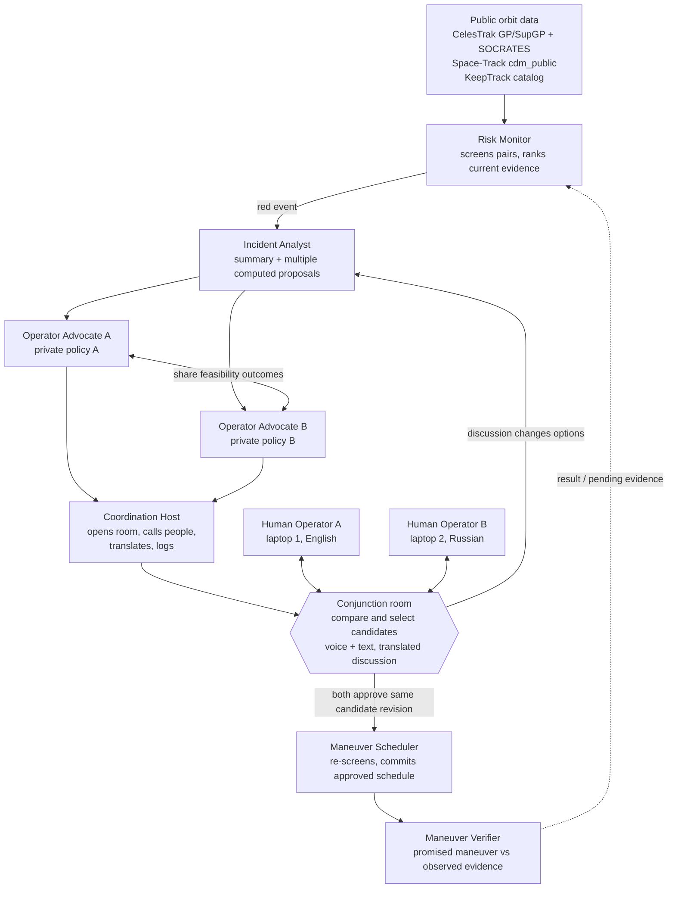

# OrbitCall — Full Kit for Cal Hacks 13.0 (plan v1)

Oct 23, 2026 · @K · Product decisions updated Oct 24, 2026

> This planning document incorporates the accepted decisions in [analysis.md](analysis.md): private policies, multiple computed proposals, approval of the same revision, protected translation, real demo data, evidence-based verification, supplied Pc, measured validation, report export and source links. Risk forecasting is removed completely. Structured counter forms, standing pair agreements, extra action labels and heuristic dismissals are skipped. The repository remains documentation only; demo outcomes and validation numbers must come from actual data and computation.

## Contents

1. [The problem: who decides, who dodges](#1-the-problem-who-decides-who-dodges)
2. [Evidence: operators have been complaining since 2019, up to two weeks ago](#2-evidence-operators-have-been-complaining-since-2019-up-to-two-weeks-ago)
3. [User and use case](#3-user-and-use-case)
4. [Idea and pitch](#4-idea-and-pitch)
5. [Architecture: roles and flow](#5-architecture-roles-and-flow)
6. [Flow and user stories](#6-flow-and-user-stories)
7. [Demo scene and screens](#7-demo-scene-and-screens)
8. [Bilingual voice channel](#8-bilingual-voice-channel)
9. [Space data sources](#9-space-data-sources)
10. [Which model for the agents: Claude or Grok](#10-which-model-for-the-agents-claude-or-grok)
11. [Sponsor plan](#11-sponsor-plan-what-we-take-what-we-dont-and-what-it-costs-in-time)
12. [What we thought through: questions the judges will ask](#12-what-we-thought-through-questions-the-judges-will-ask)
13. [The 36-hour plan](#13-the-36-hour-plan)
14. [Precedents and how we differ](#14-precedents-and-how-we-differ)
15. [Sources](#sources)

---

## 1. The problem: who decides, who dodges

The decision "which of two satellites dodges a collision" is made today by email between two companies, with no shared rules and no guarantee the other side will answer. It is the only manual step in a chain that is otherwise automated.

### How it works today

1. **Tracking.** The US Space Force (18th and 19th Space Defense Squadrons) tracks everything larger than ~10 cm with radars and telescopes. The public catalog is Space-Track.org; open orbital elements (TLEs) are on CelesTrak. Commercial networks (LeoLabs) sell more precise data.
2. **Screening.** Several times a day every object is checked against every other. If two objects will pass closer than a threshold (in low orbit about 1 km, with probability above ~1 in 10,000), both operators automatically receive a Conjunction Data Message (CDM): time of closest approach, miss distance, probability, uncertainty. There are hundreds of thousands of these per year; most are noise.
3. **Decision.** Here the automation ends. The operator's flight dynamics team recomputes the conjunction with its own data and decides: ignore, wait for refinement, or maneuver. If the other object is also an active satellite of another company, someone writes an email or calls: "are you moving or are we?" There is no protocol. There is a weak tradition: the one with better data or more fuel moves, and should warn the other. Sometimes nobody answers.
4. **Maneuver.** A short burn of centimeters per second a few hours before the conjunction. Afterwards everyone recomputes whether the maneuver created a new conjunction.
5. **The exception: Starlink.** SpaceX built an autonomous system: every Starlink gets the data itself, decides itself and moves itself, with no human. Tens of thousands of maneuvers per year. But it is one-sided: Starlink dodges everyone, and that only works because SpaceX owns most active spacecraft and can afford to always be the one that moves.
6. **Debris.** You cannot negotiate with a dead rocket stage; the active satellite always moves.

### Where it breaks

- Between companies there is no protocol for "who yields."
- There is no shared check that the maneuver was actually done.
- There is no record to settle a dispute later.
- Volume grows faster than flight dynamics teams: in half a year Starlink logged 164,000 potential events and 144,404 maneuvers.
- Half of the operators Starlink had conjunctions with in 2026 did not publish trajectories.
- Operators speak different languages and sit in different time zones; warning comes 13 minutes to 3 days ahead.
- No single regulator can order anyone to maneuver, in the US or at the UN.

**What OrbitCall solves and what it doesn't.** It solves bottleneck 3: communication and decision between operators who are willing to coordinate. It does not solve unwillingness to share data; that is policy, not software. We say this to the judges ourselves.

---

## 2. Evidence: operators have been complaining since 2019, up to two weeks ago

In seven years none of these cases ended in a collision, but every one ended in a public complaint about the same thing: there is nobody to negotiate with and no way to do it. For the pitch we take two fresh cases (October 2026 and December 2025) and one classic (ESA 2019).

| When | What happened | What was said | Source |
|---|---|---|---|
| Oct 8, 2026 | SpaceX disclosed: conjunctions with ~650 maneuvering satellites in a year, trajectories shared by half of operators; 164,000 potential events in half a year; in August 2026, 134 m from a foreign spacecraft that suddenly changed course | Nicolls (SpaceX): the big threat is an operator who maneuvers without telling the others where | Aerospace Global News |
| Dec 10, 2025 | A Chinese Chang Guang satellite passed ~200 m from STARLINK-6079; its orbital data appeared 14 minutes ahead. Three weeks later SpaceX announced lowering ~4,400 Starlinks from 550 to 480 km | Nicolls: there was no coordination at all; most risk in space comes from a lack of coordination between operators | EurAsian Times |
| Oct 2025 | State-of-play review: coordination between operators is email and phone; Starlink did 144,404 maneuvers in half a year; in August 2025 the US advised operators to email Chinese trackers | Christensen (Secure World Foundation): email doesn't scale and isn't timely | Aerospace America |
| Apr 2021 | OneWeb and Starlink separated after red alerts (probability 1.3%), then argued for a month at the FCC over whether it was even dangerous; two trackers gave different distances (1,120 m and 1,072 m) | There is no body that can order an operator to maneuver | Space.com |
| Dec 2021 | China complained to the UN: the Tiangong station twice (July 1, October 21) dodged Starlink | China's foreign ministry demanded immediate measures from the US; there was no coordination before the maneuvers | PBS NewsHour |
| Sep 2019 | ESA Aeolus vs. Starlink 44: ESA wrote to SpaceX, the answer was "we don't plan to move," risk grew, then silence; ESA maneuvered itself. The silence was caused by a bug in SpaceX's paging | Weeden (SWF): with tens or hundreds of operators this doesn't scale | GovExec |

What all six share: there was a warning, there was data, the satellites could maneuver. There was no channel, no rule and no record. That is our layer.

---

## 3. User and use case

The user is a flight dynamics engineer at a satellite operator. In the pitch we call them the dispatcher. The most painful version is a small operator with 5–50 spacecraft and no round-the-clock shift: Starlink has an autopilot, they have an inbox.

### What they do today (one conjunction with another company's active satellite)

1. Receives a CDM from the Space Force, one of fifty that week. Eyeballs whether it matters.
2. Recomputes the conjunction with their own precise data.
3. Looks for the other operator's contact: the Space Data Association directory, old emails, acquaintances.
4. Writes an email: who we are, which conjunction, our data, are you moving or are we. Waits. Sometimes a day, sometimes forever.
5. If there is an answer, agrees in words, with no shared model: "we'll raise by 200 m at T-6h, ok?"
6. Computes the maneuver, checks it doesn't create a new conjunction, uploads it to the spacecraft.
7. Hopes the other side did what it promised. There is nothing to check with.
8. If there is a dispute later, digs up the correspondence.

Steps 1, 2 and 6 are automated everywhere. Steps 3, 4, 5, 7 and 8 are by hand and by email. That is the bottleneck.

### What changes with OrbitCall

| Step | Today | With OrbitCall |
|---|---|---|
| Find what matters among 50 alerts | By eye | Queue ranked by current supplied probability and time, with sources and missing data visible |
| Find and call the other operator | Directory and email | The system opens a room and calls both itself |
| Agree on who moves | In words, no shared plan | Agents evaluate multiple proposals within private policies; humans discuss, select and approve the same revision |
| Language and time zone | English or nothing | Voice and text with translation in the room |
| Check the maneuver was done | Separate observations and correspondence | Compare the agreed plan with later evidence, including an insufficient-data outcome |
| Record for disputes and reports | Correspondence | Shared incident history, promised-versus-observed evidence and an operator-scoped report draft |

**Who pays (Q&A answer).** Operators already pay LeoLabs and Slingshot for data and a platform; satellite insurers pay for lower risk; regulators (FCC, NOAA TraCSS, EU SST) are looking for exactly this coordination layer. First customer: a consortium of small operators, or a tracking company that embeds this in its platform.

---

## 4. Idea and pitch

**OrbitCall is a dispatcher for orbit.** It watches the catalog, gathers conjunction evidence and brings the relevant operators into a shared room. Each company's agent evaluates candidate maneuvers within its private policy. Humans compare multiple proposals, discuss them in their own languages, and approve the same proposal revision. Agents follow voice transcripts and text, producing revised candidates when the discussion changes the options. After the maneuver time, the shared record compares the agreement with observed evidence. Nothing controls a satellite; two current human approvals authorize a schedule entry only.

### 2-minute pitch (demo first, as the guide asks)

Use a real pair from the demo week's SOCRATES or public CDM snapshot. Display its actual names, times, sources and computed results. Policies and participants used by the team are simulated. Do not script a fabricated conjunction, success count or observed burn.

**0:00 — hook, 15 seconds.** "A collision warning still leaves two operators with a decision: who should move, when, and on what agreement? OrbitCall brings the data, the discussion and the decision into one shared record."

**0:15 — demo, 60 seconds.** "This incident comes from this week's public data. You're Operator A; my teammate is Operator B. Each agent evaluates these candidates against its own company's private limits. Compare the proposals and select one." Operator A approves that revision. The teammate introduces a meaningful constraint in Russian; the judge hears English with the original accessible. "The discussion changed the options. Here is the new revision, why it changed, and the visible reset of both approvals. Choose the revised candidate; both of you must approve it before scheduling."

**1:15 — evidence, 25 seconds.** "The maneuver is re-screened before its schedule entry is committed. These are our measured reference coverage and separate timing/distance errors for this snapshot. For verification, this separately labeled historical replay shows the agreed maneuver beside later observations; insufficient evidence stays pending."

**1:40 — use, 20 seconds.** "Each operator keeps an inbox with incident details and contact methods even if the other person never answers. The shared log also produces a six-month report draft with supporting records and missing information clearly identified. Every future incident asks both operators again."

**One line if asked what it is:** "A shared decision room where satellite operators compare proposals, talk in their own languages and approve the same plan, with evidence of what happened afterward."

---

## 5. Architecture: roles and flow

Six agent roles, two humans, one source of truth. Public orbital data feeds deterministic screening and candidate calculation. Only each company's Operator Advocate receives that company's private policy. The Incident Analyst and shared room receive evidence, candidate results and shareable feasibility categories. Humans select and approve one exact proposal ID and revision; the Maneuver Scheduler checks that authorization again before writing the schedule.

### Roles, without implementation details

| Role | What it does | What it doesn't do |
|---|---|---|
| Risk Monitor | Screens and ranks using current supplied Pc, TCA and source flags; triggers on red | Forecast future risk estimates or decide who moves |
| Incident Analyst | Gathers shared evidence and returns a five-line summary with computed candidate proposals | Read raw private policy values or represent one company |
| Operator Advocate (one per company) | Evaluates proposals against its company's private hard constraints and preferences; shares outcomes and recommendations | Disclose private policy values, relax hard rules silently or authorize a maneuver |
| Coordination Host | Opens the room, contacts the relevant people, translates, follows discussion and records shared actions | Read raw private policies or decide for the humans |
| Maneuver Scheduler | Validates both approvals of the current selection, re-screens, then commits that exact maneuver | Accept stale approvals, infer consent or write outside the schedule location |
| Maneuver Verifier | Compares the promised maneuver with later evidence and records consistency, mismatch or missing evidence | Prove an exact burn from an isolated element-set jump |

### Principles

- Deterministic tools produce numerical results; models explain and negotiate. Candidate calculation uses a bounded grid of moving satellite, burn time and delta-v, with 2–3 feasible proposals initially and an appropriate wait candidate. Approximate geometry is labeled indicative; no unsupported post-maneuver Pc or full optimizer is claimed.
- Humans decide between proposals. Selection is separate from approval. Both approvals identify the event, candidate and revision; changing the selected candidate or revising it visibly resets both. Switching back never revives old approvals.
- A material change in policy, constraints or orbital evidence invalidates affected approvals. Unrelated conversation does not. Scheduled maneuvers are flagged for review and changed only after fresh approvals.
- Every new incident asks both operators again. Company policies and past-incident memory can inform negotiation but never provide standing authorization.
- Raw policy values are restricted in API access, database subscriptions, agent context, UI, logs and exports. Shared maneuver parameters and feasibility categories are visible; underlying private limits are not. Shareable contacts and language are separate company settings.
- Every explanation is checked against computed values. Translation protects values with placeholders, then restores them from the original message or exact proposal revision.
- All events, candidates/revisions, approvals, inbox state and shared logs use one reactive database, with company-scoped private records.
- Agents work on the top of the queue. No risk forecasting model, persistence forecast, forecast rules or forecast benchmark is built.
- Pin the real demo-week snapshot with source timestamps. Cached data supports replay; offline live operation still depends on the local backend and available services described in section 7.

---

## 6. Flow and user stories

### System flow: one conjunction from data to a recorded outcome

1. Refresh the public catalog and conjunction list subject to source limits; cache source IDs and epochs. The proposed 15-minute internal cycle here versus 5 minutes in section 13 remains an open specification decision and does not override source fetch limits.
2. Propagate active objects and compute TCA, miss distance and relative velocity. The screening horizon remains to be settled (7 days here versus the 3-day build target). Attach supplied Pc from a matching CDM or labeled SOCRATES record; do not compute or invent it. Compare the full eligible SOCRATES reference snapshot and report coverage separately from numerical error.
3. Rank by current evidence and time to conjunction. Unknown Pc is explicit and requires a defined review order, not a zero-risk assumption. Yellow stays in the feed; red (Pc > 1e-4 and TCA < 72 h) wakes the agents. Do not add action labels or heuristic dismissal rules.
4. Create each relevant person's inbox entry with the incident evidence, satellite details, contacts and source links. Incident Analyst computes multiple candidates; each Operator Advocate privately evaluates its company's constraints and returns shareable outcomes.
5. Check the explanations against numerical results. Coordination Host opens the room and contacts the owners and affected operators. The room is accessible even if no feasible agreement is found.
6. Humans compare and select a candidate. They speak or type in their own languages. Agents read the text and voice transcripts, distinguish hard constraints, preferences and corrections, and automatically revise affected candidates. Ambiguous inputs are clarified. There is no structured counter form.
7. Both owners approve the same selected proposal ID and revision. A new selection or revision clears both approvals visibly. A veto or conversational counter returns to negotiation. If the selected plan is to wait, record a review condition and monitoring state with no burn.
8. For a maneuver, re-screen the moved satellite against the whole catalog. A new conjunction returns to negotiation. Commit the exact schedule entry only while both approvals and its inputs remain current; a scheduled plan is never silently rewritten.
9. After the maneuver time, compare later observations with the agreement. Record evidence consistent with the plan, mismatch, or awaiting sufficient data. Show the agreed values, observations, source epochs, method and limitations side by side.
10. Retain shared messages, candidate choices/revisions, approvals, scheduling and verification in the incident log. Generate operator-scoped six-month report drafts and supporting records; mark coverage and missing information for review.

### User flow: Company A's dispatcher

1. Opens the board or personal inbox, sees relevant incidents, source timestamps and contacts, and can follow the CelesTrak source link.
2. Joins the room when invited or opens it independently from the inbox, whether or not B is present.
3. Reviews the summary and compares multiple computed proposals, including assumptions, feasibility outcomes and any wait option. A sees A's private policy; B cannot retrieve it.
4. Selects a candidate for joint review and discusses it by voice or text. A counter is a message; the agent interprets it and explains any resulting revision. Translation keeps source numbers and units intact.
5. Approves the exact candidate revision. Sees the other operator's approval state for that same choice. A revision or selection change resets both approvals; each person is asked again.
6. Sees the scheduling result or the wait decision. Later sees the promised-versus-observed evidence, a mismatch or a pending-data explanation.
7. Can review the shared log and export an operator-scoped report draft with its supporting event records. The next incident requires a new decision, even for the same pair.

### Unresolved situations stay in the inbox

No agreement: show the candidates and shareable conflict categories. No response: show response status and usable contact methods. Updated data removes the need for action: keep the evidence and history, and flag any scheduled plan for review. Both agree to wait: retain the condition for reconsideration. Insufficient verification data: keep the comparison pending. Reading an inbox entry, selecting a candidate or receiving no answer never counts as approval.

### User stories

- As a dispatcher, I want to compare feasible proposals and understand the tradeoffs before both companies approve one plan.
- As a dispatcher, I want my agent to use my private company policy without disclosing its values to the other operator.
- As a dispatcher, I want ordinary speech and text to update the proposals without a second form or manual re-run.
- As a dispatcher, I want the same numbers, units and times preserved in both languages, with the original wording accessible.
- As a dispatcher, I want a persistent inbox with incident data and contact methods even when nobody responds.
- As a dispatcher, I want each new incident and changed selected plan to ask for both approvals again.
- As a dispatcher, I want the agreed maneuver compared with later evidence, with missing evidence made explicit.
- As a head of operations, I want a reviewable report draft supported by incident records, with source coverage and missing fields identified.
- As an affected third operator, I want notice of the proposed new path before the maneuver; the delivery channel remains a specification decision.

---

## 7. Demo scene and screens

Two laptops show the same incident from different operator identities. The judge is A; a teammate is B and speaks Russian. Pin a real conjunction from the demo week's SOCRATES or public CDM data. Display snapshot time and sources; label demonstration policies and proposed actions as simulated. The following timing is a rehearsal target, not measured performance.

### Scene step by step

| Sec | What the judge does | What they see and hear |
|---|---|---|
| 0 | Opens the real incident from the queue or inbox | Real object IDs, TCA, supplied Pc where available, source epochs and a CelesTrak link |
| 15 | Compares and selects a candidate | Multiple computed cards, assumptions and feasibility outcomes; A's private policy indicator, with B's private limits inaccessible |
| 30 | Approves that candidate revision | Exact proposal ID/revision and "A approved; waiting for B" |
| 40 | Listens to B's new constraint in Russian | English translation preserving the original values; original wording accessible |
| 50 | Reviews the automatically revised options | What changed and why; a new selected-plan revision and visible reset of both approvals |
| 65 | Selects the revised candidate and approves again | B approves the same ID/revision; re-screen result, then schedule entry, or monitoring if both choose to wait |
| 80 | Opens the evidence and log | Actual reference coverage and separate numerical errors; a separately labeled historical verification replay with promised-versus-observed evidence |
| 90 | Previews report export | Operator, six-month period, event counts, coverage, missing fields and supporting records; no automatic filing |

If the judge changes a policy after scheduling, show "review required" and a proposed revision; do not silently change the existing schedule. If the real case has fewer than two feasible candidates, choose a different sourced demo event or state the limitation; never fabricate feasible options.

### Screens

| Screen | What's on it | Why |
|---|---|---|
| 1. Ops board | Queue: pair, TCA, distance, supplied Pc/provenance, existing red/yellow and lifecycle state; measured reference coverage and numerical agreement; CelesTrak links; globe | Show the real catalog and traceable evidence, with no forecast arrows, new action-label taxonomy or dismissal feature |
| 2. Conjunction room | Orbits and countdown; summary; shareable negotiation; translated voice/text with original accessible; candidate comparison and selection; proposal ID/revision; Approve / Veto / conversational Counter; visible approval reset; own-policy privacy indicator; maneuver diff; historical observation chart | Let both humans decide between proposals and see exactly what they approve |
| 3. Policy | Private hard constraints and preferences, with separate shareable contact/language settings | Agents can use internal limits without publishing them |
| 4. Audit log and reports | Shared messages, proposal history and approvals, scheduling results, promised-versus-observed evidence; operator/period selection, report preview and download | Keep a traceable record and prepare a reporting draft |
| 5. Personal inbox | Relevant incidents, unread updates, current situation, satellite data, contacts/how to reach them, room and history | Remain useful when communication fails or an outcome is unresolved |

Both laptops have simultaneous shared updates but company-scoped controls and private data. Backend authorization applies to every read, write and subscription; selecting a role in a URL is not authentication.

**Fallbacks on the table.** If voice is unavailable, translated text follows the same numerical-protection and revision workflow. Cached orbital snapshots preserve the real demo data. Offline two-laptop operation requires a tested local backend/LAN setup; cloud model and voice services remain unavailable without network, so use a labeled recording for those parts. An agent re-run retries processing and cannot duplicate a schedule entry or revive approvals.

---

## 8. Bilingual voice channel

The room lets each operator speak and read in their own language, alongside the same candidate proposals. It preserves technical values and feeds relevant discussion back into negotiation.

### How it works

1. Recognize voice phrase by phrase, or accept a text message, preserving speaker identity and original wording.
2. Protect numbers, units, signs, dates/times, time zones and satellite identifiers with typed placeholders. Proposal text uses values from the exact proposal revision; human messages use their own original values, including new counterproposals.
3. Translate the remaining language with room context, then restore and validate the protected values before display or speech. Missing or changed placeholders cause a retry or original-text fallback. Ambiguous speech recognition is clarified before changing a proposal.
4. Deliver voice and text in the listener's language, with the original one click away. Do not replace newly spoken values with an older proposal's numbers.
5. Feed text and voice transcripts to the agents with conversation history. Distinguish hard requirements, preferences, hypothetical ideas and corrections. Revise candidates automatically when relevant; unrelated speech does not reset approvals. Private policy values stay outside shared agent explanations.
6. Record both shared language versions and the source of proposal revisions. Spoken approval must identify the current candidate/revision and authenticated speaker unambiguously; otherwise ask which plan they approve.

### Implementation options

| Option | Chain | Role and constraint |
|---|---|---|
| A. Composite | STT (Deepgram / Whisper) → placeholder protection → Claude translation → restore/check → Cartesia TTS | Main controllable human translation path; translated speech is generated only after value checks |
| B. Grok Voice | LiveKit / Grok Voice for the Coordination Host | Voice output containing decision-critical values must pass the same protected-text checks; unchecked speech-to-speech is not the authoritative proposal or approval channel |
| C. Text only | Room chat → protect → translate → restore/check | First implementation and voice fallback, with the same agent interpretation and approval rules |

Build C first, then A; integrate B only with the same integrity requirements. Translation supports communication; it does not make a silent operator consent or turn a conversational acknowledgement into an approval.

---

## 9. Space data sources

Use public orbit sources, reference conjunction records and operator metadata. Source epochs and fetch timestamps travel with the evidence. Historical orbital observations support a separate verification replay; there is no forecasting dataset or training pipeline.

| Source | What it provides | Role for us |
|---|---|---|
| CelesTrak GP | Public orbital elements | Base catalog for deterministic screening; obey source fetch limits |
| CelesTrak SupGP | Operator-supplied orbital elements where available | A second calculation for the same event; display the two values and their min–max spread as source disagreement |
| CelesTrak SOCRATES | Reference conjunction list with encounter metrics | Validate the whole eligible reference set on a pinned snapshot; source a real demo-week pair; retain source metric definitions such as maximum probability |
| Space-Track `cdm_public` | Public conjunction records, supplied Pc and source flags, subject to account access | Prefer a matching CDM probability with object IDs, encounter time and data version; retain provenance and compare reference coverage |
| KeepTrack API v4 | Object metadata where available, subject to key/access terms | Support satellite and owner context; unavailable contact information remains explicit |
| Sourced historical orbital observations and maneuver record | Before/after evidence for a documented maneuver | Separate promised-versus-observed replay, such as an ISS reboost or documented Starlink burn, with any demonstration agreement labeled simulated |

### Screening evidence and validation

1. **Our screening vs. SOCRATES.** Freeze the reference snapshot, catalog coverage, horizon and matching tolerances. Evaluate every eligible reference event. Report matched / eligible count and recall, exclusions, unresolved matches and missed events. Report TCA and miss-distance errors separately. Input/element-set differences require evidence and do not silently disappear from the denominator. Replace all demo metrics with measured results.
2. **GP vs. SupGP.** Show both estimates, their epochs and the range between them. This is a source-spread display, not a calibrated confidence interval or probability range. Missing a source does not imply zero uncertainty.
3. **Supplied Pc.** Prefer a matching public CDM; otherwise show the labeled SOCRATES value and metric type. Matching just the satellite pair is insufficient: encounter time and data version matter. If no suitable value exists, show unavailable. No fixed sigma, invented covariance or internal Pc is used. The original Pc does not apply automatically to a candidate maneuver; approximate candidate geometry is labeled indicative.
4. **Candidate proposals.** Deterministic tools evaluate a bounded grid of moving satellite, burn time and delta-v. A simple along-track approximation may illustrate candidate differences, with assumptions and limits shown; it does not establish a numerical post-maneuver Pc target. Re-screen the chosen plan and preserve the computational inputs with its revision.
5. **Verification.** Compare changes in semi-major axis or mean motion against the object's own baseline noise, using a time series and expected changes from deterministic tools. Preserve sources, thresholds, limitations and insufficient-data outcomes in the shared record. An isolated element-set jump does not certify an exact burn.
6. **Source links.** Each queue row has a CelesTrak report/object link and source timestamps. If the exact event is not permanently addressable, label the available source accurately rather than implying external verification of the proposed maneuver.

**Scope.** Historical supplied Pc and distances may be plotted. There is no prediction of future risk estimates, including a persistence baseline, threshold forecast or benchmark comparison.

**Cache and demo.** Cache permitted snapshots and provenance, keeping credentials out of the repository and respecting redistribution terms. Pin a real event from the demo week early enough to rehearse. Live refresh updates evidence and invalidates affected approvals when inputs materially change. Cached data supports reproducible replay; it does not substitute for cloud services or a running backend.

---

## 10. Which model for the agents: Claude or Grok

**Short answer:** Claude for the reasoning agents, Grok Voice for voice, Grok as a second opinion optionally. We don't pick one; we split by task.

| Task | Model | Why |
|---|---|---|
| Risk Monitor, Incident Analyst, Operator Advocates A/B, Maneuver Scheduler, Maneuver Verifier: reasoning, tool calling, explaining decisions | Claude (Sonnet by default, Haiku for Risk Monitor where speed and cost matter) | The most reliable tool use and structured output available; Anthropic judges score "thoughtful use of Claude"; Fetch.ai doesn't require a specific model inside an agent |
| Translation in the room with conjunction context (STT → translate → TTS mode) | Claude | Translate protected text; restore and validate source values before display or speech |
| Coordination Host's voice | Grok Voice | Use the checked text/value path in section 8 for technical statements and approvals; sponsor integration cannot bypass it |
| Independent check of the rationale ("second doctor") | Grok (text API), optional | A second vendor looks at the same Maneuver Scheduler explanation and says whether it agrees; if not, we highlight it to the human. A nice answer to "who checks the agents" |

**Why not "everything on Grok."** Text Grok gives no track advantage (SpaceXAI looks at Grok Voice/Imagine + Cursor), and losing the Anthropic track over it would be a shame. Plus we know tool use on Claude; 36 hours is no time to learn a new vendor on the critical path.

**Why not "everything on Claude."** Claude has no speech-to-speech mode; through STT → Claude → TTS the latency is 1.5–2.5 s, noticeable in live dialogue. Grok Voice closes exactly that gap, and there is a separate prize for it.

**Keys and limits.** Anthropic key: our own; Haiku for Risk Monitor costs pennies even polling every 5 minutes. `XAI_API_KEY`: via the SpaceXAI track (check with the sponsor on Friday whether they give credits). Bitdeer Model Studio only if we want a third model to compare in the rationale; not on the critical path.

**What we tell the judge.** "Three different providers, not because it's fashionable, but because each role has its own job: one thinks, another speaks, a third double-checks. None of them presses the maneuver button."

---

## 11. Sponsor plan: what we take, what we don't, and what it costs in time

**Principle:** a sponsor enters the project only if it has its own role in the demo's story. If it can be dropped and the demo doesn't change, we don't take it. Four tiers below.

### Tier 1: the core, no project without them

| Sponsor | Role in OrbitCall | What they require | Hours | Prize |
|---|---|---|---|---|
| Anthropic (Claude) | Brain of all reasoning agents + translation with context | A named community (small satellite operators), a lived problem (interviews/quotes from dispatchers), works on Monday, thoughtful use of Claude | 0 beyond the main work | Anthropic track |
| Fetch.ai (uAgents / Agentverse / ASI:One) | Each role is a separate uAgent with an address; Operator Advocates A and B really negotiate via messages; the main scenario is reachable from ASI:One chat | Register on Agentverse, Agent Chat Protocol, innovationlab + hackathon badges in README, agent addresses, 3–5 min video, submission via the Submission Agent in ASI:One | 5–6 | $1,250 / $750 / $500 + two × $250 |

### Tier 2: strengthen the project if we're on plan

| Sponsor | Role in OrbitCall | What they require | Hours | Prize |
|---|---|---|---|---|
| Convex | Database and event bus: conjunction queue, room state, decision log; `useQuery` gives live updates on both laptops with no custom websockets; actions call CelesTrak/Space-Track; the scheduler wakes Risk Monitor | Convex must be the primary backend | 3–4 (saves more than it costs) | $5,000 |
| xAI Grok Voice | Coordination Host's voice, with technical values checked through section 8's text path | SpaceXAI track: Cursor + Grok Voice; model `grok-voice-think-fast-1.0`, LiveKit plugin `livekit-agents[xai]` | 4–5 | Keyboards (raffle) + voice demonstration |
| Factory Droid SDK | Maneuver Scheduler: Droid writes the maneuver file to the operator's repo and returns a diff; the human sees "what will change" before approve | `pip install droid-sdk`, `FACTORY_API_KEY`, `restrict_tools` to edit/create only, autonomy OFF, `on_permission` → our approve | 3 | $2,000 |
| Cartesia | TTS after source values are restored and checked in the human translation path; also voices notifications | Voice must be core, not decoration; for us it is | 1–2 | Cartesia track |
| Backboard | Private agent context between incidents, such as a past concession; never standing authorization or reused approval | `pip install backboard-sdk`, `memory="Auto"`, $5 credits | 1 | Backboard track |
| Tiger Data | Time series of Pc/distance per event: a "how risk grew" chart on screen and for Maneuver Verifier | Postgres + TimescaleDB, free tier | 1–2 | Tiger track |
| Auth0 | Login for two operators on two laptops, roles "owner of SAT-A / SAT-B"; approve is signed by identity | Any use of Auth0 | 1 | Auth0 track |

### Tier 3: almost free

- **.Tech domain:** orbitcall.tech, 10 minutes, a separate prize for using it.
- **Mana / Notability:** check the terms on Friday; if it's "any project using X," we take it.
- **Microsoft Built for the Real World:** not a technology but criteria: understanding the customer, measurable benefit, path to production, responsible design. Our section 12 covers this; we just submit.
- **Human First / Planet First / general tracks:** submit by description, no code changes.

### Tier 4: ask on Friday, decide on site

- **Atlassian** ("Agents that do the work" / "Security for agents" tracks): unclear whether their product is needed. If the idea "an agent does the work under human control" is enough, we submit. Ask the Atlassian sponsor in #spons-atlassian.
- **Hyphenate** (autonomous finance for CFOs): our topic is off, but they have a workshop Saturday; ask whether "agents negotiating over resources (fuel)" counts as their theme.
- **Spacetime:** competes with Convex for the same role; we take only one. Convex wins: outbound HTTP from actions, while Spacetime reducers run in a sandbox with no network.

### Not taking, and why

Bright Data / Apify (data comes as direct CSV, no scraping needed) · Visa / x402 / payment tracks (no payments) · CRS and other hardware tracks · Bitdeer (only if time remains for a third model to compare) · tracks that need their specific vertical (finance, health, education).

### How much in total

The original sponsor estimates were rough and preceded the accepted product decisions. Re-estimate against section 13's required work; privacy, candidate selection, approval integrity, protected translation and reporting take priority over optional integrations.

**Cut rule at H24:** if there is no working voice call by Saturday 18:00, Factory, Backboard and Tiger go first, and Auth0 integration may be replaced with pre-provisioned, server-authorized operator sessions. A URL role switch alone is only a simulated UI demo and cannot satisfy privacy or identity requirements.

---

## 12. What we thought through: questions the judges will ask

Each item is a decision we made and a short answer for the table. Freya learns the first eight.

1. **Why pairs, not groups?** A conjunction is always two objects at one point at one time; triples are statistically rare. But one satellite can be in several pairs in a week, so after a maneuver Maneuver Scheduler recomputes the moved satellite against the whole catalog, not only against its partner.
2. **Who decides who moves?** Agents evaluate multiple computed candidates against private company policies. Humans compare them, select one and both approve the same proposal ID/revision. A different selection or revised plan resets both approvals; each new incident asks again. Third parties are notified if the maneuver affects them; the channel remains to be specified.
3. **What if they do not agree?** The room and personal inbox keep the evidence, candidate proposals, shareable disagreement categories and contact methods accessible. Operators continue by voice or text; agents follow the discussion. No agreement means no jointly authorized schedule entry.
4. **What if an operator does not respond?** Keep the incident, public data and available contacts in the inbox. Show response status without inferring consent. Operators can contact each other or act through their own operational procedures; OrbitCall does not bypass its requirement for both approvals. Internal policy values remain private even when companies participate.
5. **How is the promise checked?** The Maneuver Verifier compares the agreed revision with later observations, using an object-specific noise baseline and documented method. It records evidence consistent with the plan, mismatch or insufficient data. Public orbital elements alone do not prove exact burn time or delta-v.
6. **When to act: now or wait for refinement?** Industry thresholds: Pc > 1e-4 and TCA < 72 h is red, we wake the humans. Between 1e-5 and 1e-4 is yellow, agents prepare options, humans aren't bothered. We show GP/SupGP source disagreement with epochs, not a statistical confidence band; missing Pc is explicit. Waiting remains a joint decision with a review condition.
7. **How are constraints represented?** Each company controls its own private hard constraints and preferences. Its advocate returns candidate feasibility and shareable categories, not raw fuel or mission limits. Humans see the actual proposed maneuver parameters and decide among the feasible alternatives.
8. **What can the agent do on its own?** Agents gather evidence, compute, propose, contact and translate. Only two authenticated approvals for the exact current candidate revision, plus its re-screen, authorize the schedule write. A spoken approval must identify that choice unambiguously. Nothing commands a satellite.
9. **How do you check the agent's explanations?** Numbers come from deterministic tools and every explanation is checked against them. A second model remains an optional review layer; it does not replace numerical checks or human approval.
10. **The log.** Shared agent messages, both languages of human conversation, candidate choices and revisions, approvals with identity/time, scheduling and promised-versus-observed evidence form one immutable incident record. Private policy values and internal context are excluded. The operator can export a six-month report draft and supporting event records.
11. **Scale.** Screening and numerical candidate calculations are deterministic code. Agent negotiation runs on the top of the queue. Measure runtime and model cost on the selected catalog and demo workflow before quoting performance figures.
12. **Public data is coarse.** Show source epochs, GP/SupGP spread and missing evidence explicitly. Use supplied Pc matched to the event/version; do not calculate a substitute probability or claim the original Pc describes a proposed burn. Candidate geometry is indicative. Precise ephemeris/covariance integration requires additional implementation and validation.
13. **If Wi-Fi drops during judging.** Keep the pinned demo-week source snapshot. Local screening and room state require the tested local backend/LAN setup with the same access controls. Cloud models, translation and voice remain unavailable without internet; show a labeled recording for those parts.
14. **How are you different from Slingshot Beacon / SDA / TraCSS?** They are a bulletin board and data exchange: they show a conjunction and give a chat. We are a dispatcher: priority, policy-based negotiation, a call in two languages, execution with verification. Beacon is a phone book, OrbitCall is the one who calls. More in section 14.
15. **Who pays?** Operators with 5–50 satellites and no 24/7 shift: universities, Earth-observation startups, IoT constellations. Today they have one engineer with email on their phone. The big ones (Starlink) are already automated internally; they need us as a channel to the small ones.

16. **What does report export include?** A selected operator and six-month reporting period, unique conjunction events, coordination and maneuver counts, unresolved events and source references. Revisions and repeated alerts are not new events; planned/scheduled maneuvers are separate from observed or operator-confirmed execution. Coordination and maneuver counts can overlap. Show data coverage and unresolved event matching. Missing required information is supplied explicitly by an operator with provenance, never invented as zero.
17. **Is it an FCC filing?** S3 targets a draft mapped to FCC 26-47, §100.201(d). Verify the final rule, applicability, effective dates, reporting periods and required fields before releasing a filing-ready template. Preserve the template's rule/version and evidence provenance; let the operator preview and download the draft and supporting CSV. Do not file automatically or claim complete compliance from a partial incident log. The [2025 FCC proposal](https://www.govinfo.gov/content/pkg/FR-2025-12-05/html/2025-22019.htm) documents the reporting concept but is not evidence of the final 2026 requirements.

**What we do not promise.** No internally computed Pc, unsupported post-maneuver probability, production maneuver optimizer or exact-burn certification from sparse public elements. No risk forecasting, structured counter forms, saved pair agreements, new action-label taxonomy or heuristic dismissals. Humans choose between bounded computed candidates and approve each incident again; report drafts remain subject to review.

---

## 13. The 36-hour plan

Counted from the start of hacking Friday evening (H0 ≈ 21:00). Devpost deadline is Sunday 9:00 (H36), judging 10:30–12:30.

**Roles.** Adil: queue/source links, inbox, candidate comparison, approval resets, privacy indicators and report preview. Andrew: source matching, screening/validation, computed candidates, verification evidence and report aggregation. Kostya: private policy access, agent negotiation, approval/schedule authorization, protected translation, Fetch.ai and optional sponsor integrations. Freya: real-event demo, report-template requirements, pitch, video and scenario checks. Accepted scope takes precedence over optional integrations; estimates must be rechecked against working progress.

| Window | Adil (UI) | Andrew (data) | Kostya (agents) | Freya (product) |
|---|---|---|---|---|
| H0–H2, Fri 21–23 | Repo, Next.js + Convex, two stub pages `/queue` and `/room/[id]` | Download and commit the cache: GP, SupGP (starlink, oneweb, planet), SOCRATES CSV, cdm_public, KeepTrack brief | Keys: Anthropic, Agentverse, xAI (ask at the SpaceXAI table), Factory. Convex schema: events, private policies, rooms, candidates/revisions, approvals, inbox, shared log; server-side access boundaries | Agree with Atlassian/Hyphenate on criteria; pin a sourced demo-week pair and the script from section 7; label simulated policies and participants |
| H2–H6, Fri 23 – Sat 3 | Queue and inbox: current evidence, source epochs, CelesTrak links, existing colors/status | SGP4 (sgp4 npm or python-sgp4), screen active vs. catalog with a 3-day initial target pending Q1, retain source metadata; compute a small candidate grid | Risk Monitor cron (5-minute initial target pending Q2): ranks current supplied Pc/TCA. Incident Analyst explains computed candidates; advocates privately evaluate policies | One-page policies for operators A and B (fuel, mission, language, contact); first pitch draft |
| ✅ **H6** | **Queue is live, events from the real catalog, Incident Analyst writes a summary. Sleep 3–4 hours in shifts.** | | | |
| H6–H14, Sat 3–11 | Room: compare/select candidates, free-text discussion, proposal ID/revision, visible approval reset, own-policy privacy indicator | Validation: full eligible SOCRATES snapshot recall plus timing/distance errors and input differences; supplied Pc matching; GP/SupGP spread | Operator Advocates A/B with private policies and shareable outcomes; server-authorized approvals bound to selection/revision; checked text translation; Agentverse/Chat Protocol | Run the script manually on what exists; list what a judge won't understand without explanation → to Adil as captions |
| ✅ **H14** | **Text decision path: real event → multiple candidates → select/approve → conversational counter → revision/reset → both approve the same version. Verify that B cannot read A's policy.** | | | |
| H14–H24, Sat 11–21 | Shared log with promised-versus-observed view; proposal diff; report preview; supporting orbit view | Re-screen selected candidates; historical verification replay with baseline noise and pending-data state; six-month report counts, deduplication, coverage and supporting CSV | Voice: checked STT → protect/translate/restore → TTS, originals accessible; Grok Host only with the same integrity checks; conversation updates candidates automatically | Hyphenate workshop; second pitch draft with timing; Devpost draft; README with Fetch.ai badges |
| ✅ **H24, Sat 21:00** | **Check accepted scope first: approval/version integrity, privacy, real data, candidate choice, translation checks, verification evidence, validation and report draft. Optional sponsor work follows only if these paths work.** | | | |
| H24–H30, Sat 21 – Sun 3 | Polish: absent operator, no feasible option, wait, missing Pc/evidence, report missing fields; policy edit flags scheduled plan for review | Review report field mapping and export coverage; historical observation chart only; test cached snapshot and labeled fallback | Validate stale approval rejection, atomic schedule authorization, privacy across reads/subscriptions/logs/exports, placeholder failures and fresh approvals for a repeat incident; optional integrations only afterward | Record the 3–5 min video for Fetch.ai (also the backup demo if the network drops); pitch run with a timer ×3 |
| ✅ **H30, Sun 3:00** | **Features frozen. Only bugs on the demo path from here.** | | | |
| H30–H36, Sun 3–9 | Demo run on two laptops on venue network ×5; screenshots for Devpost | Refresh if available; retain the rehearsed real demo-week snapshot and show its timestamp; rerun measured validation if inputs change | Submit via ASI:One Submission Agent; check agent addresses in README; keys in `.env` and not in the repo | Devpost by 8:30 with the table number, all tracks ticked; printout of section 12 answers; team at the table at 10:15 |

### Cut order if we run out of time (bottom up: the lowest goes first)

1. Real sourced data, supplied Pc/provenance, full-scope validation and CelesTrak links: retained.
2. Private policies, multiple computed proposals, conversational revisions and both approvals of one exact selection: retained.
3. Protected voice/text translation and the persistent inbox/contact workflow: retained.
4. Re-screened scheduling and promised-versus-observed verification with pending evidence: retained.
5. Report draft, supporting records and explicit coverage/missing fields: retained.
6. Globe and extra presentation polish can be reduced.
7. Fetch.ai Agentverse/Chat Protocol affects the sponsor track; any reduction is an explicit track decision.
8. Grok Voice can fall back to the checked STT/translation/TTS path.
9. Tiger, Backboard, Factory and the optional second model can be cut before accepted scope. Auth0 can be substituted, but server-side company identity and privacy cannot be removed.

The analysis's other proposed cuts were not adopted by the latest decision; optional features remain subject to this cut order. Forecasting and M3/S2/S4/S5 are already excluded, not reserve work to add later.

**Rules for the 36 hours.** One branch, main; deploy to Vercel + Convex from H2 so the demo is always at a URL. No new ideas after H6; everything new goes into LATER.md. Sleep in pairs: Adil + Freya Sat 3–7, Andrew + Kostya Sat 7–11, same the second night. Every 6 hours Freya runs the demo as the judge, without asking the developers where to click.

---

## 14. Precedents and how we differ

| Who | What it is | What's missing | Our answer at the table |
|---|---|---|---|
| SpaceATC (GitHub Rishet11/spaceatc, FAR AWAY 2026) | LangGraph agent, SGP4, 3D globe, synthetic conjunction scenarios; 1 star, no prize | Live catalog, a second party, humans in the loop, post-check | "Our demo uses a sourced real event, two operators approving the same revision, and a separately labeled historical evidence replay" |
| PARLEY (lablab.ai Band of Agents, June 2026) | Six role-playing agents (incl. "Oracle," "Arbiter") negotiate a maneuver; data source not named; 0 likes, no prize | Real data, operator policies, a human, execution | "An arbiter decides for the operators; no operator will sign up for that. Our agents propose, humans approve" |
| Slingshot Beacon (since 2022, free) | Coordination platform: operators see conjunctions, share ephemerides, message each other | Prioritization, policy-based negotiation, voice, languages, execution check | "Beacon is a phone book and a bulletin board. OrbitCall is the dispatcher who calls and checks what was done. We'd happily take their ephemerides as a source" |
| Space Data Association (since 2009) | A closed club of large operators (Intelsat, SES, Eutelsat, Inmarsat), mostly GEO | Small operators, LEO dynamics, openness | "For those not in the club" |
| NOAA TraCSS (US, since 2024–2025) | Government civil alert service replacing the Space Force mailing; funding unstable | Coordination between operators; it's an alert source, not a room | "They say 'there will be a conjunction.' Who agrees and how is still email" |
| Starlink autonomous avoidance | Satellites move on their own by an onboard algorithm; tens of thousands of maneuvers per half-year | A second party: other operators find out after the fact or never | "Works for the biggest player inside itself. Our job is when it's two different companies" |

**In one paragraph for a judge who knows the industry.** Alerts exist (Space-Track, TraCSS, CelesTrak). Data sharing exists, but voluntary and partial (SDA, Beacon, SupGP). Autonomy exists, but only inside one operator (Starlink). The gap is between "alert received" and "two operators agreed and did it": today that's email, time zones, languages and a broken pager. In June 2026 the UN is still debating a recommendation to "share the duty phone number." OrbitCall lives in that gap.

---

## Sources

**Data and APIs**

- CelesTrak SOCRATES · CelesTrak SupGP · CelesTrak GP
- Space-Track: API documentation and cdm_public
- KeepTrack API
- Starlink: operators page and public ephemerides
- Historical maneuver replay: select a documented event and retain the maneuver reference plus before/after orbit sources
- Reporting research: [FCC 2025 proposal](https://www.govinfo.gov/content/pkg/FR-2025-12-05/html/2025-22019.htm), [July 2026 draft](https://docs.fcc.gov/public/attachments/DOC-422740A1.pdf); final FCC 26-47 mapping and effective dates require verification before a filing-ready export

**How dispatchers communicate today**

- PopSci: ESA and SpaceX deconflicted satellites by email, 2019
- SCMP: US responds to China on Tiangong–Starlink conjunctions, 2022
- IBTimes: Starlink-6079 conjunction with a Chinese satellite, December 2025
- UN COPUOS: draft recommendations on sharing contacts and data, June 2026
- Carnegie Endowment: international cooperation on collision avoidance, 2023

**Precedents**

- SpaceATC, GitHub · PARLEY, lablab.ai Band of Agents (June 2026) · Slingshot Beacon · Space Data Association

**Sponsors**

- Cal Hacks 13.0 track pages, documentation for Fetch.ai Innovation Lab, Convex, SpacetimeDB, Factory Droid SDK, xAI Grok Voice, LiveKit, Cartesia, Backboard, Tiger Data (links in section 11 by package and model names).
