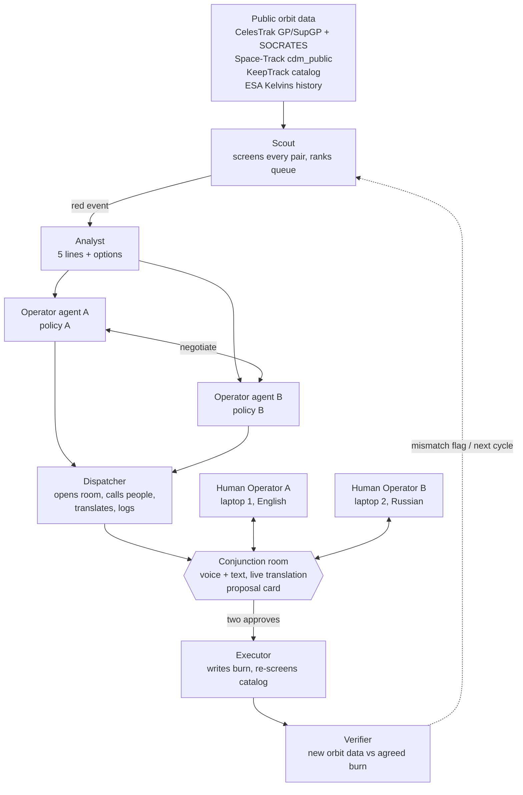

# OrbitCall — Full Kit for Cal Hacks 13.0 (plan v1)

Oct 23, 2026 · @K

> Version 1 of the team plan, written before hacking starts. Numbers in the pitch and demo script
> (for example "47 of 50 matched within 500 m" or "180 m → 3.2 km") are **target / script values**,
> not measured results. They get replaced with real numbers once the code runs.

## Contents

1. [The problem: who decides, who dodges](#1-the-problem-who-decides-who-dodges)
2. [Evidence: operators have been complaining since 2019, up to two weeks ago](#2-evidence-operators-have-been-complaining-since-2019-up-to-two-weeks-ago)
3. [User and use case](#3-user-and-use-case)
4. [Idea and pitch](#4-idea-and-pitch)
5. [Architecture: roles and flow](#5-architecture-roles-and-flow)
6. [Flow and user stories](#6-flow-and-user-stories)
7. [Demo scene and screens](#7-demo-scene-and-screens)
8. [Bilingual voice channel](#8-bilingual-voice-channel)
9. [Space data sources](#9-space-data-sources)
10. [Which model for the agents: Claude or Grok](#10-which-model-for-the-agents-claude-or-grok)
11. [Sponsor plan](#11-sponsor-plan-what-we-take-what-we-dont-and-what-it-costs-in-time)
12. [What we thought through: questions the judges will ask](#12-what-we-thought-through-questions-the-judges-will-ask)
13. [The 36-hour plan](#13-the-36-hour-plan)
14. [Precedents and how we differ](#14-precedents-and-how-we-differ)
15. [Sources](#sources)

---

## 1. The problem: who decides, who dodges

The decision "which of two satellites dodges a collision" is made today by email between two companies, with no shared rules and no guarantee the other side will answer. It is the only manual step in a chain that is otherwise automated.

### How it works today

1. **Tracking.** The US Space Force (18th and 19th Space Defense Squadrons) tracks everything larger than ~10 cm with radars and telescopes. The public catalog is Space-Track.org; open orbital elements (TLEs) are on CelesTrak. Commercial networks (LeoLabs) sell more precise data.
2. **Screening.** Several times a day every object is checked against every other. If two objects will pass closer than a threshold (in low orbit about 1 km, with probability above ~1 in 10,000), both operators automatically receive a Conjunction Data Message (CDM): time of closest approach, miss distance, probability, uncertainty. There are hundreds of thousands of these per year; most are noise.
3. **Decision.** Here the automation ends. The operator's flight dynamics team recomputes the conjunction with its own data and decides: ignore, wait for refinement, or maneuver. If the other object is also an active satellite of another company, someone writes an email or calls: "are you moving or are we?" There is no protocol. There is a weak tradition: the one with better data or more fuel moves, and should warn the other. Sometimes nobody answers.
4. **Maneuver.** A short burn of centimeters per second a few hours before the conjunction. Afterwards everyone recomputes whether the maneuver created a new conjunction.
5. **The exception: Starlink.** SpaceX built an autonomous system: every Starlink gets the data itself, decides itself and moves itself, with no human. Tens of thousands of maneuvers per year. But it is one-sided: Starlink dodges everyone, and that only works because SpaceX owns most active spacecraft and can afford to always be the one that moves.
6. **Debris.** You cannot negotiate with a dead rocket stage; the active satellite always moves.

### Where it breaks

- Between companies there is no protocol for "who yields."
- There is no shared check that the maneuver was actually done.
- There is no record to settle a dispute later.
- Volume grows faster than flight dynamics teams: in half a year Starlink logged 164,000 potential events and 144,404 maneuvers.
- Half of the operators Starlink had conjunctions with in 2026 did not publish trajectories.
- Operators speak different languages and sit in different time zones; warning comes 13 minutes to 3 days ahead.
- No single regulator can order anyone to maneuver, in the US or at the UN.

**What OrbitCall solves and what it doesn't.** It solves bottleneck 3: communication and decision between operators who are willing to coordinate. It does not solve unwillingness to share data; that is policy, not software. We say this to the judges ourselves.

---

## 2. Evidence: operators have been complaining since 2019, up to two weeks ago

In seven years none of these cases ended in a collision, but every one ended in a public complaint about the same thing: there is nobody to negotiate with and no way to do it. For the pitch we take two fresh cases (October 2026 and December 2025) and one classic (ESA 2019).

| When | What happened | What was said | Source |
|---|---|---|---|
| Oct 8, 2026 | SpaceX disclosed: conjunctions with ~650 maneuvering satellites in a year, trajectories shared by half of operators; 164,000 potential events in half a year; in August 2026, 134 m from a foreign spacecraft that suddenly changed course | Nicolls (SpaceX): the big threat is an operator who maneuvers without telling the others where | Aerospace Global News |
| Dec 10, 2025 | A Chinese Chang Guang satellite passed ~200 m from STARLINK-6079; its orbital data appeared 14 minutes ahead. Three weeks later SpaceX announced lowering ~4,400 Starlinks from 550 to 480 km | Nicolls: there was no coordination at all; most risk in space comes from a lack of coordination between operators | EurAsian Times |
| Oct 2025 | State-of-play review: coordination between operators is email and phone; Starlink did 144,404 maneuvers in half a year; in August 2025 the US advised operators to email Chinese trackers | Christensen (Secure World Foundation): email doesn't scale and isn't timely | Aerospace America |
| Apr 2021 | OneWeb and Starlink separated after red alerts (probability 1.3%), then argued for a month at the FCC over whether it was even dangerous; two trackers gave different distances (1,120 m and 1,072 m) | There is no body that can order an operator to maneuver | Space.com |
| Dec 2021 | China complained to the UN: the Tiangong station twice (July 1, October 21) dodged Starlink | China's foreign ministry demanded immediate measures from the US; there was no coordination before the maneuvers | PBS NewsHour |
| Sep 2019 | ESA Aeolus vs. Starlink 44: ESA wrote to SpaceX, the answer was "we don't plan to move," risk grew, then silence; ESA maneuvered itself. The silence was caused by a bug in SpaceX's paging | Weeden (SWF): with tens or hundreds of operators this doesn't scale | GovExec |

What all six share: there was a warning, there was data, the satellites could maneuver. There was no channel, no rule and no record. That is our layer.

---

## 3. User and use case

The user is a flight dynamics engineer at a satellite operator. In the pitch we call them the dispatcher. The most painful version is a small operator with 5–50 spacecraft and no round-the-clock shift: Starlink has an autopilot, they have an inbox.

### What they do today (one conjunction with another company's active satellite)

1. Receives a CDM from the Space Force, one of fifty that week. Eyeballs whether it matters.
2. Recomputes the conjunction with their own precise data.
3. Looks for the other operator's contact: the Space Data Association directory, old emails, acquaintances.
4. Writes an email: who we are, which conjunction, our data, are you moving or are we. Waits. Sometimes a day, sometimes forever.
5. If there is an answer, agrees in words, with no shared model: "we'll raise by 200 m at T-6h, ok?"
6. Computes the maneuver, checks it doesn't create a new conjunction, uploads it to the spacecraft.
7. Hopes the other side did what it promised. There is nothing to check with.
8. If there is a dispute later, digs up the correspondence.

Steps 1, 2 and 6 are automated everywhere. Steps 3, 4, 5, 7 and 8 are by hand and by email. That is the bottleneck.

### What changes with OrbitCall

| Step | Today | With OrbitCall |
|---|---|---|
| Find what matters among 50 alerts | By eye | Queue ranked by probability, time and risk forecast |
| Find and call the other operator | Directory and email | The system opens a room and calls both itself |
| Agree on who moves | In words, no rules | Both sides' agents converge on written policies in a minute; humans say yes/no |
| Language and time zone | English or nothing | Voice and text with translation in the room |
| Check the maneuver was done | No way | Compare new orbital data with the promised maneuver |
| Record for disputes | Correspondence | Log of every step from both sides |

**Who pays (Q&A answer).** Operators already pay LeoLabs and Slingshot for data and a platform; satellite insurers pay for lower risk; regulators (FCC, NOAA TraCSS, EU SST) are looking for exactly this coordination layer. First customer: a consortium of small operators, or a tracking company that embeds this in its platform.

---

## 4. Idea and pitch

**OrbitCall is a dispatcher for orbit.** It continuously watches the catalog, finds dangerous conjunctions, gathers the evidence, calls the people it concerns into one room, lets the two companies' agents negotiate by their own rules, and asks humans only "yes or no." People speak their own language; the room translates. After the maneuver it verifies the maneuver happened. Nothing moves without a human. It is a handshake, not a law.

### 2-minute pitch (demo first, as the guide asks)

> Script values below (180 m, 3.2 km, 47/50) are targets for the demo, not measured results yet.

**0:00 — hook, 15 seconds.** "Two weeks ago SpaceX said Starlink had close calls with 650 satellites this year, and only half of those operators shared where they were going. In December a satellite passed 200 meters from a Starlink with 14 minutes' notice. Nobody had talked. The coordination layer between satellite operators is still email."

**0:15 — demo, 60 seconds.** "This is this week's real catalog. Watch the queue — that pair just turned red: 180 meters on Sunday 03:14 UTC. Our dispatcher opened a room and called both operators. You're Operator A. My teammate is Operator B, in Russia." (teammate speaks Russian, the judge hears English) "He just said his satellite has an imaging pass Wednesday and can't move. The agents re-settled: you move, 0.2 m/s, Sunday 03:14 minus six hours. Miss distance 180 m to 3.2 km. Approve?" (judge clicks) "Both approved. Scheduled. Verified against the whole catalog — no new conjunctions."

**1:15 — how it works, 25 seconds.** "Public orbit data in, same propagator Space Force uses. Screening runs all the time and ranks by probability and time. Agents wake up only for the red top of the queue. Each company's agent knows its own fuel, mission windows and risk policy. They settle inside those rules; humans approve. Every step is logged. Validated against CelesTrak's conjunction list: 47 of 50 matched within 500 meters."

**1:40 — who and what's next, 20 seconds.** "Slingshot Beacon gave operators a shared chat. We give them a shared dispatcher. Customer: small and mid operators who have an inbox where Starlink has an autopilot. Next step: a real operator's policy file and Space Force CDMs instead of public TLEs — that's a parser, not a redesign."

**One line if asked "what is it" in the elevator:** "Air traffic control for satellites, except the controllers are agents and the pilots still say yes."

---

## 5. Architecture: roles and flow

Five agent roles, two humans, one source of truth. Data flows top down, humans stand on the same level as the room, and nothing passes below them without two "yes" votes.

**Agents gather, negotiate and propose; two humans approve; the system verifies.** Reading the architecture figure from the original top down: public orbit data (CelesTrak TLE + SOCRATES, Space-Track public CDMs, KeepTrack catalog, ESA Kelvins history) feeds the **Scout**, which screens every pair, ranks the queue and wakes the agents on red. The **Analyst** packs messy data into 5 lines + 2 options; **Operator agents A and B** each know their company policy and settle who moves, when and by how much; the **Dispatcher** opens the room, calls the right people, translates and logs. **Human Operator A** (laptop 1, English) and **Human Operator B** (laptop 2, Russian) meet in the **Conjunction room** (voice + text, live translation, a proposal card, both must say yes) with approve / veto / counter. Below them, the **Executor** writes the burn and re-screens against the whole catalog, and the **Verifier** compares new orbit data to the agreed burn and flags a mismatch to both sides; a dashed line returns to the Scout.

From the top: open data; Scout keeps the queue and wakes the others only on red; Analyst packs, operator agents bargain, Dispatcher calls people into the room; after two approvals Executor records the maneuver and rechecks it against the whole catalog, Verifier later confirms the maneuver happened.

Diagram reconstructed from the text above (the original figure is not part of the kit):

### Roles, without implementation details

| Role | What it does | What it doesn't do |
|---|---|---|
| Scout | Continuous screening, queue by probability and time, forecast "risk will rise or fall," trigger on red | Doesn't decide who moves |
| Analyst | Gathers everything on the pair: orbits, uncertainty, fuel, mission windows, history of concessions; gives a five-line summary and two or three options | Doesn't represent either side |
| Operator agent (one per company) | Knows its company's policy, proposes, objects, converges with the other agent | Can't step outside the policy, doesn't execute |
| Dispatcher | Opens the room, finds and calls the right people (the two owners plus anyone the fix affects), translates, runs the conversation, writes the log | Doesn't vote or decide |
| Executor | After two "yes" votes writes the maneuver to the schedule, rechecks the satellite against the whole catalog, refuses if a new conjunction appears | Access only to one schedule folder |
| Verifier | Checks against new orbital data that the maneuver happened and matched what was promised | — |

### Principles

- Physics is computed by deterministic code (SGP4), not by a model. Models reason, explain and translate.
- Every agent explanation passes a deterministic check against the numbers before it reaches the screen.
- One source of truth: all state (conjunctions, policies, proposals, approvals, log) lives in one reactive database; both laptops subscribe to it.
- Agents don't hang on every pair. They are an event handler for the top of the queue.
- The demo works offline: the catalog and conjunction list are cached from Friday evening.

---

## 6. Flow and user stories

### System flow: one conjunction from data to "resolved"

1. Every 15 minutes pull the public catalog and conjunction list; cache it.
2. Propagate all active objects 7 days ahead, find pairs closer than the threshold, compute distance, time and probability. Cross-check with SOCRATES, store the match count.
3. Sort the queue: probability divided by hours to conjunction, adjusted for fuel and risk forecast. Yellow goes to the feed. Red (above 1 in 10,000 and under 72 hours) wakes the agents.
4. Analyst gathers a summary for the pair. Operator A and Operator B read their companies' policies and converge: who moves, when, by how much, what miss distance results.
5. The explanation passes a check against the numbers. Dispatcher opens the room, calls both owners and anyone the proposed maneuver affects.
6. People talk and write in their own language; the room translates. A new fact from a human ("can't move on Wednesday") makes the agents recompute.
7. Both owners click "yes." One "no" returns to step 4 with a new constraint.
8. Executor records the maneuver, rechecks the moved satellite against the whole catalog. A new conjunction means refusal and a return to step 4.
9. After the maneuver time Verifier compares the new orbit with the promised one. Match: "resolved"; no match: a flag to both sides.
10. Every step is a line in the log, visible to both sides.

### User flow: Company A's dispatcher

1. Opens the board. Sees the feed of conjunctions for their satellites, by risk. One row is red, next to it "agents working."
2. After 20 seconds, a call: "proposal ready, the other operator is in the room." Joins.
3. Sees two orbits, a countdown, a five-line summary, a transcript of the agents' negotiation and a card: who moves, when, by how much, distance before and after.
4. Hears the other operator in their own language, sees the transcript. Replies by voice or text.
5. Clicks Approve. Sees "waiting for B," then "both approved, scheduled, checked against the catalog."
6. The next day the row shows "maneuver confirmed" or a warning.

### User stories

- As a small operator's dispatcher, I want to see only the conjunctions that need a decision today, so I don't read 50 emails.
- As a dispatcher, I want the other operator found and invited without me, so I don't hunt for contacts in directories.
- As a dispatcher, I want a ready proposal with before-and-after numbers, so I can decide in a minute, not a day.
- As a dispatcher in Moscow or Changchun, I want to speak my own language and be understood immediately.
- As a dispatcher, I want to write my company's rules once, so the agent bargains for me within them.
- As a dispatcher, I want to know the other side actually did the maneuver, so I don't take their word for it.
- As a head of operations, I want a log of every decision, so in a dispute I can show who said what and when.
- As a third operator whose satellite ends up on the new path, I want to learn about it before the maneuver, not after.

---

## 7. Demo scene and screens

Two laptops on the table, one web UI on both, a headset with a mic for the teammate. The judge sits at laptop 1 as Operator A. The teammate is at laptop 2 as Operator B and speaks Russian. The whole scene is 90 seconds; the judge takes three actions.

### Scene step by step

| Sec | What the judge does | What they see and hear |
|---|---|---|
| 0 | Looks at the feed | This week's conjunction queue; a row creeps up and turns red; an "agents working" badge |
| 20 | Accepts the call into the room | Two orbits on a globe, countdown, five-line summary, negotiation transcript, card "B moves" |
| 35 | Listens | Teammate in Russian: "my satellite has an imaging pass Wednesday, I can't move"; the judge hears English and sees the text |
| 45 | Watches | Agents recomputed: the card flipped to "A moves, 0.2 m/s, Sunday 03:14 minus 6 h, 180 m → 3.2 km" |
| 55 | Clicks Approve | "Waiting for B" → teammate clicks → "both approved, scheduled"; the globe shows the maneuver, the number changes; "checked against the catalog, no new conjunctions" |
| 70 | Opens Policy A, changes one rule | Re-run: the proposal flips again. The judge changed the outcome with a rule |
| 85 | Looks at the corner of the screen | "Validated vs SOCRATES: 47/50 within 500 m" and a log with timestamps |

### Screens

| Screen | What's on it | Why |
|---|---|---|
| 1. Ops board (feed) | Left: conjunction queue — pair, time to conjunction, distance, probability, "risk rising/falling" arrow, status (new / agents / proposal / approved / verified). Right: globe with the constellation. In the corner: the validation number | The judge sees it is a system with a queue, not a single case |
| 2. Conjunction room | Top: two orbits, conjunction point, countdown. Middle: Analyst's five-line summary; agents' negotiation transcript; human channel, voice and text, each line in the reader's language. Bottom: proposal card (who, when, delta-v, fuel, distance before → after) and three buttons: Approve / Veto / Counter. Status of both sides | This is where the judge acts |
| 3. Policy (operator policy) | One-page form: minimum fuel reserve, "don't move" mission windows, acceptable risk, mission priority per satellite | Shows that people write the rules; changes the outcome in front of them |
| 4. Audit log | Log: time, who (agent or human), what they said or did, numbers before and after; maneuver verification mark | The answer to "what if there's a dispute later" |

Both laptops show the same screens from different sides: A has A's buttons, B has B's, lines in the laptop owner's language. Updates are simultaneous; that is the "live" backend for the Convex/Spacetime judge.

**Fallbacks on the table.** Voice can't be heard in the hall: text chat with translation, same effect. Wi-Fi is down: everything from cache, backend local on one laptop, the second over LAN. Agent hangs: a "re-run" button, one try, no excuses.

---

## 8. Bilingual voice channel

Dispatchers in the US, Europe, China, Russia and India share one orbit and don't share a language. In August 2025 the US officially advised operators to email Chinese trackers; that is the level of today's channel. We build a room where everyone speaks and reads in their own language, with the agent's proposal and its numbers right beside them.

### How it works

1. Operator B speaks Russian into laptop 2's microphone.
2. Speech is recognized to text as a stream, phrase by phrase.
3. The phrase is translated with the room's context (satellite names, terms like "imaging window," numbers untouched).
4. On laptop 1 an English voice plays and text appears; on laptop 2 the Russian original shows in the transcript.
5. The line goes to the agents as a new constraint ("can't move on Wednesday"); they recompute.
6. Both versions of the phrase are written to the log.

No third participant-translator is needed: translation goes directly from one person's input to the other's output.

### Implementation options

| Option | Chain | Latency | Pros | Cons | Tracks |
|---|---|---|---|---|---|
| A. Composite (recommended for the demo) | STT (Deepgram / Whisper) → Claude translates with context → TTS (Cartesia) | 1.5–2.5 s | Text visible to both, numbers aren't distorted, every piece is replaceable | Three services | Cartesia (voice as part of the main flow), Anthropic |
| B. Speech-to-speech via one API | Grok Voice realtime (OpenAI Realtime-compatible, via LiveKit or directly) | < 1 s | Fast, one integration | Less control over text, transcript has to be pulled separately | SpaceXAI (requires Grok Voice) |
| C. Text only (fallback) | Room chat → Claude translates | < 1 s | Works in a noisy hall, two hours of work | No voice | Anthropic |

**Plan:** C first (Saturday morning, once the room works), then A on top (Saturday afternoon). B for voicing the Dispatcher and a spoken "approve" command, to cover SpaceXAI if there is time left. Two voice sponsors in one project is fine as long as each has its own role: Cartesia is the humans' voice, Grok is the dispatcher's voice.

**What to tell the judge honestly.** Translation doesn't fix unwillingness to share data. It removes one of the reasons an email in English goes unanswered.

---

## 9. Space data sources

We take five open sources with different roles: two sets of orbits of different precision, two independent conjunction lists for cross-checking, one historical dataset for the risk model. This gives the agents more data and gives us a technical story: "we compared the sources, and here is what we found."

| Source | What it gives | Access | Update | Role for us |
|---|---|---|---|---|
| CelesTrak GP | TLE/OMM for ~12,000 active objects and the whole 18 SDS catalog; CSV, JSON, XML | No registration; polite-polling policy (no more than once per 2 hours per file) | Several times a day | Base catalog for screening |
| CelesTrak SupGP | Orbits from the operators themselves: Starlink (from SpaceX public ephemerides), OneWeb, Kuiper, Iridium, Planet, SES, Telesat, ISS; 5–15× more precise than GP per CelesTrak tests | No registration; `supgp.php?FILE=starlink&FORMAT=csv` | Daily | Second set of orbits: compute the conjunction on GP and on SupGP, show the difference; that is the agent's "uncertainty" |
| CelesTrak SOCRATES | 7-day-ahead conjunction list (all active vs. whole catalog, 5 km threshold): TCA, min distance, max probability, relative velocity; CSV | No registration | 3× a day | Reference #1 to validate our screening; source of live pairs for the demo |
| Space-Track cdm_public | Public CDMs from the Space Force: TCA, MIN_RNG, PC, both objects, type, radar cross-section, EMERGENCY_REPORTABLE flag; JSON/CSV/XML | Free account, cookie auth; limit: 3 full-conjunction requests a day, 30/min, 300/hour | Continuous | Reference #2: official alerts, compared with SOCRATES and with us; the "emergency" flag feeds queue priority |
| KeepTrack API v4 | Catalog of 63,000+ objects with type, purpose, country, launch date in one request (`/v4/sats/brief`) | Free key, 500/hour; non-commercial license | Daily | Metadata for Analyst: whose satellite, what for, from which country; what the Dispatcher needs to call the right people |
| ESA Kelvins CDM dataset | History of real ESA CDMs 2015–2019: a row per message, 103 features, events as time series, target = final risk; 221 MB, CC BY 4.0 | Open | Static | Training the "risk will rise or fall" model for Scout |

### How we compare sources against each other (the technical story for judges)

1. **Our screening vs. SOCRATES.** Same TLEs, our SGP4: how many of their top 50 we find ourselves within 500 m and a few seconds of TCA. The number goes on screen.
2. **GP vs. SupGP.** The same conjunction, two orbit sets: the difference in distance is an honest uncertainty estimate without covariances. The agent sees "US data says 180 m, operator data says 410 m" and decides whether to wait for refinement.
3. **SOCRATES vs. public CDMs.** An independent service against official alerts: which pairs are in one and not the other. A pair both see gets higher priority.
4. **Kelvins forecast vs. the naive "current risk = final risk."** If the model isn't better than the naive rule on their test set, we don't include it and say so honestly.

**What we don't take and why.** LeoLabs: paid, no public API. N2YO: positions and passes for observers, nothing beyond TLE. ESA DISCOS: masses and sizes, useful, but registration with approval; no time. Bright Data / Apify aren't needed for this data; everything is served as direct CSV/JSON.

**Cache.** Friday evening we download all six and commit them to the repo as a snapshot. The demo runs from cache; live fetch is a "refresh" button we press only on working Wi-Fi.

---

## 10. Which model for the agents: Claude or Grok

**Short answer:** Claude for the reasoning agents, Grok Voice for voice, Grok as a second opinion optionally. We don't pick one; we split by task.

| Task | Model | Why |
|---|---|---|
| Scout, Analyst, Operator A/B, Executor, Verifier: reasoning, tool calling, explaining decisions | Claude (Sonnet by default, Haiku for Scout where speed and cost matter) | The most reliable tool use and structured output available; Anthropic judges score "thoughtful use of Claude"; Fetch.ai doesn't require a specific model inside an agent |
| Translation in the room with conjunction context (STT → translate → TTS mode) | Claude | Needs a translation that knows "burn" here is a maneuver, not an injury; a generic translator loses that |
| Dispatcher's voice, live speech-to-speech conversation | Grok Voice | OpenAI Realtime-compatible API, sub-second latency, LiveKit plugin; the SpaceXAI track requires Grok Voice |
| Independent check of the rationale ("second doctor") | Grok (text API), optional | A second vendor looks at the same Executor explanation and says whether it agrees; if not, we highlight it to the human. A nice answer to "who checks the agents" |
| Risk forecast on Kelvins | Not an LLM | Gradient boosting on 103 features, trained in half an hour; no LLM needed here |

**Why not "everything on Grok."** Text Grok gives no track advantage (SpaceXAI looks at Grok Voice/Imagine + Cursor), and losing the Anthropic track over it would be a shame. Plus we know tool use on Claude; 36 hours is no time to learn a new vendor on the critical path.

**Why not "everything on Claude."** Claude has no speech-to-speech mode; through STT → Claude → TTS the latency is 1.5–2.5 s, noticeable in live dialogue. Grok Voice closes exactly that gap, and there is a separate prize for it.

**Keys and limits.** Anthropic key: our own; Haiku for Scout costs pennies even polling every 5 minutes. `XAI_API_KEY`: via the SpaceXAI track (check with the sponsor on Friday whether they give credits). Bitdeer Model Studio only if we want a third model to compare in the rationale; not on the critical path.

**What we tell the judge.** "Three different providers, not because it's fashionable, but because each role has its own job: one thinks, another speaks, a third double-checks. None of them presses the maneuver button."

---

## 11. Sponsor plan: what we take, what we don't, and what it costs in time

**Principle:** a sponsor enters the project only if it has its own role in the demo's story. If it can be dropped and the demo doesn't change, we don't take it. Four tiers below.

### Tier 1: the core, no project without them

| Sponsor | Role in OrbitCall | What they require | Hours | Prize |
|---|---|---|---|---|
| Anthropic (Claude) | Brain of all reasoning agents + translation with context | A named community (small satellite operators), a lived problem (interviews/quotes from dispatchers), works on Monday, thoughtful use of Claude | 0 beyond the main work | Anthropic track |
| Fetch.ai (uAgents / Agentverse / ASI:One) | Each role is a separate uAgent with an address; Operator A and Operator B really negotiate via messages; the main scenario is reachable from ASI:One chat | Register on Agentverse, Agent Chat Protocol, innovationlab + hackathon badges in README, agent addresses, 3–5 min video, submission via the Submission Agent in ASI:One | 5–6 | $1,250 / $750 / $500 + two × $250 |

### Tier 2: strengthen the project if we're on plan

| Sponsor | Role in OrbitCall | What they require | Hours | Prize |
|---|---|---|---|---|
| Convex | Database and event bus: conjunction queue, room state, decision log; `useQuery` gives live updates on both laptops with no custom websockets; actions call CelesTrak/Space-Track; the scheduler wakes Scout | Convex must be the primary backend | 3–4 (saves more than it costs) | $5,000 |
| xAI Grok Voice | Dispatcher's voice in the room: speech-to-speech, latency < 1 s | SpaceXAI track: Cursor + Grok Voice; model `grok-voice-think-fast-1.0`, LiveKit plugin `livekit-agents[xai]` | 4–5 | Keyboards (raffle) + the main wow moment of the demo |
| Factory Droid SDK | Executor: Droid writes the maneuver file to the operator's repo and returns a diff; the human sees "what will change" before approve | `pip install droid-sdk`, `FACTORY_API_KEY`, `restrict_tools` to edit/create only, autonomy OFF, `on_permission` → our approve | 3 | $2,000 |
| Cartesia | TTS for the "STT → Claude → Cartesia" mode (fallback if Grok Voice gives no keys) and voicing notifications | Voice must be core, not decoration; for us it is | 1–2 | Cartesia track |
| Backboard | Agent memory between incidents: Operator A remembers it yielded last time | `pip install backboard-sdk`, `memory="Auto"`, $5 credits | 1 | Backboard track |
| Tiger Data | Time series of Pc/distance per event: a "how risk grew" chart on screen and for Verifier | Postgres + TimescaleDB, free tier | 1–2 | Tiger track |
| Auth0 | Login for two operators on two laptops, roles "owner of SAT-A / SAT-B"; approve is signed by identity | Any use of Auth0 | 1 | Auth0 track |

### Tier 3: almost free

- **.Tech domain:** orbitcall.tech, 10 minutes, a separate prize for using it.
- **Mana / Notability:** check the terms on Friday; if it's "any project using X," we take it.
- **Microsoft Built for the Real World:** not a technology but criteria: understanding the customer, measurable benefit, path to production, responsible design. Our section 12 covers this; we just submit.
- **Human First / Planet First / general tracks:** submit by description, no code changes.

### Tier 4: ask on Friday, decide on site

- **Atlassian** ("Agents that do the work" / "Security for agents" tracks): unclear whether their product is needed. If the idea "an agent does the work under human control" is enough, we submit. Ask the Atlassian sponsor in #spons-atlassian.
- **Hyphenate** (autonomous finance for CFOs): our topic is off, but they have a workshop Saturday; ask whether "agents negotiating over resources (fuel)" counts as their theme.
- **Spacetime:** competes with Convex for the same role; we take only one. Convex wins: outbound HTTP from actions, while Spacetime reducers run in a sandbox with no network.

### Not taking, and why

Bright Data / Apify (data comes as direct CSV, no scraping needed) · Visa / x402 / payment tracks (no payments) · CRS and other hardware tracks · Bitdeer (only if time remains for a third model to compare) · tracks that need their specific vertical (finance, health, education).

### How much in total

Tier 1 is ~13 hours of sponsor integration on top of the main work, tier 2 another ~9, tier 3 is 1. This fits the plan in section 13 with three developers, because Convex and Fetch.ai replace infrastructure we would otherwise write ourselves rather than adding to it.

**Cut rule at H24:** if there is no working voice call by Saturday 18:00, Factory, Backboard and Tiger go first, and Auth0 is replaced with two URLs, `?role=A` / `?role=B`.

---

## 12. What we thought through: questions the judges will ask

Each item is a decision we made and a short answer for the table. Freya learns the first eight.

1. **Why pairs, not groups?** A conjunction is always two objects at one point at one time; triples are statistically rare. But one satellite can be in several pairs in a week, so after a maneuver Executor recomputes the moved satellite against the whole catalog, not only against its partner.
2. **Who decides who moves?** Not a vote and not a central arbiter. Two agents with their companies' policies arrive at a proposal, two humans approve it. Third parties are notified only if the maneuver affects them.
3. **What if they don't agree?** Then the system does what nobody does today: it brings the people into one room in two minutes instead of two days of correspondence. The agents show both sides the same numbers. If even the humans don't agree, each acts by their own policy, but at least knowing what the other will do. That already beats today's "both dodged in the same direction."
4. **Half of operators don't share data. What then?** The system works on the public catalog without them; whoever connects gets SupGP precision and negotiation, whoever doesn't becomes the "non-responding party," and the agent plans a unilateral maneuver with margin. The incentive to connect: people stop dodging you blindly and burning your fuel.
5. **Why trust the other company's agent?** You don't have to. The agent says "we'll shift by 200 m," Verifier looks at new TLEs a day later and writes to the log whether they shifted. Trust but verify, and the history of kept promises becomes the operator's reputation.
6. **When to act: now or wait for refinement?** Industry thresholds: Pc > 1e-4 and TCA < 72 h is red, we wake the humans. Between 1e-5 and 1e-4 is yellow, agents prepare options, humans aren't bothered. We show the GP/SupGP difference as a measure of uncertainty so the human decides whether to wait for the next update.
7. **Fairness: why does the small one always move?** The operator's policy is their word: remaining fuel, mission lifetime, imaging windows. The big one with a full tank and a cheap maneuver moves first, and that is visible in the log. In the demo it's exactly that: changing the policy changes the outcome.
8. **What can the agent do on its own?** Nothing with the satellite. Agents read, compute, propose, call, translate, write a file. Two humans on two devices press approve, and only then does the file enter the operator's queue.
9. **How do you check the agent's explanations?** The numbers in the rationale come from tools, not generation; a second model checks the text against the numbers and flags discrepancies before the human sees it.
10. **The log.** Every agent message, every approve with identity and time, both languages of the conversation, the verification result, in one immutable log. If something goes wrong, you can see who said what and who pressed what.
11. **Scale.** Screening is plain code (SGP4 on 12,000 objects takes seconds). The LLM kicks in only on red events, tens a day, not thousands. Cost per event is cents.
12. **Public data is coarse.** Yes. That's why two orbit sources and an honest uncertainty band on screen, not one number to three decimals. In production the operator plugs in its own ephemerides and covariances; the architecture doesn't change.
13. **If Wi-Fi drops during judging.** The catalog and conjunctions are cached from Friday, agents work from it; without network we lose only voice and the LLM. For that case: a recorded video of the call and the room's text mode.
14. **How are you different from Slingshot Beacon / SDA / TraCSS?** They are a bulletin board and data exchange: they show a conjunction and give a chat. We are a dispatcher: priority, policy-based negotiation, a call in two languages, execution with verification. Beacon is a phone book, OrbitCall is the one who calls. More in section 14.
15. **Who pays?** Operators with 5–50 satellites and no 24/7 shift: universities, Earth-observation startups, IoT constellations. Today they have one engineer with email on their phone. The big ones (Starlink) are already automated internally; they need us as a channel to the small ones.

**What we don't promise.** We don't compute true Pc with covariances (we take it from SOCRATES/CDM), we don't plan a real maneuver with delta-V optimization (three fixed options: raise, lower, wait), we don't replace the operator. Say this ourselves before we're asked.

---

## 13. The 36-hour plan

Counted from the start of hacking Friday evening (H0 ≈ 21:00). Devpost deadline is Sunday 9:00 (H36), judging 10:30–12:30.

**Roles.** Adil: the whole front end (queue, room, globe, log). Andrew: data and orbital mechanics (fetch, SGP4, screening, validation, Verifier). Kostya: agents, Fetch.ai, voice, sponsor integrations. Freya: product: demo script, pitch, Devpost, video, sponsors on site, answers from section 12, tests as the judge.

| Window | Adil (UI) | Andrew (data) | Kostya (agents) | Freya (product) |
|---|---|---|---|---|
| H0–H2, Fri 21–23 | Repo, Next.js + Convex, two stub pages `/queue` and `/room/[id]` | Download and commit the cache: GP, SupGP (starlink, oneweb, planet), SOCRATES CSV, cdm_public, KeepTrack brief | Keys: Anthropic, Agentverse, xAI (ask at the SpaceXAI table), Factory. Convex schema: events, rooms, messages, approvals, log | Agree with Atlassian/Hyphenate on criteria; pin the demo script from section 7 on one page |
| H2–H6, Fri 23 – Sat 3 | Queue screen on live data from Convex: cards, color, sort by P | SGP4 (sgp4 npm or python-sgp4), screen active vs. catalog 3 days ahead, write to events | Scout as a Convex cron (every 5 min): computes P, colors events, creates a room on red. Analyst on Claude: 5 lines + 3 options | One-page policies for operators A and B (fuel, mission, language, contact); first pitch draft |
| ✅ **H6** | **Queue is live, events from the real catalog, Analyst writes a summary. Sleep 3–4 hours in shifts.** | | | |
| H6–H14, Sat 3–11 | Room: summary, agent negotiation feed, two approve buttons, "waiting for the other" status | Validation: our pairs vs. SOCRATES top 50, match count on screen. GP vs. SupGP on one pair | Operator A/B as uAgents with Freya's policies, 2–3 rounds of message exchange, Agentverse registration, Chat Protocol. Dispatcher creates the room and writes the log | Run the script manually on what exists; list what a judge won't understand without explanation → to Adil as captions |
| ✅ **H14** | **End-to-end pass in text: red event → room → agents agree → two approves from two laptops. No voice, no globe. This is the minimum submittable version.** | | | |
| H14–H24, Sat 11–21 | Globe (globe.gl / CesiumJS) with two orbits and the TCA point; log screen; maneuver diff in the room | Executor re-screening: moved satellite vs. catalog; Verifier on historical TLEs (find a real Starlink maneuver in the archive and show the jump) | Voice: LiveKit room + Grok Voice, two participants, each hears the other in their own language; subtitles in the room. If Grok hasn't taken off by H20: STT → Claude → Cartesia mode | Hyphenate workshop; second pitch draft with timing; Devpost draft; README with Fetch.ai badges |
| ✅ **H24, Sat 21:00** | **Cut-off point. Voice works: go to tier 2 sponsors. No voice: all remaining time on voice, everything else frozen.** | | | |
| H24–H30, Sat 21 – Sun 3 | Polish: empty states, errors, dark theme, large font for the table; a "change policy" button for the judge | Tiger Data: Pc series per event, chart in the room; cache tested against Wi-Fi loss by unplugging the network | Factory Droid writes `maneuver.yaml` to the operator's repo, diff in the UI; Backboard memory for Operator A; Auth0 for two roles; second model checks the rationale | Record the 3–5 min video for Fetch.ai (also the backup demo if the network drops); pitch run with a timer ×3 |
| ✅ **H30, Sun 3:00** | **Features frozen. Only bugs on the demo path from here.** | | | |
| H30–H36, Sun 3–9 | Demo run on two laptops on venue network ×5; screenshots for Devpost | Fresh fetch at 8:00 so the queue is today's; pick and pin the "demo pair" | Submit via ASI:One Submission Agent; check agent addresses in README; keys in `.env` and not in the repo | Devpost by 8:30 with the table number, all tracks ticked; printout of section 12 answers; team at the table at 10:15 |

### Cut order if we run out of time (bottom up: the lowest goes first)

1. Queue on live data + validation number vs. SOCRATES: not cut.
2. Room with agent negotiation and two approves: not cut.
3. The judge changing a policy changes the outcome: not cut.
4. Voice call in two languages (at least in STT → Claude → TTS mode).
5. Executor with diff and re-screening.
6. Verifier on a historical maneuver.
7. Globe.
8. Fetch.ai Agentverse registration and Chat Protocol (if cut, we lose only their track; agents stay as plain processes).
9. Grok Voice instead of the STT/TTS chain.
10. Tiger, Backboard, Auth0, Factory, second model: cut first, in any order.

**Rules for the 36 hours.** One branch, main; deploy to Vercel + Convex from H2 so the demo is always at a URL. No new ideas after H6; everything new goes into LATER.md. Sleep in pairs: Adil + Freya Sat 3–7, Andrew + Kostya Sat 7–11, same the second night. Every 6 hours Freya runs the demo as the judge, without asking the developers where to click.

---

## 14. Precedents and how we differ

| Who | What it is | What's missing | Our answer at the table |
|---|---|---|---|
| SpaceATC (GitHub Rishet11/spaceatc, FAR AWAY 2026) | LangGraph agent, SGP4, 3D globe, synthetic conjunction scenarios; 1 star, no prize | Live catalog, a second party, humans in the loop, post-check | "One agent on made-up data decides by itself. We have today's catalog, two companies, two humans, a check a day later" |
| PARLEY (lablab.ai Band of Agents, June 2026) | Six role-playing agents (incl. "Oracle," "Arbiter") negotiate a maneuver; data source not named; 0 likes, no prize | Real data, operator policies, a human, execution | "An arbiter decides for the operators; no operator will sign up for that. Our agents propose, humans approve" |
| Slingshot Beacon (since 2022, free) | Coordination platform: operators see conjunctions, share ephemerides, message each other | Prioritization, policy-based negotiation, voice, languages, execution check | "Beacon is a phone book and a bulletin board. OrbitCall is the dispatcher who calls and checks what was done. We'd happily take their ephemerides as a source" |
| Space Data Association (since 2009) | A closed club of large operators (Intelsat, SES, Eutelsat, Inmarsat), mostly GEO | Small operators, LEO dynamics, openness | "For those not in the club" |
| NOAA TraCSS (US, since 2024–2025) | Government civil alert service replacing the Space Force mailing; funding unstable | Coordination between operators; it's an alert source, not a room | "They say 'there will be a conjunction.' Who agrees and how is still email" |
| Starlink autonomous avoidance | Satellites move on their own by an onboard algorithm; tens of thousands of maneuvers per half-year | A second party: other operators find out after the fact or never | "Works for the biggest player inside itself. Our job is when it's two different companies" |

**In one paragraph for a judge who knows the industry.** Alerts exist (Space-Track, TraCSS, CelesTrak). Data sharing exists, but voluntary and partial (SDA, Beacon, SupGP). Autonomy exists, but only inside one operator (Starlink). The gap is between "alert received" and "two operators agreed and did it": today that's email, time zones, languages and a broken pager. In June 2026 the UN is still debating a recommendation to "share the duty phone number." OrbitCall lives in that gap.

---

## Sources

**Data and APIs**

- CelesTrak SOCRATES · CelesTrak SupGP · CelesTrak GP
- Space-Track: API documentation and cdm_public
- KeepTrack API
- ESA Kelvins Collision Avoidance Challenge dataset, Zenodo
- Starlink: operators page and public ephemerides

**How dispatchers communicate today**

- PopSci: ESA and SpaceX deconflicted satellites by email, 2019
- SCMP: US responds to China on Tiangong–Starlink conjunctions, 2022
- IBTimes: Starlink-6079 conjunction with a Chinese satellite, December 2025
- UN COPUOS: draft recommendations on sharing contacts and data, June 2026
- Carnegie Endowment: international cooperation on collision avoidance, 2023

**Precedents**

- SpaceATC, GitHub · PARLEY, lablab.ai Band of Agents (June 2026) · Slingshot Beacon · Space Data Association

**Sponsors**

- Cal Hacks 13.0 track pages, documentation for Fetch.ai Innovation Lab, Convex, SpacetimeDB, Factory Droid SDK, xAI Grok Voice, LiveKit, Cartesia, Backboard, Tiger Data (links in section 11 by package and model names).
