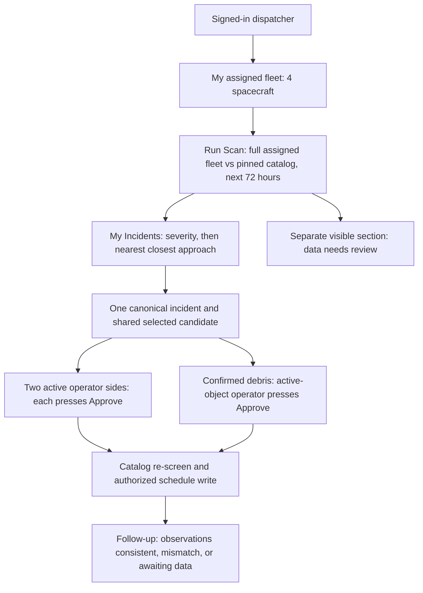

# OrbitCall: assigned fleet and dispatcher workflow

Accepted product decisions, October 24, 2026. This workflow follows the locked [master roadmap](master-roadmap.md), including the latest four-screen, group-room, language, and sponsor decisions. It supersedes earlier global-queue demo descriptions. These are requirements, not implemented capabilities. Endpoint details belong to [specification.md](specification.md), stable function IDs to [functionality.md](functionality.md).

## Runtime mode decision (October 24)

The user confirmed: Dev on keeps the working TLE catalog and synthetic conjunction scenarios. Dev off is the real mode and requires backend OMM, with no silent TLE or simulation fallback. Until the OMM backend and frontend integration are ready, show an explicit unavailable/integration-pending state. This applies in both Git branches; `main` is not a runtime data mode. CelesTrak remains the source. OMM is an exchange format, not an automatic improvement in orbit accuracy. It supports larger object IDs and avoids legacy TLE format limits. See [CelesTrak format documentation](https://celestrak.org/NORAD/documentation/gp-data-formats.php).

## 1. Responsibility and identity

An authenticated dispatcher monitors an assigned fleet. A company owns or operates spacecraft. A server-managed assignment grants a particular user responsibility for particular objects within that company. A user's country, display flag and language do not determine spacecraft ownership, fleet membership or permissions.

The main demo has three dispatcher users and one read-only observer display, with support for a fourth operator in a separate test: dispatchers based in Russia, the United States and China, each with an explicit assigned fleet. Seed four spacecraft per enabled user for the demonstration. Real catalog object metadata stays real. Demo assignments, identities, policies and maneuvers are labeled simulated and make no claim that the team represents actual owners. The linked demo can use two explicitly simulated US fleet objects, one for each pair incident, while preserving four assigned objects per dispatcher. Simulated objects can replace seeded slots or be explicitly assigned on launch. The demo must make the resulting fleet count visible.

The locked demo languages are English, Russian, and Mandarin (`en`, `ru`, `zh`). Language is configured per dispatcher, separately from country. Grok STT and Claude translation serve all three, Cartesia speaks English/Mandarin, and Grok TTS speaks Russian. Test the actual voices before rehearsal.

The shared room's Coordination Host uses Gemini to clarify discussion and summarize each current pair-specific plan. Claude runs analysis and private advocates, while Grok independently checks rationale. Host text follows the existing checked translation/speech path. The host cannot approve on anyone's behalf.

Assignments are seeded by the backend team for the demo. Self-service assignment administration is out of scope. Revoking an assignment removes incident access and invalidates that person's affected current approvals. Event ownership and A/B sides remain stable across viewers. A may be the user's counterpart in another event.

## 2. Main screen: My Fleet + incidents + globe

This layout was selected by the user:

- **My Fleet:** all assigned satellites, including satellites with no detected conjunctions. Each row shows name, object ID, current propagated position (latitude, longitude, altitude), position time, orbital epoch/freshness, unresolved incident count and last screening coverage. Unknown position is unavailable, not a zero coordinate.
- **Globe:** highlight the assigned fleet against a subdued catalog. Selecting a fleet row focuses its spacecraft and filters incidents involving it. Selecting an incident frames both objects and their orbits. Public catalog browsing is a separate context view and grants no room or policy access.
- **Incidents:** the union of events involving at least one assigned satellite. An event involving two fleet members appears once, with both members identified. Show the user's object(s), the other object, time until closest approach, miss distance, supplied Pc and provenance, status and the reason for priority.
- **Header:** user, company, assigned fleet count, snapshot time, last completed scan, 72-hour horizon, coverage and Run Scan. A filter changes the view, not the fleet-wide scope of Run Scan. The button says "Scan my fleet (4)" when four objects are assigned.

TCA means **Time of Closest Approach**, the instant the two objects reach their smallest predicted separation. Prefer "Time until closest approach" in English and "До ближайшего сближения" in Russian, with TCA explained in a tooltip. The clock and miss distance are separate quantities. A close approach is not a claim of collision.

If the user has no assigned satellites, show an assignment empty state and disable Run Scan. Do not substitute a global queue.

Before the first scan, My Incidents is empty and offers Run Scan; it never fills with reference pairs (decision of October 25, 2026). Run Scan appears on both the Orbit and Conjunctions screens. Signed out, it stays visible but explains that scanning needs a provisioned account, and starts nothing.

## 3. Run Scan: my fleet against the catalog

1. Resolve the authenticated user's active assignments on the server. The client cannot submit arbitrary primary object IDs.
2. Pin the fleet assignment version, catalog snapshot and window from scan start to start + 72 hours. "All other satellites" means all other objects available in this snapshot, including debris and other assigned fleet members. Disclose excluded objects, propagation failures and the actual catalog scope. This is not a claim to cover every object in space.
3. Screen each assigned object against the other usable catalog objects. Skip self-pairs and deduplicate unordered pairs. Public-source fetch cadence remains separate from manual screening and the five-minute monitoring cycle.
4. Create or update canonical conjunction events and attach matching supplied probability data. Screening computes encounter geometry, not a new Pc. A scan can find a close approach with no supplied probability.
5. Check every published event against the SOCRATES reference list (`matching_sources` phase). The event shows one of three states with their numbers next to ours: **Matched in SOCRATES** (same pair, TCA within 60 s), **Data differs** (same pair, different element-set epochs, so the numbers are not comparable) or **Not in SOCRATES**. This shows the screening works on real data. It is provenance, not a confidence score, and "Not in SOCRATES" is not an error.
6. Stream scan state (queued, running, completed, failed), phase and measured counters. The radar sweep visualizes actual work. Repeated clicks reuse the active run. Shared work across users may be cached by snapshot, assignment version and time window without leaking other fleets.
7. Publish results to every authorized assigned dispatcher for the involved object(s). A Russia-based user's object approaching a US-based user's object creates one canonical event visible in both relevant personal queues. Related pair events can share a coordination room with 2-4 operators. A China-based operator joins when a linked incident concerns their fleet. Room membership grants only the intentionally shared context, not another company's private policy or unrelated incident access.
8. Zero detections reads "No close approaches found within this scan's scope and 72-hour window", with source and coverage. An incomplete or failed scan never produces a safe/clear badge. Previous results remain visible with their scan time.

Routine monitoring continues every five minutes over cached inputs. A manual scan is a refresh of fleet screening, not the only way to receive an updated alert. Validation may separately use a broader reference scope. Catalog-context pairs never enter My Incidents unless a fleet member is involved.

## 4. Priority selected by the user

The working queue uses **severity first, then earliest closest approach within each severity**. This is an OrbitCall product rule, not a validated universal operational standard. Do not use Pc divided by hours to closest approach.

- Red: usable current supplied Pc > 1e-4 with future closest approach less than 72 hours away.
- Yellow: usable supplied Pc from 1e-5 through 1e-4, or > 1e-4 at 72 hours or later. Other events with usable Pc follow.
- Within each severity: ascending closest-approach time, then emergency-reportable flag, then descending Pc, then stable event ID. A cross-source match is provenance, not a numerical confidence score.
- Probability reads first as "1 in N" (`1 in 770`). The exact value appears next to it, smaller: a decimal with two significant digits from 0.0001 up (`0.0013`), scientific notation below (`1.3 × 10⁻⁷`). SOCRATES values keep their `max_prob` label.
- Missing or stale evidence goes into a separate always-visible **Data needs review** section, sorted by closest-approach time, then miss distance, then event ID. It is not zero risk and is not buried below the known-Pc queue. Source freshness limits are versioned backend configuration per source; the UI displays the reason and epochs.
- A previously red event whose evidence goes stale retains its last-known severity visibly marked stale and moves to Data needs review. An explicit source emergency flag remains visible. Do not silently clear risk or infer a fresh red classification from unknown Pc.
- Active decisions appear in the working queue. Scheduled/monitoring and awaiting-verification cases remain in a visible follow-up section. Verified/no-action historical cases remain accessible through history and inbox. `reviewRequired` is visible in follow-up and the notification area and never disappears because a maneuver was scheduled.

Explain priorities in words: "High supplied probability, closest approach in 2 hours". Report fleet affected counts by unique assigned spacecraft, not event count. Report incident counts by canonical event ID.

## 5. Incident decision paths

A room can contain several linked pair incidents. The main demo contains US/RU and US/CN, with three active dispatchers. Call/chat are room-scoped. Selection, approvals, scheduling, and verification stay event-scoped. The fourth screen is an authenticated read-only observer projection. No participant approves every event merely by joining the room.

### Start workflow and the room

The room is an optional communication channel that connects automatically. On the incident, a dispatcher presses **Start workflow**. That creates the coordination room for the encounter and joins every dispatcher currently assigned to an involved spacecraft, from every involved company, to the room and its call. The other dispatchers get an inbox notice ("You were added to the coordination room") and stay on the screen they are on; nobody is redirected. When they open Rooms, they are already inside, see who is present, and can talk the details through before deciding. Deciding never requires opening the room. A head of operations reads the room and cannot start, join or post. The room closes when every linked incident is resolved, approved or no longer needing action; it stays readable as history, and a later Start workflow opens a new room.

### Two active spacecraft with participating operators

1. Open the incident from My Incidents or Inbox, and press Start workflow when the other operator should be involved. Review the five-line summary, both objects, sources and missing evidence.
2. Show **up to four** computed candidate cards, including wait when justified. Show fewer if fewer exist. Feasibility and the source of recommendations are explicit. Do not manufacture alternatives or force agreement between the two advocates.
3. Selecting a card publishes the shared selected proposal ID and immutable revision. Selection does not approve it. Choosing an existing alternative is not automatically a counter or a request to recompute it.
4. Each authorized dispatcher independently presses Approve for the same selection. Veto is explicit. A counter is ordinary text or transcribed speech that agents interpret, not an approval status or structured counter form. Speech never approves.
5. A changed selection, selected revision, material evidence, policy or approval authorization invalidates the required approvals visibly. Unrelated conversation does not. Approvals bind the selection generation as well as proposal/revision, so switching away and back cannot revive them.
6. Re-screen the approved maneuver against the catalog and atomically recheck current authorization before committing its schedule entry. Wait records a review condition with no burn. Scheduled is distinct from observed execution. Historical verification replay is labeled separately.

### Debris: unilateral avoidance

The user selected a separate unilateral process. If an involved object is confirmed debris, it has no required approver. The assigned dispatcher for the maneuverable active object explicitly approves that object's selected plan. Show "Single-operator avoidance: debris has no operator", never "B approved" or "Both approved". Do not create a fictional approval or a second advocate for debris.

The moving object must be the user's assigned active spacecraft. Computation, own-company policy evaluation, revision resets, catalog re-screen, idempotent schedule write and verification still apply. Preserve workflow, required sides, actual approver and debris classification evidence in the audit record. A veto leaves the event unresolved and requests revised options. A wait decision remains monitoring.

An absent or unregistered operator of an active spacecraft is **not** debris. Its absence never converts bilateral coordination into unilateral authorization. The incident remains accessible with available contact details and no jointly authorized schedule. If two fleet members of one company are involved, show the canonical event as internal review. This revision does not grant a same-company scheduling shortcut; keep scheduling disabled until its internal approval rule is specified.

## 6. Research and design rationale

Checked October 24, 2026 using primary sources. These sources support the workflow pattern, not OrbitCall's accuracy, numerical thresholds or a compliance claim.

| Evidence | Design implication |
|---|---|
| [NASA CARA overview](https://www.nasa.gov/cara/) describes protected primary assets screened against other catalogued secondary objects | Use assigned fleet as primary scope and the available catalog as counterpart scope |
| [Space-Track documentation](https://www.space-track.org/documentation) describes owner/operator ephemerides and maneuver plans screened against the catalog | Run Scan screens user responsibility against broader traffic. Planned maneuvers require another screen |
| [ESA collision avoidance](https://www.esa.int/content/view/full/413425) describes dashboard statistics and detailed event history, including geometry and orbit information | Pair a fleet dashboard with a detailed incident view. Keep evidence epochs and history accessible |
| [NASA risk assessment](https://www.nasa.gov/cara/step-2-close-approach-risk-assessment/) separates close-proximity detection from collision risk assessment | Do not turn a geometry hit into a calculated probability or guaranteed collision |
| [NASA handbook](https://www.nasa.gov/wp-content/uploads/2023/07/oce-51.pdf) discusses timing tradeoffs and the distinction between non-maneuverable objects and active spacecraft coordination | Keep severity and time visible. Distinguish debris avoidance from two-operator coordination |

The selected screen layout and severity/time ordering are product decisions informed by this research. No opaque confidence badge or synthetic probability is justified by these sources.

## 7. Acceptance scenarios

1. Each enabled demo account opens its own four-object fleet, positions and relevant incidents. Country changes do not change authorization.
2. Selecting one satellite filters the list. Run Scan still checks all assigned satellites and labels that scope.
3. One fleet member approaching an external object appears. An unrelated external/external pair does not enter the user's queue.
4. An event shared by two enabled accounts has the same ID, selection and revision on both screens. An unrelated third account cannot read the room or private traces. A member involved in a different linked incident can read the shared room projection but cannot approve this event or read private records.
5. Empty, partial, failed and zero-result scans have distinct states. Changing a snapshot or assignments prevents an old run from being labeled current for the new scope.
6. A red event in two hours precedes a red event in ten hours even if the latter has a higher Pc. Red precedes yellow. Unknown/stale Pc remains visible in Data needs review.
7. Selecting a different existing candidate does not send a counter. Both sides approve the exact shared selection. Assignment revocation or material input changes invalidate affected authorization.
8. Debris avoidance requires only the real assigned operator and never a fabricated B approval. An absent active operator never triggers this path.
9. A schedule write is not a verified burn. Simulation and historical replay remain labeled and excluded from real validation/report counts.
